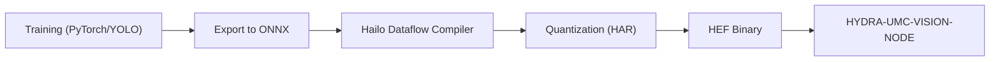

<!-- =============================================================================
HYDRA-UMC-DETECTION-HEF - Compiled-model registry
Copyright (C) JuanenRac (Electro Hobby 3D) <electrohobby3d@gmail.com>
GPL-3.0-or-later - see LICENSE
============================================================================= -->

<p align="center">
  
</p>

# 🎯 HYDRA-UMC-DETECTION-HEF

<p align="center">🇺🇸 <b>English</b> | <a href="README_spa.md">🇪🇸 Español</a> | <a href="README_fra.md">🇫🇷 Français</a> | <a href="README_ita.md">🇮🇹 Italiano</a> | <a href="README_deu.md">🇩🇪 Deutsch</a> | <a href="README_zho.md">🇨🇳 简体中文</a> | <a href="README_jpn.md">🇯🇵 日本語</a> | <a href="README_por.md">🇵🇹 Português</a></p>

### 📦 Compiled-Model Registry and Safe-Load Gate for Hailo HEF Models (no model is compiled or run yet)

<p align="center">
  
  
  
  
  
  
</p>

---

> **Safety and security status:** this ecosystem is not a certified safety system. There is no hardware E-STOP path, no firmware-enforced limits or interlocks and no verified motion command yet; firmware images are checked with CRC-32 and an Ed25519 signature, and a release build refuses the published development keys (the tool heads and expansion boards behind the relay still run URTC bootloaders, which take a shared-key HMAC-SHA256 instead of a signature); TLS and mutual TLS are optional and off by default; no custom board has been populated or tested yet. Read the [security baseline](https://github.com/JuanenRac/HYDRA-UMC-DOCS/blob/main/docs/SECURITY_BASELINE.md) and the [threat model](https://github.com/JuanenRac/HYDRA-UMC-DOCS/blob/main/docs/THREAT_MODEL.md) before relying on any statement here for the safety of a person.

---

## 📋 At a glance

| | |
|---|---|
| Version | `0.1.7` |
| Maturity | Functional |
| Tests | 150 |
| Stack | Python / Hailo SDK / HEF model registry (no model compiled yet) |
| Target | The Raspberry Pi CM5 of a HYDRA-UMC cell |
| On real hardware | Not yet: no run on real hardware is recorded for this version |

**Jump to:** [Overview](#-overview) · [Architecture](#-architecture) · [Features](#-features) · [Security & Safety](#-security--safety) · [Interfaces](#-interfaces) · [Configuration](#-configuration) · [Quick start](#-quick-start) · [Testing](#-testing) · [Troubleshooting](#-troubleshooting) · [Repository Structure](#-repository-structure) · [Related Projects](#-related-projects)

## 🚦 Project status

Each line is one part of this repository and the light says how far it is today. It is written from what the repository can show (tests, builds, runs), not from what is planned.

🟢 Done and verified · 🟡 Works, with known limits · 🟠 Partly done or not verified yet · 🔴 Not done or not working

| Area | State | What it means here |
|---|---|---|
| Software | 🟡 | Works for its main purpose; the honesty check above lists what is still missing |
| Tests | 🟢 | 150 automated tests, run on every change |
| Real hardware | 🔴 | Not yet: no run on real hardware is recorded for this version |
| Documentation | 🟢 | README in eight languages, checked against the manifest on every change |

## 🎯 Overview

**HYDRA-UMC-DETECTION-HEF** is intended to be a curated library and toolchain for high-performance neural network models compiled to the **Hailo Executable Format (HEF)**, tuned for industrial micro-factory environments: electronics assembly, SMD placement, and tool head validation.

Compiling a model (ONNX, then the Hailo Dataflow Compiler, then a `.hef`) runs on an x86_64 Linux host with the Dataflow Compiler installed and a calibration dataset for quantisation; it does not need the Hailo-8 itself. Only running the compiled model needs the accelerator. `registry load` and `GET /registry/load` refuse an ambiguous registry (the same name and version with different files), accept the architecture as the device reports it (`HAILO8`) and can pin an exact version with `--version` / `?version=`; `registry add` is serialised so concurrent adds do not lose entries. On the board the models live in `/opt/hydra-umc/detection-hef/models`.

This is one of the 4 children of **[HYDRA-UMC-VISION-NODE](https://github.com/JuanenRac/HYDRA-UMC-VISION-NODE)**, the family's integration parent: this project owns model compilation and versioning only - the served, running copy of a `.hef` model is loaded and executed by the parent, which owns the Hailo-8 device handle, not by this project itself.

## 🧩 Role in HYDRA-UMC

**HYDRA-UMC-DETECTION-HEF** is the shelf where the compiled models of the vision node are kept in order: each model has a name, a version, a task, an input shape, its classes and a checksum, and nothing may be loaded unless it matches. No model has been compiled or run on a Hailo chip yet.

## 🏛️ Architecture

The diagram below is the target *compilation* toolchain this project is being built towards - still not implemented, since every step needs real Hailo hardware. The model *registry* (versioning + integrity checking of whatever `.hef` files this pipeline eventually produces) is real today; see "Key Points" above and the design decisions below.

<p align="center">
  
</p>

<details>
<summary>Text version of the diagram (Mermaid)</summary>



</details>

**Why it is built this way**

### Why no `hardware/`/`firmware/` here, and why `os/`/`models/` still live in the parent

This project ships model files and the tooling that compiles them, not a physical device - so, like the rest of the Vision AI Node family, it carries no `hardware/`/`firmware/` folder. It does not carry `os/` or `models/` either, even though `.hef` files are literally *produced* here: the *served, running* copy loaded onto the Hailo-8 NPU at runtime lives only in the integration parent, [HYDRA-UMC-VISION-NODE](https://github.com/JuanenRac/HYDRA-UMC-VISION-NODE), because that is the process that owns the Hailo-8 device handle. This project's own `build/` is where compiled toolchain output is meant to land before being published there.

### The compilation flow is the design decision, ahead of the code

The diagram above already fixes the intended pipeline shape: PyTorch/YOLO training happens elsewhere (out of scope for this repository), models are exported to ONNX, run through the Hailo Dataflow Compiler for INT8/INT4 quantization (producing a `.har`), and finally packaged as a `.hef` binary that [HYDRA-UMC-VISION-NODE](https://github.com/JuanenRac/HYDRA-UMC-VISION-NODE) consumes. Deciding and documenting this shape now, before writing the toolchain code, keeps the eventual implementation from having to improvise the model registry/versioning story later.

### Design decisions already made

* **A missing local `.hef` file is not a checksum failure** - `verify_checksum()` returns `None` (not `False`) when the file the registry describes isn't present under `--models-dir`, and `registry validate` reports it as "skipped", not an error. The registry is expected to describe models that may live in a separate object store, not necessarily checked into this repo - only a checksum that actually mismatches for a file that *is* present indicates a corrupt registry.
* **Why `safe_load()` checks architecture before checksum, not the other way around.** Architecture compatibility is pure metadata (no I/O); checksum verification needs to read a real file. Checking the cheap, fundamental gate first means a model compiled for the wrong Hailo chip is rejected before the filesystem is ever touched, and the rejection reason names the most fundamental failing check rather than a misleading "file missing" for a model that was never going to run on this hardware anyway.
* **Why architecture compatibility is exact-match, not a compatibility matrix.** The Hailo Dataflow Compiler bakes the target chip into a `.hef` at compile time - claiming e.g. a Hailo-15H can run a Hailo-8 `.hef` would need real cross-architecture validation on real hardware this environment doesn't have. Exact match is the only compatibility claim honestly verifiable from registry metadata alone.

## ✨ Features

* ✅ **Real v0 - model registry:** `registry.py` parses and schema-validates a JSON registry of compiled models, detects duplicate name+version entries, finds the latest version for a name/task, and sha256-checksums local `.hef` files against it. Exposed via `registry validate`/`registry latest`/`registry add` below - no Hailo SDK or hardware needed to run or test it.
* 🔒 **Real v0 - safe-load gate:** `compatibility.py`'s `safe_load()` checks real Hailo-architecture compatibility (`hailo8`/`hailo15h`/etc. - every registry entry now declares its target chip) before verifying the checksum, and never reports a model ready to deploy unless both real checks pass. Exposed via `registry load` below.
* 🌐 **Real v0 - JSON/HTTP API:** `api.py`'s `serve` subcommand runs the exact same registry/safe-load checks as a long-running local service (default `127.0.0.1:8093`) via `GET /registry`, `GET /registry/latest`, `GET /registry/load`, and `GET /stats` - the registry and models directory are configured once at startup, not per request. See [`docs/CLI_REFERENCE.md`](docs/CLI_REFERENCE.md) for real captured examples of every endpoint.
* 🛠️ **Industrial Detection (planned):** models targeting PCB components, solder joints, and mechanical defects.
* 📐 **Fiducial Alignment (planned):** high-precision anchors for Pick-and-Place synchronization.
* ⚡ **Quantized Performance (planned):** INT8/INT4 variants targeting the Hailo-8/Hailo-10 NPUs for sub-10ms inference. *(future work - needs the real Hailo-8/Hailo-10 NPU and Dataflow Compiler this environment doesn't have.)*
* 🤖 **Pose Estimation (planned):** keypoint detection for robotic arm joint tracking. *(future work, same reason.)*
* 🧩 **Why it exists as its own project:** compiling and versioning models is a data/ML workflow, entirely different from the runtime process that serves them - keeping the toolchain here means a bad compile never risks the running perception node, and models can be iterated on and validated offline before ever reaching [HYDRA-UMC-VISION-NODE](https://github.com/JuanenRac/HYDRA-UMC-VISION-NODE).
* 📐 **Input and output contract (optional):** a registry entry may carry an `io_contract` that says how to feed the model (layout, colour order, data type, normalisation, resize or letterbox, pad value) and how to read its output (NMS format, box order, normalised boxes, thresholds). It is validated when the registry loads, kept when the registry is rewritten, and its checksum is part of the model identity. An entry without it loads as before.
* 🔐 **Verified bytes:** `safe_load(..., keep_bytes=True)` reads the file once, checks its SHA-256 and returns those same bytes, so a consumer that builds the model from them (the vision streamer and the visual servoing API do) cannot be handed a file that changed after the check. `GET /stats` shows file names, not absolute paths, unless `serve --stats-full-paths` is given.

**Honesty check - what actually runs today:** the real, hardware-independent half of this project's job - the model registry (`registry.py`) and the real safe-load gate (`compatibility.py`), exposed via `registry validate`/`registry latest`/`registry load` and, as a long-running JSON/HTTP API, via `serve` (`api.py`) - is implemented and tested (150 tests). The ONNX export, Hailo Dataflow Compiler quantization, and HAR/HEF packaging steps that would actually *produce* the models this registry describes are still future work: they need real Hailo hardware this environment doesn't have. See [`CHANGELOG.md`](CHANGELOG.md) for exactly what has shipped so far, and "Roadmap & Known limits" below for what remains open.

## 🔒 Security & Safety

| Threat | Defence | Where |
|---|---|---|
| Loading a corrupt model or one for another chip | The load gate (`compatibility.py`) compares the SHA-256 of the `.hef` with the registry and the Hailo architecture with `KNOWN_HAILO_ARCHS` (`hailo8`, `hailo8r`, `hailo8l`, `hailo15h`, `hailo15m`, `hailo15l`, `hailo10h`); loading needs `--target-arch` | `compatibility.py`, `registry.py` |
| A duplicate or malformed version | The registry validates its schema, requires versions of the form `X.Y.Z` and reports duplicates | `registry.py` |
| Exposure to the network | The HTTP surface is read only and listens on `127.0.0.1:8093` by default. It has no token: whether it needs one is still open | `api.py`, `main.py` |

**What it never does:** it compiles nothing and runs no model: it only keeps and checks the registry of compiled files.

`GET /stats` shows file names, not absolute paths, so a caller does not learn where the host keeps its registry and models; `serve --stats-full-paths` shows the full paths again.

## 🔌 Interfaces

HTTP on `127.0.0.1:8093` by default (read only) and a command line. The full reference is `docs/CLI_REFERENCE.md`.

| Topic or route | What it carries |
|---|---|
| `GET /registry`, `GET /registry/latest`, `GET /registry/load` | the registry, the latest version of a model, and the result of the load gate |
| `GET /stats` | health |
| `registry validate \| latest \| load \| add` | `--registry`, `--models-dir`, `--hef-path`, `--name`, `--version X.Y.Z`, `--task`, `--input-shape 640,640,3`, `--classes`, `--hailo-arch` |
| `serve` | `--registry FILE --models-dir DIR --addr 127.0.0.1 --port 8093` |

## ⚙️ Configuration

There are no environment variables: everything is a command-line flag (`--registry` is always needed, `--models-dir` depends on the command).

## 🚀 Quick start

### Prerequisites

* **Python 3.10 or newer** on your `PATH` (the scripts try `python3` then fall back to `python`).
* No ONNX/Hailo Dataflow Compiler tooling is required yet - **zero third-party runtime dependencies** at this stage (`dependencies = []` in `pyproject.toml`).
* A few tens of MB of disk space for a local virtual environment under `.venv/`.

### Step by step

```bash
# Linux / macOS
./build.sh
```

1. **Version check** - reads and prints the project version; building never changes it (only `python tools/hydra_project_tool.py bump` raises it).
2. **Virtual environment** - creates `.venv/` if missing; reuses it otherwise.
3. **Editable install** - `pip install -e ".[dev]"` so `src/` edits take effect immediately, installs `pytest`, and registers the `hydra-umc-detection-hef` console entry point.
4. **Compile-check** - `python -m compileall -q src` byte-compiles every file under `src/`, catching syntax errors ecosystem-wide.
5. **Real test suite** - `python -m pytest tests/ -q` (150 tests covering the registry, the safe-load gate, and the CLI).

`set -euo pipefail` stops the script at the first failing step; the build only reports success if all 5 pass.

```bash
./run.sh
```

Locates the interpreter inside `.venv` (handling both the POSIX and Windows `.venv` layouts) and runs `python -m hydra_umc_detection_hef.main`, forwarding any arguments through - bare invocation prints name + version + role.

Real example - validate a registry and look up the latest version of a model:

```bash
./run.sh registry validate --registry registry.json --models-dir models/
# 2 entries in registry.json
#   pcb-defect 0.1.0: pcb-defect-0.1.0.hef not present locally, skipped
#   pcb-defect 0.2.0: checksum OK
# registry OK

./run.sh registry latest --registry registry.json --name pcb-defect
# pcb-defect 0.2.0  task=detection  input_shape=(640, 640, 3)
# classes: solder_bridge, missing_component
# hef_path: pcb-defect-0.2.0.hef
# sha256: 1c8a52bb4a34927d55efc913b23f06bd08ff5eeee0aca2ccd8d2c0fd34c81497
```

Each registry entry also declares its target `hailo_arch` (e.g. `hailo8`). The real `registry load` subcommand combines the checksum check above with a real architecture-compatibility check, and only ever reports a model ready if both pass:

```bash
./run.sh registry load --registry registry.json --models-dir models/ --name pcb-defect --target-arch hailo8
# READY: pcb-defect 0.2.0 (hailo8) verified and ready

./run.sh registry load --registry registry.json --models-dir models/ --name pcb-defect --target-arch hailo15h
# REJECTED_ARCH_MISMATCH: model compiled for 'hailo8', this deployment targets 'hailo15h'
```

Adding a new model no longer means hand-editing the JSON (including the sha256 `verify_checksum()` only ever checked, never generated) - `registry add` hashes the real local `.hef` file and appends a validated entry:

```bash
./run.sh registry add --registry registry.json --models-dir models/ --hef-path pcb-defect-0.3.0.hef \
  --name pcb-defect --version 0.3.0 --task detection --input-shape 640,640,3 \
  --classes solder_bridge,missing_component --hailo-arch hailo8
# added pcb-defect 0.3.0 to registry.json (sha256=<the real computed digest>)
```

The registry file is rewritten atomically (written beside it, fsynced, then renamed over it), so a power cut or a full disk while adding a model leaves the previous registry intact instead of a truncated file.

The same registry/safe-load checks are also reachable as a long-running JSON/HTTP API via `./run.sh serve --registry registry.json --models-dir models/` (default `127.0.0.1:8093`). See [`docs/CLI_REFERENCE.md`](docs/CLI_REFERENCE.md) for the full command and endpoint reference, with every example captured from a real run.

```bat
:: Windows - identical steps, batch syntax
build.bat
run.bat
```

## 🧪 Testing

150 automated tests run with `python -m pytest tests/ -q`: the registry, the safe-load gate, the command line and the HTTP surface. They use no Hailo tooling, no hardware and no outside network.

The CI runs `HYDRA_UMC_CI=1 python tools/ci_validate.py`, which checks the manifest, the documents, the eight READMEs and the pictures.

## 🏗️ Build & Release

There is nothing to compile for a release: `build.sh` / `build.bat` create the virtual environment, install the package in editable mode and run the tests, and `build-test` only checks. Building never changes the version; it is raised only by `python tools/hydra_project_tool.py bump`, which also moves the changelog. The version of the package, the manifest and the changelog must agree, and `ci_validate.py` fails when they do not.

## 🩺 Troubleshooting

* **`python`/`python3` not found** - install Python 3.10+ and ensure it is on `PATH`.
* **`compileall` fails** - a real syntax error was introduced under `src/`; the build stops without touching the install, on purpose.
* **"No `.venv` found" from `run.sh`/`run.bat`** - run `build.sh`/`build.bat` at least once first.
* **Stale editable install** - delete `.venv/` and rebuild; rarely needed.

## 📂 Repository Structure

<p align="center">
  
</p>

<details>
<summary>Text version of the tree</summary>

```text
HYDRA-UMC-DETECTION-HEF/
├── src/hydra_umc_detection_hef/
│   ├── registry.py                              the registry of compiled models
│   ├── compatibility.py                         the safe-load gate for a .hef
│   ├── api.py                                   read-only HTTP surface
│   └── main.py                                  command line and start-up
├── tests/                                       93 tests
├── docs/                                        the command-line reference
├── systemd/                                     service unit for the CM5
├── tools/                                       build and test runner, version bump, CI validator, README and picture generators and checks
├── images/                                      banner and the pictures of the README
├── .github/                                     CI workflow and issue templates
├── pyproject.toml                               package metadata and dependencies
├── hydra-umc.project.json                       manifest: version, maturity, family
├── CHANGELOG.md                                 what changed in each version
├── build.sh build.bat                           build scripts (they never change the version)
├── build-test.sh build-test.bat                 build scripts (they never change the version)
├── test.sh test.bat                             run the tests
├── Dockerfile                                   container image
├── bump_version.py / bump_manifest_version.py   explicit version bump
├── run.sh run.bat                               start the service
└── SECURITY.md SUPPORT.md CONTRIBUTING.md CODE_OF_CONDUCT.md LICENSE LICENSE.md
```

</details>

## 🗺️ Roadmap & Known limits

**Known limits today**

**What works today:** the model registry - schema validation (including required, validated Hailo-architecture metadata), duplicate-version detection, latest-version lookup, and sha256 integrity checking (`registry.py`) - plus a real, combined safe-load gate that checks architecture compatibility and checksum integrity together and never reports a model ready unless both pass (`compatibility.py`), the same checks exposed as a real long-running JSON/HTTP API (`api.py`, `serve` subcommand) alongside the one-shot CLI, 150 tests total, and a real, installable Python package with a verified entry point and an explicit `bump` command that raises the version (building never changes it). See [`CHANGELOG.md`](CHANGELOG.md) for the captured build/run output.

**What is still open, in no particular order and with no committed timeline, and blocked on real Hailo hardware:**

* The real ONNX export step from trained PyTorch/YOLO models.
* Hailo Dataflow Compiler integration for INT8/INT4 quantization. The manual steps are written down in [`docs/COMPILING_A_HEF.md`](docs/COMPILING_A_HEF.md); the script that automates them waits for a Dataflow Compiler licence.
* HAR/HEF packaging that would actually populate a registry file this project's `registry.py` already knows how to read and validate.
* Publishing compiled `.hef` output into [HYDRA-UMC-VISION-NODE](https://github.com/JuanenRac/HYDRA-UMC-VISION-NODE)'s `models/` folder.

## 🌍 Languages

This README and the documents of the repository exist in eight languages: English, Spanish, German, French, Italian, Japanese, Chinese and Portuguese (Portugal). They are written together and checked in the CI so that the eight files have the same sections and the same links. This repository has no screen or message catalogue of its own, so there are no interface strings to translate.

## 🔗 Related Projects

This project is part of the HYDRA-UMC robotics ecosystem by the same author (JuanenRac / Electro Hobby 3D). Worth knowing about, since a request might actually be about one of these rather than this repository.

**Parent Project**
- **[HYDRA-UMC-VISION-NODE](https://github.com/JuanenRac/HYDRA-UMC-VISION-NODE)** — integration hub for the Hailo-8 vision pipeline, with a real per-stage hardware-readiness check; the parent this repo is one specific stage or consumer of, within its own perception pipeline.

**Sibling Projects** — the other stages/consumers of HYDRA-UMC-VISION-NODE's own Hailo-8 perception pipeline
- **[HYDRA-UMC-VISION-STREAMER](https://github.com/JuanenRac/HYDRA-UMC-VISION-STREAMER)** — real GStreamer pipeline + MediaMTX config generator with a real HailoRT integration boundary.
- **[HYDRA-UMC-SAFETY-ZONES](https://github.com/JuanenRac/HYDRA-UMC-SAFETY-ZONES)** — v0 zone-breach, calibration-freshness and E-STOP-request logic that takes object positions from a file; no detector feeds it and no physical E-STOP is wired to it yet.
- **[HYDRA-UMC-VISUAL-SERVOING-API](https://github.com/JuanenRac/HYDRA-UMC-VISUAL-SERVOING-API)** — Position-Based Visual Servoing correction law with authorisation gated on the zone state; no camera pose estimation yet.

**Directly Related**
- **[URTC](https://github.com/JuanenRac/URTC)** — firmware for the physical Universal Robot Tool Controller PCB, 25+ tool profiles over CAN bus; visual recognition of URTC's own tool heads relies on models compiled here.

**Also Part of the Ecosystem**

*Core Hardware & Platform*
- **[HYDRA-UMC](https://github.com/JuanenRac/HYDRA-UMC)** — the robot-arm motherboard design: CM5 host + dual-core STM32H745, meant to orchestrate up to 8 tool arms over CAN-OTA/SPI-OTA (firmware at an early stage; no populated board yet).
- **[HYDRA-UMC-OS](https://github.com/JuanenRac/HYDRA-UMC-OS)** — reproducible Raspberry Pi OS product layer for the CM5: read-only agent, validated config/profiles, WiFi first-contact provisioning.
- **[HYDRA-UMC-SDK](https://github.com/JuanenRac/HYDRA-UMC-SDK)** — the shared JSON-Schema contract and software job-gate boundary every bridge validates its commands against (not a certified safety function).
- **[HYDRA-UMC-CONNECTOR-HUB](https://github.com/JuanenRac/HYDRA-UMC-CONNECTOR-HUB)** — declarative adapter-manifest registry and validator for external-machine connectors; extends the SDK's own contract idea to external machines without replacing the industrial-gateway projects.

*Core Backend & Clients*
- **[HYDRA-UMC-SERVER](https://github.com/JuanenRac/HYDRA-UMC-SERVER)** — the real headless backend (REST/WebSocket) every control client actually talks to.
- **[HYDRA-UMC-STUDIO](https://github.com/JuanenRac/HYDRA-UMC-STUDIO)** — web control dashboard with real-time multi-robot 3D visualization.
- **[HYDRA-UMC-SUITE](https://github.com/JuanenRac/HYDRA-UMC-SUITE)** — desktop (PySide6) swarm command center for multiple servers at once, packaged as a standalone executable.
- **[HYDRA-UMC-ANDROID-CONTROL](https://github.com/JuanenRac/HYDRA-UMC-ANDROID-CONTROL)** — native Android control app with biometric login and a paired Wear OS companion.
- **[HYDRA-UMC-IOS-CONTROL](https://github.com/JuanenRac/HYDRA-UMC-IOS-CONTROL)** — iOS/iPadOS control app (Flutter) with real-time WebSocket sync.
- **[HYDRA-UMC-DSI](https://github.com/JuanenRac/HYDRA-UMC-DSI)** — native touch UI for the onboard 7" DSI touchscreen, embedded on the CM5 itself.
- **[HYDRA-UMC-EDITOR-URDF](https://github.com/JuanenRac/HYDRA-UMC-EDITOR-URDF)** — desktop graphical URDF creator/editor that pushes finished models into STUDIO's own catalog.
- **[HYDRA-UMC-EDITOR-STL](https://github.com/JuanenRac/HYDRA-UMC-EDITOR-STL)** — desktop STL model editor, transforming/replacing/removing/adding real parts in the same model catalog HYDRA-UMC-EDITOR-URDF also edits.
- **[HYDRA-UMC-BRIDGE-AMR](https://github.com/JuanenRac/HYDRA-UMC-BRIDGE-AMR)** — coordination boundary for AGV/AMR fleets via a VDA 5050 MQTT publisher (tested against an emulated fleet only).
- **[HYDRA-UMC-BRIDGE-CNC](https://github.com/JuanenRac/HYDRA-UMC-BRIDGE-CNC)** — high-level CNC-cell coordinator with GRBL status/control-byte access (tested against an emulator only).
- **[HYDRA-UMC-BRIDGE-DROIDS](https://github.com/JuanenRac/HYDRA-UMC-BRIDGE-DROIDS)** — coordination boundary for legged/humanoid droids, with a Boston Dynamics Spot command sender (tested against an emulator only).
- **[HYDRA-UMC-BRIDGE-LASER](https://github.com/JuanenRac/HYDRA-UMC-BRIDGE-LASER)** — laser-cell coordinator reading 3 key/enclosure/interlock GPIO signals (tested against a fake chip only; it cannot arm or fire a laser).
- **[HYDRA-UMC-BRIDGE-OPENPNP](https://github.com/JuanenRac/HYDRA-UMC-BRIDGE-OPENPNP)** — safe high-level board-flow coordinator for OpenPnP pick-and-place.
- **[HYDRA-UMC-BRIDGE-PRINTER3D](https://github.com/JuanenRac/HYDRA-UMC-BRIDGE-PRINTER3D)** — safe coordination boundary for Moonraker/Klipper 3D printers, with real gated job commands.
- **[HYDRA-UMC-BRIDGE-ROS2](https://github.com/JuanenRac/HYDRA-UMC-BRIDGE-ROS2)** — coordinator with a lazily imported rclpy ROS 2 transport (not yet run against a ROS 2 installation).
- **[HYDRA-UMC-BRIDGE-UAV](https://github.com/JuanenRac/HYDRA-UMC-BRIDGE-UAV)** — coordination boundary for camera-equipped UAVs, with a MAVLink command sender (tested against an emulator only).

*URTC Tool Platform*
- **[URTC-FLASHER](https://github.com/JuanenRac/URTC-FLASHER)** — desktop GUI flashing tool for URTC boards, CAN-OTA plus full-chip SWD/JTAG.
- **[URTC-TESTER](https://github.com/JuanenRac/URTC-TESTER)** — desktop live CAN-bus diagnostic tool for URTC boards, one panel per tool profile.
- **[URTC-WEB-STUDIO](https://github.com/JuanenRac/URTC-WEB-STUDIO)** — browser-based alternative to URTC-TESTER via the Web Serial API, no local install needed.
- **[URTC-GATEWAY](https://github.com/JuanenRac/URTC-GATEWAY)** — gateway in front of the URTC CAN bus: an allowed list of identifiers, a rate limit and a session key; software tested on a computer, not yet on a real bus.

*Cognitive AI Node (Hailo-10)*
- **[HYDRA-UMC-COGNITIVE-NODE](https://github.com/JuanenRac/HYDRA-UMC-COGNITIVE-NODE)** — integration hub for the Hailo-10 cognitive pipeline (LLM/VLA/voice orchestration).
- **[HYDRA-UMC-VLA-ENGINE](https://github.com/JuanenRac/HYDRA-UMC-VLA-ENGINE)** — real action-token encoding/decoding and trajectory generation for a Vision-Language-Action model.
- **[HYDRA-UMC-VOICE-UI](https://github.com/JuanenRac/HYDRA-UMC-VOICE-UI)** — real voice front-end (VAD + intent parser) with a bounded, confirmation-gated Watch relay.
- **[HYDRA-UMC-SEMANTIC-PLANNER](https://github.com/JuanenRac/HYDRA-UMC-SEMANTIC-PLANNER)** — real rule-based task decomposition and semantic error recovery over MCU error codes.
- **[HYDRA-UMC-DOCS-QA](https://github.com/JuanenRac/HYDRA-UMC-DOCS-QA)** — real stdlib-only TF-IDF document search over this ecosystem's own Markdown docs.
- **[HYDRA-UMC-LOCAL-TECHNICIAN](https://github.com/JuanenRac/HYDRA-UMC-LOCAL-TECHNICIAN)** — local, policy-gated AI maintenance technician for the ecosystem itself - observes, diagnoses and proposes fixes; the two highest risk levels are deliberately not implemented yet.

*Orchestration & Swarm*
- **[HYDRA-UMC-ORCHESTRATOR](https://github.com/JuanenRac/HYDRA-UMC-ORCHESTRATOR)** — integration hub with a real gRPC/Protobuf health-report contract and mission state machine.
- **[HYDRA-UMC-JOB-DISPATCHER](https://github.com/JuanenRac/HYDRA-UMC-JOB-DISPATCHER)** — real priority-based job queue with deduplication, over a real HTTP API.
- **[HYDRA-UMC-NODE-HEALING](https://github.com/JuanenRac/HYDRA-UMC-NODE-HEALING)** — real gRPC-based fleet health watchdog with retry/backoff and identity-mismatch detection.
- **[HYDRA-UMC-PATH-PLANNER-3D](https://github.com/JuanenRac/HYDRA-UMC-PATH-PLANNER-3D)** — real RRT-based 3D path planner with real obstacle/workspace collision validation.
- **[HYDRA-UMC-SWARM-SYNC](https://github.com/JuanenRac/HYDRA-UMC-SWARM-SYNC)** — real CRDT LWW-Element-Map state sync, property-tested for multi-cell convergence.

*Digital Twin & Simulation*
- **[HYDRA-UMC-TWIN](https://github.com/JuanenRac/HYDRA-UMC-TWIN)** — integration hub for the digital-twin engine, with a real version-compatibility sync contract.
- **[HYDRA-UMC-HIL-BRIDGE](https://github.com/JuanenRac/HYDRA-UMC-HIL-BRIDGE)** — hardware-in-the-loop router with a software collision interlock between simulation and real hardware (tested without real hardware).
- **[HYDRA-UMC-PHYSICS-REPLICA](https://github.com/JuanenRac/HYDRA-UMC-PHYSICS-REPLICA)** — real forward kinematics and joint-limit validation over a real URDF subset.
- **[HYDRA-UMC-SYNTHETIC-DATA-GEN](https://github.com/JuanenRac/HYDRA-UMC-SYNTHETIC-DATA-GEN)** — real procedural 2D scene generator with YOLO/COCO annotation export.

*Data & Analytics*
- **[HYDRA-UMC-DATALAKE](https://github.com/JuanenRac/HYDRA-UMC-DATALAKE)** — real sqlite3-backed time-series store with a real ingest/query HTTP API.
- **[HYDRA-UMC-ANOMALY-DETECTOR](https://github.com/JuanenRac/HYDRA-UMC-ANOMALY-DETECTOR)** — real FFT + statistical baseline anomaly detector with drift monitoring.
- **[HYDRA-UMC-PRODUCTION-REPORTS](https://github.com/JuanenRac/HYDRA-UMC-PRODUCTION-REPORTS)** — real OEE/availability calculation over DATALAKE history, with reproducible CSV export.
- **[HYDRA-UMC-TELEMETRY-COLLECTOR](https://github.com/JuanenRac/HYDRA-UMC-TELEMETRY-COLLECTOR)** — real CAN/WebSocket ingestion pipeline into DATALAKE, with sequence deduplication.

*Industrial Gateway*
- **[HYDRA-UMC-GATEWAY-INDUSTRIAL](https://github.com/JuanenRac/HYDRA-UMC-GATEWAY-INDUSTRIAL)** — integration hub relaying to industrial protocols, with a real command allowlist/backpressure layer.
- **[HYDRA-UMC-OPCUA-SERVER](https://github.com/JuanenRac/HYDRA-UMC-OPCUA-SERVER)** — real OPC-UA address space, verified with a real binary-protocol client session.
- **[HYDRA-UMC-MQTT-BROKER](https://github.com/JuanenRac/HYDRA-UMC-MQTT-BROKER)** — real MQTT broker with optional per-client authentication and topic ACLs.
- **[HYDRA-UMC-MTCONNECT-ADAPTER](https://github.com/JuanenRac/HYDRA-UMC-MTCONNECT-ADAPTER)** — real MTConnect `/probe` and `/current` XML endpoints with degraded-mode output.

*Complementary Tools & Ecosystem Operations*
- **[HYDRA-UMC-DASHBOARD-AI](https://github.com/JuanenRac/HYDRA-UMC-DASHBOARD-AI)** — Smart Summaries and Anomaly Highlighting panels over DATALAKE/ANOMALY-DETECTOR, with an honest statistical fallback.
- **[HYDRA-UMC-TOOL-CLI](https://github.com/JuanenRac/HYDRA-UMC-TOOL-CLI)** — fleet CLI with a real, stable exit-code contract, a genuine live client of HYDRA-UMC-SERVER's own API.
- **[HYDRA-UMC-WATCH](https://github.com/JuanenRac/HYDRA-UMC-WATCH)** — WearOS companion app with haptic alert patterns and a paired-phone voice relay (not yet run on a physical watch).
- **[URTC-SMART-RACK](https://github.com/JuanenRac/URTC-SMART-RACK)** — firmware for a board-mounting rack with real tool-ID decoding and Smart Idle pre-heating logic.
- **[URTC-VISION-TOOL](https://github.com/JuanenRac/URTC-VISION-TOOL)** — firmware plus a real Python vision companion for a thermal/RGB inspection tool head.
- **[HYDRA-UMC-UPDATER](https://github.com/JuanenRac/HYDRA-UMC-UPDATER)** — administrative desktop tool that discovers, clones and updates every repo in this ecosystem.
- **[HYDRA-UMC-OS-REBUILDER](https://github.com/JuanenRac/HYDRA-UMC-OS-REBUILDER)** — Windows/Linux desktop tool that builds a ready-to-flash CM5 image pre-loaded with the ecosystem's most current versions, with Raspberry-Pi-Imager-style first-boot Wi-Fi/user/SSH configuration.
- **[HYDRA-UMC-OPS-AGENT](https://github.com/JuanenRac/HYDRA-UMC-OPS-AGENT)** — maintenance-incident coordinator: a low-privilege edge role collects a sanitized inventory/health snapshot, a control-plane role renders it read-only and asks an AI provider to suggest a diagnosis - never applies a patch or deploys anything.
- **[HYDRA-UMC-DEV-SERVER](https://github.com/JuanenRac/HYDRA-UMC-DEV-SERVER)** — reproducible development host (Raspberry Pi 5 / CM5) that stores the ecosystem's source and runs bounded build/test tasks under a durable queue; a dedicated dev role, explicitly not an operational CM5.

## 📚 Documentation

Where to read more:

* [docs/CLI_REFERENCE.md](docs/CLI_REFERENCE.md) - every command and flag, the HTTP routes and the exit codes
* [Security baseline of the ecosystem](https://github.com/JuanenRac/HYDRA-UMC-DOCS/blob/main/docs/SECURITY_BASELINE.md)
* [Threat model of the ecosystem](https://github.com/JuanenRac/HYDRA-UMC-DOCS/blob/main/docs/THREAT_MODEL.md)
* [Changelog of this repository](CHANGELOG.md)
* [License of this repository](LICENSE.md)

## 🤝 Contributing & Community

* Before a pull request run `HYDRA_UMC_CI=1 py -3 tools/ci_validate.py` (or `HYDRA_UMC_CI=1 python3 tools/ci_validate.py`): it must print `CI_VALIDATION=PASS`. Do not run `build.sh` or `build.bat` for this check; building is not a check.
* The eight READMEs are written from one source in HYDRA-UMC-DOCS; do not edit them by hand. Change the source and write them again with `tools/make_readmes.py`.
* Do not state in a README what has not run: say "simulated" or "not tried on hardware" where that is the truth.
* See [CONTRIBUTING.md](CONTRIBUTING.md), the [code of conduct](CODE_OF_CONDUCT.md), [SECURITY.md](SECURITY.md) and [SUPPORT.md](SUPPORT.md).

## 👤 AUTHOR

**JuanenRac (Electro Hobby 3D)** · electrohobby3d@gmail.com

## 📜 LICENSE

GPL-3.0-or-later - [LICENSE](LICENSE).
