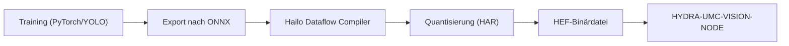

<!-- =============================================================================
HYDRA-UMC-DETECTION-HEF - Compiled-model registry
Copyright (C) JuanenRac (Electro Hobby 3D) <electrohobby3d@gmail.com>
GPL-3.0-or-later - see LICENSE
============================================================================= -->

<p align="center">
  
</p>

# 🎯 HYDRA-UMC-DETECTION-HEF

<p align="center"><a href="README.md">🇺🇸 English</a> | <a href="README_spa.md">🇪🇸 Español</a> | <a href="README_fra.md">🇫🇷 Français</a> | <a href="README_ita.md">🇮🇹 Italiano</a> | 🇩🇪 <b>Deutsch</b> | <a href="README_zho.md">🇨🇳 简体中文</a> | <a href="README_jpn.md">🇯🇵 日本語</a> | <a href="README_por.md">🇵🇹 Português</a></p>

### 📦 Registry für kompilierte Modelle und Safe-Load-Prüfung für Hailo-HEF-Modelle (noch wird kein Modell kompiliert oder ausgeführt)

<p align="center">
  
  
  
  
  
  
</p>

---

> **Stand von Sicherheit (Safety) und Security:** Dieses Ökosystem ist kein zertifiziertes Sicherheitssystem. Es gibt noch keinen Hardware-E-STOP-Pfad, keine von der Firmware durchgesetzten Grenzen oder Verriegelungen und keinen verifizierten Bewegungsbefehl; Firmware-Images werden mit CRC-32 und einer Ed25519-Signatur geprüft, und ein Release-Build verweigert die veröffentlichten Entwicklungsschlüssel (die Werkzeugköpfe und Erweiterungsplatinen hinter dem Relais laufen noch mit URTC-Bootloadern, die statt einer Signatur ein HMAC-SHA256 mit gemeinsamem Schlüssel verwenden); TLS und gegenseitiges TLS sind optional und standardmäßig aus; noch keine eigene Platine wurde bestückt oder getestet. Lesen Sie die [Sicherheitsbasis](https://github.com/JuanenRac/HYDRA-UMC-DOCS/blob/main/docs/SECURITY_BASELINE.md) und das [Bedrohungsmodell](https://github.com/JuanenRac/HYDRA-UMC-DOCS/blob/main/docs/THREAT_MODEL.md), bevor Sie sich für die Sicherheit einer Person auf eine Aussage hier verlassen.

---

## 📋 Auf einen Blick

| | |
|---|---|
| Version | `0.1.6` |
| Reifegrad | Funktionsfähig |
| Tests | 93 |
| Technik | Python / Hailo SDK / HEF model registry (no model compiled yet) |
| Ziel | Der Raspberry Pi CM5 einer HYDRA-UMC-Zelle |
| Auf echter Hardware | Noch nicht: für diese Version ist kein Lauf auf echter Hardware vermerkt |

**Springe zu:** [Überblick](#-überblick) · [Architektur](#-architektur) · [Funktionen](#-funktionen) · [Sicherheit und Schutz](#-sicherheit-und-schutz) · [Schnittstellen](#-schnittstellen) · [Konfiguration](#-konfiguration) · [Schnellstart](#-schnellstart) · [Tests](#-tests) · [Fehlerbehebung](#-fehlerbehebung) · [Struktur des Repositorys](#-struktur-des-repositorys) · [Verwandte Projekte](#-verwandte-projekte)

## 🚦 Projektstatus

Jede Zeile ist ein Teil dieses Repositorys, und die Ampel sagt, wie weit er heute ist. Sie beruht auf dem, was das Repository zeigen kann (Tests, Builds, Läufe), nicht auf dem, was geplant ist.

🟢 Fertig und überprüft · 🟡 Funktioniert, mit bekannten Grenzen · 🟠 Teilweise fertig oder noch nicht überprüft · 🔴 Nicht gemacht oder funktioniert nicht

| Bereich | Stand | Was das hier bedeutet |
|---|---|---|
| Software | 🟡 | Funktioniert für seinen Hauptzweck; die Ehrlichkeitsprüfung oben nennt, was noch fehlt |
| Tests | 🟢 | 93 automatische Tests, bei jeder Änderung ausgeführt |
| Echte Hardware | 🔴 | Noch nicht: für diese Version ist kein Lauf auf echter Hardware vermerkt |
| Dokumentation | 🟢 | README in acht Sprachen, bei jeder Änderung gegen das Manifest geprüft |

## 🎯 Überblick

**HYDRA-UMC-DETECTION-HEF** soll eine kuratierte Bibliothek und Toolchain für leistungsstarke neuronale Netzwerkmodelle werden, kompiliert in das **Hailo Executable Format (HEF)**, abgestimmt auf industrielle Mikrofabrik-Umgebungen: Elektronikmontage, SMD-Bestückung und Werkzeugkopf-Validierung.

Das Kompilieren eines Modells (ONNX, dann der Hailo Dataflow Compiler, dann eine `.hef`) läuft auf einem x86_64-Linux-Rechner mit installiertem Dataflow Compiler und einem Kalibrierdatensatz für die Quantisierung; der Hailo-8 selbst wird dafür nicht benötigt. Nur das Ausführen des kompilierten Modells braucht den Beschleuniger. `registry load` und `GET /registry/load` lehnen eine mehrdeutige Registry ab (gleicher Name und gleiche Version mit unterschiedlichen Dateien), akzeptieren die Architektur so, wie das Gerät sie meldet (`HAILO8`), und können mit `--version` / `?version=` eine genaue Version festlegen; `registry add` ist serialisiert, damit gleichzeitige Einträge nicht verloren gehen. Auf dem Board liegen die Modelle in `/opt/hydra-umc/detection-hef/models`.

Dies ist eines der 4 Kind-Projekte von **[HYDRA-UMC-VISION-NODE](https://github.com/JuanenRac/HYDRA-UMC-VISION-NODE)**, dem Integrations-Elternteil der Familie: Dieses Projekt besitzt nur Modellkompilierung und -versionierung - die ausgelieferte, laufende Kopie eines `.hef`-Modells wird vom Elternteil geladen und ausgeführt, dem das Hailo-8-Gerätehandle gehört, nicht von diesem Projekt.

## 🧩 Rolle in HYDRA-UMC

**HYDRA-UMC-DETECTION-HEF** ist das Regal, auf dem die kompilierten Modelle des Vision-Knotens geordnet liegen: Jedes Modell hat Namen, Version, Aufgabe, Eingabeform, Klassen und Prüfsumme, und nichts darf geladen werden, was nicht passt. Auf einem Hailo-Chip wurde noch kein Modell kompiliert oder ausgeführt.

## 🏛️ Architektur

Das Diagramm unten ist die Ziel-*Kompilierungs*-Toolchain, auf die dieses Projekt hinarbeitet - immer noch nicht implementiert, da jeder Schritt echte Hailo-Hardware benötigt. Das Modell*register* (Versionierung + Integritätsprüfung der `.hef`-Dateien, die diese Pipeline eines Tages erzeugt) ist heute real; siehe "Kernpunkte" oben und die Designentscheidungen unten.

<p align="center">
  
</p>

<details>
<summary>Textversion des Diagramms (Mermaid)</summary>



</details>

**Warum es so gebaut ist**

### Warum es hier kein `hardware/`/`firmware/` gibt und `os/`/`models/` im Elternteil bleiben

Dieses Projekt liefert Modelldateien und die Werkzeuge, die sie kompilieren, kein physisches Gerät - daher trägt es, wie der Rest der Vision-AI-Node-Familie, keinen `hardware/`/`firmware/`-Ordner. Es trägt auch kein `os/` oder `models/`, obwohl `.hef`-Dateien hier buchstäblich *erzeugt* werden: Die *ausgelieferte, laufende* Kopie, die zur Laufzeit auf die Hailo-8-NPU geladen wird, lebt nur im Integrations-Elternteil, [HYDRA-UMC-VISION-NODE](https://github.com/JuanenRac/HYDRA-UMC-VISION-NODE), da dieser der Prozess ist, dem das Hailo-8-Gerätehandle gehört. Das eigene `build/` dieses Projekts ist der Ort, an dem kompilierte Toolchain-Ausgaben landen sollen, bevor sie dort veröffentlicht werden.

### Der Kompilierungsablauf ist die Designentscheidung, vor dem Code

Das obige Diagramm legt die geplante Pipeline-Form bereits fest: PyTorch/YOLO-Training findet anderswo statt (außerhalb des Umfangs dieses Repositorys), Modelle werden nach ONNX exportiert, durchlaufen den Hailo Dataflow Compiler für INT8/INT4-Quantisierung (was ein `.har` erzeugt) und werden schließlich als `.hef`-Binärdatei paketiert, die [HYDRA-UMC-VISION-NODE](https://github.com/JuanenRac/HYDRA-UMC-VISION-NODE) konsumiert. Diese Form jetzt zu entscheiden und zu dokumentieren, bevor der Toolchain-Code geschrieben wird, erspart der endgültigen Implementierung, die Modellregister-/Versionierungsgeschichte später improvisieren zu müssen.

### Bereits getroffene Designentscheidungen

* **Eine fehlende lokale `.hef`-Datei ist kein Checksummen-Fehler** - `verify_checksum()` gibt `None` (nicht `False`) zurück, wenn die vom Register beschriebene Datei nicht unter `--models-dir` vorhanden ist, und `registry validate` meldet dies als "skipped", nicht als Fehler. Das Register soll Modelle beschreiben können, die in einem separaten Object-Store liegen, nicht notwendigerweise in diesem Repo eingecheckt - nur eine tatsächlich abweichende Checksumme für eine vorhandene Datei zeigt ein beschädigtes Register an.
* **Warum `safe_load()` die Architektur vor der Checksumme prüft, nicht umgekehrt.** Architektur-Kompatibilität ist reine Metadaten (keine I/O); die Checksummen-Prüfung muss eine echte Datei lesen. Zuerst das billige, fundamentale Gate zu prüfen bedeutet, dass ein für den falschen Hailo-Chip kompiliertes Modell abgelehnt wird, bevor überhaupt das Dateisystem berührt wird, und der Ablehnungsgrund nennt die tatsächlich fehlgeschlagene fundamentale Prüfung statt eines irreführenden "Datei fehlt" für ein Modell, das ohnehin nie auf dieser Hardware gelaufen wäre.
* **Warum Architektur-Kompatibilität eine exakte Übereinstimmung ist, keine Kompatibilitätsmatrix.** Der Hailo Dataflow Compiler brennt den Ziel-Chip zur Kompilierzeit in eine `.hef` ein - zu behaupten, dass z.B. ein Hailo-15H eine Hailo-8-`.hef` ausführen könnte, würde eine echte architekturübergreifende Validierung auf echter Hardware erfordern, die diese Umgebung nicht hat. Exakte Übereinstimmung ist die einzige Kompatibilitätsaussage, die allein aus den Register-Metadaten ehrlich nachweisbar ist.

## ✨ Funktionen

* ✅ **Echtes v0 - Modellregister:** `registry.py` parst und schema-validiert ein JSON-Register kompilierter Modelle, erkennt doppelte Name+Version-Einträge, findet die neueste Version für einen Namen/Task, und prüft lokale `.hef`-Dateien per sha256-Checksumme gegen das Register. Über `registry validate`/`registry latest`/`registry add` unten verfügbar - kein Hailo-SDK oder Hardware nötig, um es auszuführen oder zu testen.
* 🔒 **Echtes v0 - Sicheres-Laden-Gate:** `safe_load()` in `compatibility.py` prüft die echte Hailo-Architektur-Kompatibilität (`hailo8`/`hailo15h`/usw. - jeder Registereintrag deklariert jetzt seinen Ziel-Chip) vor der Checksummen-Prüfung und meldet ein Modell nur dann als bereit zum Deployment, wenn beide echten Prüfungen bestehen. Über `registry load` unten verfügbar.
* 🌐 **Echtes v0 - JSON/HTTP-API:** der `serve`-Unterbefehl von `api.py` führt genau dieselben Register-/Sicheres-Laden-Prüfungen als langlebigen lokalen Dienst aus (Standard `127.0.0.1:8093`) über `GET /registry`, `GET /registry/latest`, `GET /registry/load` und `GET /stats` - Register und Modellverzeichnis werden nur einmal beim Start konfiguriert, nicht pro Anfrage. Siehe [`docs/CLI_REFERENCE.md`](docs/CLI_REFERENCE.md) für echte, erfasste Beispiele jedes Endpunkts.
* 🛠️ **Industrielle Erkennung (geplant):** Modelle für PCB-Komponenten, Lötstellen und mechanische Defekte.
* 📐 **Passermarken-Ausrichtung (geplant):** hochpräzise Anker für die Pick-and-Place-Synchronisation.
* ⚡ **Quantisierte Leistung (geplant):** INT8/INT4-Varianten für die Hailo-8/Hailo-10-NPUs für Inferenz unter 10ms. *(zukünftige Arbeit - benötigt die echte Hailo-8/Hailo-10-NPU und den Dataflow Compiler, die diese Umgebung nicht hat.)*
* 🤖 **Posenschätzung (geplant):** Keypoint-Erkennung für die Nachverfolgung von Roboterarm-Gelenken. *(zukünftige Arbeit, gleicher Grund.)*
* 🧩 **Warum als eigenes Projekt:** Kompilieren und Versionieren von Modellen ist ein Daten-/ML-Workflow, völlig anders als der Laufzeitprozess, der sie bedient - die Toolchain hier zu halten bedeutet, dass eine fehlgeschlagene Kompilierung nie den laufenden Wahrnehmungsknoten gefährdet, und Modelle können offline iteriert und validiert werden, bevor sie [HYDRA-UMC-VISION-NODE](https://github.com/JuanenRac/HYDRA-UMC-VISION-NODE) erreichen.
* 📐 **Ein- und Ausgabevertrag (optional):** Ein Registry-Eintrag kann einen `io_contract` tragen, der sagt, wie das Modell zu füttern ist (Layout, Farbreihenfolge, Datentyp, Normalisierung, Skalieren oder Letterbox, Füllwert) und wie seine Ausgabe zu lesen ist (NMS-Format, Box-Reihenfolge, normalisierte Boxen, Schwellen). Er wird beim Laden der Registry geprüft, beim Neuschreiben der Registry erhalten, und seine Prüfsumme gehört zur Identität des Modells. Ein Eintrag ohne ihn wird wie bisher geladen.
* 🔐 **Geprüfte Bytes:** `safe_load(..., keep_bytes=True)` liest die Datei einmal, prüft ihr SHA-256 und liefert genau diese Bytes zurück, sodass ein Verbraucher, der das Modell daraus baut (der Vision-Streamer und die Visual-Servoing-API tun das), keine Datei untergeschoben bekommt, die sich nach der Prüfung geändert hat. `GET /stats` zeigt Dateinamen statt absoluter Pfade, außer mit `serve --stats-full-paths`.

**Ehrlichkeitscheck - was heute wirklich läuft:** die reale, hardwareunabhängige Hälfte der Aufgabe dieses Projekts - das Modellregister (`registry.py`) und das echte Sicheres-Laden-Gate (`compatibility.py`), verfügbar über `registry validate`/`registry latest`/`registry load` und, als langlebige JSON/HTTP-API, über `serve` (`api.py`) - ist implementiert und getestet (93 Tests). Der ONNX-Export, die Quantisierung über den Hailo Dataflow Compiler und die HAR/HEF-Paketierung, die die von diesem Register beschriebenen Modelle tatsächlich erzeugen würden, bleiben zukünftige Arbeit: sie benötigen echte Hailo-Hardware, die diese Umgebung nicht hat. Siehe [`CHANGELOG.md`](CHANGELOG.md) für genau das, was bisher geliefert wurde, und "Aktueller Status & Nächste Schritte" unten für das, was noch offen ist.

## 🔒 Sicherheit und Schutz

| Bedrohung | Abwehr | Wo |
|---|---|---|
| Ein beschädigtes oder für einen anderen Chip gedachtes Modell laden | Das Ladetor (`compatibility.py`) vergleicht den SHA-256 der `.hef` mit der Registry und die Hailo-Architektur mit `KNOWN_HAILO_ARCHS` (`hailo8`, `hailo8r`, `hailo8l`, `hailo15h`, `hailo15m`, `hailo15l`, `hailo10h`); Laden braucht `--target-arch` | `compatibility.py`, `registry.py` |
| Eine doppelte oder fehlerhafte Version | Die Registry prüft ihr Schema, verlangt Versionen der Form `X.Y.Z` und meldet Duplikate | `registry.py` |
| Offenlegung im Netz | Die HTTP-Schnittstelle ist schreibgeschützt und lauscht standardmäßig auf `127.0.0.1:8093`. Sie hat kein Token: ob sie eines braucht, ist offen | `api.py`, `main.py` |

**Was er nie tut:** er kompiliert nichts und führt kein Modell aus: Er hält und prüft nur die Registry kompilierter Dateien.

`GET /stats` zeigt Dateinamen statt absoluter Pfade, sodass ein Aufrufer nicht erfährt, wo der Host sein Register und seine Modelle ablegt; `serve --stats-full-paths` zeigt wieder die vollständigen Pfade.

## 🔌 Schnittstellen

HTTP standardmäßig auf `127.0.0.1:8093` (schreibgeschützt) und eine Kommandozeile. Die vollständige Referenz ist `docs/CLI_REFERENCE.md`.

| Topic oder Route | Was es trägt |
|---|---|
| `GET /registry`, `GET /registry/latest`, `GET /registry/load` | die Registry, die neueste Version eines Modells und das Ergebnis des Ladetors |
| `GET /stats` | Gesundheit |
| `registry validate \| latest \| load \| add` | `--registry`, `--models-dir`, `--hef-path`, `--name`, `--version X.Y.Z`, `--task`, `--input-shape 640,640,3`, `--classes`, `--hailo-arch` |
| `serve` | `--registry DATEI --models-dir VERZ --addr 127.0.0.1 --port 8093` |

## ⚙️ Konfiguration

Es gibt keine Umgebungsvariablen: Alles ist eine Kommandozeilenoption (`--registry` wird immer gebraucht, `--models-dir` hängt vom Befehl ab).

## 🚀 Schnellstart

### Voraussetzungen

* **Python 3.10 oder neuer** im `PATH` (die Skripte probieren `python3`, dann `python`).
* Kein ONNX- oder Hailo-Dataflow-Compiler-Werkzeug ist bisher erforderlich - **null Drittanbieter-Laufzeitabhängigkeiten** in dieser Phase (`dependencies = []` in `pyproject.toml`).
* Einige Dutzend MB Festplattenplatz für eine lokale virtuelle Umgebung unter `.venv/`.

### Schritt für Schritt

```bash
# Linux / macOS
./build.sh
```

1. **Versionsprüfung** - liest und zeigt die Projektversion an; Bauen ändert sie nie (nur `python tools/hydra_project_tool.py bump` erhöht sie).
2. **Virtuelle Umgebung** - erstellt `.venv/`, falls nicht vorhanden; verwendet es sonst weiter.
3. **Editierbare Installation** - `pip install -e ".[dev]"`, sodass Änderungen unter `src/` sofort wirken, installiert `pytest`, und registriert den Konsolen-Einstiegspunkt `hydra-umc-detection-hef`.
4. **Compile-Check** - `python -m compileall -q src` kompiliert jede Datei unter `src/` zu Bytecode.
5. **Echte Test-Suite** - `python -m pytest tests/ -q` (93 Tests, die das Register, das Sicheres-Laden-Gate und die CLI abdecken).

`set -euo pipefail` stoppt das Skript beim ersten fehlschlagenden Schritt; der Build meldet Erfolg nur, wenn alle 5 Schritte erfolgreich waren.

```bash
./run.sh
```

Sucht den Interpreter innerhalb von `.venv` und führt `python -m hydra_umc_detection_hef.main` aus, wobei alle Argumente weitergereicht werden - der nackte Aufruf gibt Name + Version + Rolle aus.

Echtes Beispiel - ein Register validieren und die neueste Version eines Modells nachschlagen:

```bash
./run.sh registry validate --registry registry.json --models-dir models/
# 2 entries in registry.json
#   pcb-defect 0.1.0: pcb-defect-0.1.0.hef not present locally, skipped
#   pcb-defect 0.2.0: checksum OK
# registry OK

./run.sh registry latest --registry registry.json --name pcb-defect
# pcb-defect 0.2.0  task=detection  input_shape=(640, 640, 3)
# classes: solder_bridge, missing_component
# hef_path: pcb-defect-0.2.0.hef
# sha256: 1c8a52bb4a34927d55efc913b23f06bd08ff5eeee0aca2ccd8d2c0fd34c81497
```

Jeder Registereintrag deklariert auch seine Ziel-`hailo_arch` (z.B. `hailo8`). Der echte `registry load`-Unterbefehl kombiniert die obige Checksummen-Prüfung mit einer echten Architektur-Kompatibilitätsprüfung und meldet ein Modell nur dann als bereit, wenn beide bestehen:

```bash
./run.sh registry load --registry registry.json --models-dir models/ --name pcb-defect --target-arch hailo8
# READY: pcb-defect 0.2.0 (hailo8) verified and ready

./run.sh registry load --registry registry.json --models-dir models/ --name pcb-defect --target-arch hailo15h
# REJECTED_ARCH_MISMATCH: model compiled for 'hailo8', this deployment targets 'hailo15h'
```

Ein neues Modell hinzuzufügen bedeutet nicht mehr, das JSON von Hand zu bearbeiten (einschließlich des sha256, den `verify_checksum()` nur prüft, niemals generiert) - `registry add` hasht die echte lokale `.hef`-Datei und hängt einen validierten Eintrag an:

```bash
./run.sh registry add --registry registry.json --models-dir models/ --hef-path pcb-defect-0.3.0.hef \
  --name pcb-defect --version 0.3.0 --task detection --input-shape 640,640,3 \
  --classes solder_bridge,missing_component --hailo-arch hailo8
# added pcb-defect 0.3.0 to registry.json (sha256=<der echte berechnete Digest>)
```

Die Registerdatei wird atomar neu geschrieben (daneben geschrieben, mit fsync gesichert, dann darübergelegt), sodass ein Stromausfall oder ein voller Datenträger beim Hinzufügen eines Modells das bisherige Register intakt lässt statt einer abgeschnittenen Datei.

Dieselben Register-/Sicheres-Laden-Prüfungen sind auch als langlebige JSON/HTTP-API über `./run.sh serve --registry registry.json --models-dir models/` erreichbar (Standard `127.0.0.1:8093`). Siehe [`docs/CLI_REFERENCE.md`](docs/CLI_REFERENCE.md) für die vollständige Befehls- und Endpunkt-Referenz, mit jedem Beispiel aus einem echten Lauf erfasst.

```bat
:: Windows - gleiche Schritte, Batch-Syntax
build.bat
run.bat
```

## 🧪 Tests

93 automatische Tests laufen mit `python -m pytest tests/ -q`: die Registry, das sichere Ladetor, die Kommandozeile und die HTTP-Schnittstelle. Sie brauchen keine Hailo-Werkzeuge, keine Hardware und kein äußeres Netz.

Die CI führt `HYDRA_UMC_CI=1 python tools/ci_validate.py` aus; das prüft das Manifest, die Dokumente, die acht READMEs und die Bilder.

## 🏗️ Build und Veröffentlichung

Für eine Veröffentlichung gibt es nichts zu kompilieren: `build.sh` / `build.bat` legen die virtuelle Umgebung an, installieren das Paket im editierbaren Modus und führen die Tests aus, `build-test` prüft nur. Bauen ändert nie die Version; sie wird nur von `python tools/hydra_project_tool.py bump` erhöht, das auch das Änderungsprotokoll fortschreibt. Die Version von Paket, Manifest und Änderungsprotokoll muss übereinstimmen, sonst schlägt `ci_validate.py` fehl.

## 🩺 Fehlerbehebung

* **`python`/`python3` nicht gefunden** - Python 3.10+ installieren und sicherstellen, dass es im `PATH` liegt.
* **`compileall` schlägt fehl** - ein echter Syntaxfehler wurde unter `src/` eingeführt; der Build stoppt absichtlich, ohne die Installation anzufassen.
* **"No `.venv` found" von `run.sh`/`run.bat`** - `build.sh`/`build.bat` vorher mindestens einmal ausführen.
* **Veraltete editierbare Installation** - `.venv/` löschen und neu bauen; selten nötig.

## 📂 Struktur des Repositorys

<p align="center">
  
</p>

<details>
<summary>Textversion des Baums</summary>

```text
HYDRA-UMC-DETECTION-HEF/
├── src/hydra_umc_detection_hef/
│   ├── registry.py                              die Registry der kompilierten Modelle
│   ├── compatibility.py                         das sichere Ladetor für eine .hef
│   ├── api.py                                   schreibgeschützte HTTP-Schnittstelle
│   └── main.py                                  Kommandozeile und Start
├── tests/                                       93 Tests
├── docs/                                        die Kommandozeilen-Referenz
├── systemd/                                     Dienst-Unit für den CM5
├── tools/                                       Build- und Testläufer, Versionserhöhung, CI-Prüfer, README- und Bildgeneratoren samt Prüfungen
├── images/                                      Banner und die Bilder der README
├── .github/                                     CI-Workflow und Issue-Vorlagen
├── pyproject.toml                               Paketmetadaten und Abhängigkeiten
├── hydra-umc.project.json                       Manifest: Version, Reifegrad, Familie
├── CHANGELOG.md                                 was sich in jeder Version geändert hat
├── build.sh build.bat                           Build-Skripte (ändern die Version nie)
├── build-test.sh build-test.bat                 Build-Skripte (ändern die Version nie)
├── test.sh test.bat                             führen die Tests aus
├── Dockerfile                                   Container-Image
├── bump_version.py / bump_manifest_version.py   ausdrückliche Versionserhöhung
├── run.sh run.bat                               den Dienst starten
└── SECURITY.md SUPPORT.md CONTRIBUTING.md CODE_OF_CONDUCT.md LICENSE LICENSE.md
```

</details>

## 🗺️ Roadmap und bekannte Grenzen

**Bekannte Grenzen heute**

**Was heute funktioniert:** das Modellregister - Schema-Validierung (einschließlich erforderlicher, validierter Hailo-Architektur-Metadaten), Erkennung doppelter Versionen, Suche nach der neuesten Version, und sha256-Integritätsprüfung (`registry.py`) - plus ein echtes, kombiniertes Sicheres-Laden-Gate, das Architektur-Kompatibilität und Checksummen-Integrität zusammen prüft und ein Modell nur dann als bereit meldet, wenn beide bestehen (`compatibility.py`), dieselben Prüfungen zusätzlich als echte, langlebige JSON/HTTP-API (`api.py`, `serve`-Unterbefehl) neben der Einmal-CLI, 93 Tests insgesamt, plus ein echtes, installierbares Python-Paket mit verifiziertem Einstiegspunkt und ein expliziter `bump`-Befehl, der die Version erhöht (der Build ändert sie nie). Siehe [`CHANGELOG.md`](CHANGELOG.md) für die erfasste Build-/Run-Ausgabe.

**Was noch offen ist, ohne bestimmte Reihenfolge, ohne verbindlichen Zeitplan, und blockiert durch echte Hailo-Hardware:**

* Der echte ONNX-Export aus trainierten PyTorch/YOLO-Modellen.
* Die Integration des Hailo Dataflow Compiler für INT8/INT4-Quantisierung. Die manuellen Schritte stehen in [`docs/COMPILING_A_HEF.md`](docs/COMPILING_A_HEF.md); das Skript, das sie automatisiert, wartet auf eine Dataflow-Compiler-Lizenz.
* Die HAR/HEF-Paketierung, die eine Registerdatei, die das `registry.py` dieses Projekts bereits lesen und validieren kann, tatsächlich befüllen würde.
* Veröffentlichung kompilierter `.hef`-Ausgaben im `models/`-Ordner von [HYDRA-UMC-VISION-NODE](https://github.com/JuanenRac/HYDRA-UMC-VISION-NODE).

## 🌍 Sprachen

Diese README und die Dokumente des Repositorys gibt es in acht Sprachen: Englisch, Spanisch, Deutsch, Französisch, Italienisch, Japanisch, Chinesisch und Portugiesisch (Portugal). Sie entstehen gemeinsam, und die CI prüft, dass die acht Dateien dieselben Abschnitte und dieselben Links haben. Dieses Repository hat weder eine eigene Oberfläche noch einen eigenen Meldungskatalog, es gibt also keine Oberflächentexte zu übersetzen.

## 🔗 Verwandte Projekte

Dieses Projekt ist Teil des HYDRA-UMC-Robotik-Ökosystems desselben Autors (JuanenRac / Electro Hobby 3D). Gut zu wissen, da eine Anfrage eigentlich eines dieser Projekte betreffen könnte statt dieses Repositorys.

**Übergeordnetes Projekt**
- **[HYDRA-UMC-VISION-NODE](https://github.com/JuanenRac/HYDRA-UMC-VISION-NODE)** — Integrationsknoten für die Hailo-8-Vision-Pipeline, mit einer echten stufenweisen Hardware-Bereitschaftsprüfung; das übergeordnete Projekt, dessen spezifische Stufe bzw. Verbraucher dieses Repository innerhalb seiner eigenen Wahrnehmungs-Pipeline ist.

**Geschwisterprojekte** — die übrigen Stufen/Verbraucher der eigenen Hailo-8-Wahrnehmungs-Pipeline von HYDRA-UMC-VISION-NODE
- **[HYDRA-UMC-VISION-STREAMER](https://github.com/JuanenRac/HYDRA-UMC-VISION-STREAMER)** — echter GStreamer-Pipeline- + MediaMTX-Konfigurationsgenerator mit einer echten HailoRT-Integrationsschranke.
- **[HYDRA-UMC-SAFETY-ZONES](https://github.com/JuanenRac/HYDRA-UMC-SAFETY-ZONES)** — v0-Logik für Zonenverletzung, Kalibrierungsaktualität und E-STOP-Anforderung, die Objektpositionen aus einer Datei nimmt; kein Detektor speist sie, und noch kein physischer E-STOP ist angeschlossen.
- **[HYDRA-UMC-VISUAL-SERVOING-API](https://github.com/JuanenRac/HYDRA-UMC-VISUAL-SERVOING-API)** — Position-Based-Visual-Servoing-Korrekturgesetz mit Freigabe abhängig vom Zonenstatus; noch keine Posenschätzung per Kamera.

**Direkt verwandt**
- **[URTC](https://github.com/JuanenRac/URTC)** — Firmware für die physische Universal-Robot-Tool-Controller-Platine, 25+ Werkzeugprofile über CAN-Bus; die visuelle Erkennung der eigenen Werkzeugköpfe von URTC beruht auf den hier kompilierten Modellen.

**Ebenfalls Teil des Ökosystems**

*Kern-Hardware & Plattform*
- **[HYDRA-UMC](https://github.com/JuanenRac/HYDRA-UMC)** — der Entwurf des Motherboards des Roboterarms: CM5-Host + Dual-Core-STM32H745, gedacht zur Koordination von bis zu 8 Werkzeugarmen über CAN-OTA/SPI-OTA (Firmware in einer frühen Phase; noch keine bestückte Platine).
- **[HYDRA-UMC-OS](https://github.com/JuanenRac/HYDRA-UMC-OS)** — reproduzierbare Raspberry-Pi-OS-Produktschicht für den CM5: schreibgeschützter Agent, validierte Konfiguration/Profile, WiFi-Ersteinrichtung.
- **[HYDRA-UMC-SDK](https://github.com/JuanenRac/HYDRA-UMC-SDK)** — der gemeinsame JSON-Schema-Vertrag und die Software-Auftragsschranke, gegen die jede Bridge ihre Befehle validiert (keine zertifizierte Sicherheitsfunktion).
- **[HYDRA-UMC-CONNECTOR-HUB](https://github.com/JuanenRac/HYDRA-UMC-CONNECTOR-HUB)** — deklaratives Adapter-Manifest-Register und Validator für Konnektoren externer Maschinen; erweitert die eigene Vertragsidee des SDK auf externe Maschinen, ohne die Industrie-Gateway-Projekte zu ersetzen.

*Kern-Backend & Clients*
- **[HYDRA-UMC-SERVER](https://github.com/JuanenRac/HYDRA-UMC-SERVER)** — das reale Headless-Backend (REST/WebSocket), mit dem jeder Steuerungsclient tatsächlich spricht.
- **[HYDRA-UMC-STUDIO](https://github.com/JuanenRac/HYDRA-UMC-STUDIO)** — Web-Steuerungs-Dashboard mit Echtzeit-3D-Visualisierung mehrerer Roboter.
- **[HYDRA-UMC-SUITE](https://github.com/JuanenRac/HYDRA-UMC-SUITE)** — Desktop-Schwarmleitstand (PySide6) für mehrere Server gleichzeitig, verpackt als eigenständige ausführbare Datei.
- **[HYDRA-UMC-ANDROID-CONTROL](https://github.com/JuanenRac/HYDRA-UMC-ANDROID-CONTROL)** — native Android-Steuerungs-App mit biometrischem Login und einer gekoppelten Wear-OS-Begleit-App.
- **[HYDRA-UMC-IOS-CONTROL](https://github.com/JuanenRac/HYDRA-UMC-IOS-CONTROL)** — iOS/iPadOS-Steuerungs-App (Flutter) mit Echtzeit-WebSocket-Synchronisierung.
- **[HYDRA-UMC-DSI](https://github.com/JuanenRac/HYDRA-UMC-DSI)** — native Touch-UI für das eingebaute 7"-DSI-Touchscreen, direkt auf dem CM5 eingebettet.
- **[HYDRA-UMC-EDITOR-URDF](https://github.com/JuanenRac/HYDRA-UMC-EDITOR-URDF)** — grafischer Desktop-URDF-Ersteller/-Editor, der fertige Modelle in STUDIOs eigenen Katalog überträgt.
- **[HYDRA-UMC-EDITOR-STL](https://github.com/JuanenRac/HYDRA-UMC-EDITOR-STL)** — Desktop-STL-Modelleditor, der echte Teile im selben Modellkatalog transformiert/ersetzt/entfernt/hinzufügt, den auch HYDRA-UMC-EDITOR-URDF bearbeitet.
- **[HYDRA-UMC-BRIDGE-AMR](https://github.com/JuanenRac/HYDRA-UMC-BRIDGE-AMR)** — Koordinationsschranke für AGV-/AMR-Flotten über einen VDA-5050-MQTT-Publisher (nur gegen eine emulierte Flotte getestet).
- **[HYDRA-UMC-BRIDGE-CNC](https://github.com/JuanenRac/HYDRA-UMC-BRIDGE-CNC)** — High-Level-Koordinator für CNC-Zellen mit GRBL-Status-/Steuerbyte-Zugriff (nur gegen einen Emulator getestet).
- **[HYDRA-UMC-BRIDGE-DROIDS](https://github.com/JuanenRac/HYDRA-UMC-BRIDGE-DROIDS)** — Koordinationsschranke für laufende/humanoide Droiden, mit einem Boston-Dynamics-Spot-Befehlssender (nur gegen einen Emulator getestet).
- **[HYDRA-UMC-BRIDGE-LASER](https://github.com/JuanenRac/HYDRA-UMC-BRIDGE-LASER)** — Koordinator für Laserzellen, liest 3 Schlüssel-/Gehäuse-/Verriegelungs-GPIO-Signale (nur gegen einen simulierten Chip getestet; kann keinen Laser scharfschalten oder auslösen).
- **[HYDRA-UMC-BRIDGE-OPENPNP](https://github.com/JuanenRac/HYDRA-UMC-BRIDGE-OPENPNP)** — sicherer High-Level-Koordinator für den Leiterplattenfluss von OpenPnP Pick-and-Place.
- **[HYDRA-UMC-BRIDGE-PRINTER3D](https://github.com/JuanenRac/HYDRA-UMC-BRIDGE-PRINTER3D)** — sichere Koordinationsschranke für Moonraker/Klipper-3D-Drucker, mit echten gesicherten Job-Befehlen.
- **[HYDRA-UMC-BRIDGE-ROS2](https://github.com/JuanenRac/HYDRA-UMC-BRIDGE-ROS2)** — Koordinator mit einem träge importierten rclpy-ROS-2-Transport (noch nicht gegen eine ROS-2-Installation ausgeführt).
- **[HYDRA-UMC-BRIDGE-UAV](https://github.com/JuanenRac/HYDRA-UMC-BRIDGE-UAV)** — Koordinationsschranke für kameraausgestattete UAVs, mit einem MAVLink-Befehlssender (nur gegen einen Emulator getestet).

*URTC-Werkzeugplattform*
- **[URTC-FLASHER](https://github.com/JuanenRac/URTC-FLASHER)** — Desktop-GUI-Flash-Tool für URTC-Platinen, CAN-OTA plus Full-Chip-SWD/JTAG.
- **[URTC-TESTER](https://github.com/JuanenRac/URTC-TESTER)** — Desktop-Live-CAN-Bus-Diagnosetool für URTC-Platinen, ein Panel pro Werkzeugprofil.
- **[URTC-WEB-STUDIO](https://github.com/JuanenRac/URTC-WEB-STUDIO)** — browserbasierte Alternative zu URTC-TESTER über die Web-Serial-API, ohne lokale Installation.
- **[URTC-GATEWAY](https://github.com/JuanenRac/URTC-GATEWAY)** — Gateway vor dem CAN-Bus von URTC: Liste erlaubter Kennungen, Ratenbegrenzung und Sitzungsschlüssel; Software auf dem Computer getestet, noch nicht an einem echten Bus.

*Kognitiver KI-Knoten (Hailo-10)*
- **[HYDRA-UMC-COGNITIVE-NODE](https://github.com/JuanenRac/HYDRA-UMC-COGNITIVE-NODE)** — Integrationsknoten für die Hailo-10-Cognitive-Pipeline (LLM-/VLA-/Sprach-Orchestrierung).
- **[HYDRA-UMC-VLA-ENGINE](https://github.com/JuanenRac/HYDRA-UMC-VLA-ENGINE)** — echte Aktions-Token-Kodierung/-Dekodierung und Trajektoriengenerierung für ein Vision-Language-Action-Modell.
- **[HYDRA-UMC-VOICE-UI](https://github.com/JuanenRac/HYDRA-UMC-VOICE-UI)** — echtes Sprach-Frontend (VAD + Intent-Parser) mit einem begrenzten, bestätigungsgesicherten Watch-Relay.
- **[HYDRA-UMC-SEMANTIC-PLANNER](https://github.com/JuanenRac/HYDRA-UMC-SEMANTIC-PLANNER)** — echte regelbasierte Aufgabenzerlegung und semantische Fehlerbehebung über MCU-Fehlercodes.
- **[HYDRA-UMC-DOCS-QA](https://github.com/JuanenRac/HYDRA-UMC-DOCS-QA)** — echte, nur auf der Standardbibliothek basierende TF-IDF-Dokumentensuche über die eigenen Markdown-Dokumente dieses Ökosystems.
- **[HYDRA-UMC-LOCAL-TECHNICIAN](https://github.com/JuanenRac/HYDRA-UMC-LOCAL-TECHNICIAN)** — lokaler, richtlinien-gesteuerter KI-Wartungstechniker für das Ökosystem selbst - beobachtet, diagnostiziert und schlägt Korrekturen vor; die zwei höchsten Risikostufen sind absichtlich noch nicht implementiert.

*Orchestrierung & Schwarm*
- **[HYDRA-UMC-ORCHESTRATOR](https://github.com/JuanenRac/HYDRA-UMC-ORCHESTRATOR)** — Integrationsknoten mit einem echten gRPC/Protobuf-Health-Report-Vertrag und einer Missions-Zustandsmaschine.
- **[HYDRA-UMC-JOB-DISPATCHER](https://github.com/JuanenRac/HYDRA-UMC-JOB-DISPATCHER)** — echte prioritätsbasierte Job-Queue mit Deduplizierung, über eine echte HTTP-API.
- **[HYDRA-UMC-NODE-HEALING](https://github.com/JuanenRac/HYDRA-UMC-NODE-HEALING)** — echter gRPC-basierter Flotten-Health-Watchdog mit Retry/Backoff und Identitäts-Mismatch-Erkennung.
- **[HYDRA-UMC-PATH-PLANNER-3D](https://github.com/JuanenRac/HYDRA-UMC-PATH-PLANNER-3D)** — echter RRT-basierter 3D-Pfadplaner mit echter Hindernis-/Arbeitsraum-Kollisionsvalidierung.
- **[HYDRA-UMC-SWARM-SYNC](https://github.com/JuanenRac/HYDRA-UMC-SWARM-SYNC)** — echte CRDT-LWW-Element-Map-Zustandssynchronisation, eigenschaftsgetestet auf Multi-Zellen-Konvergenz.

*Digitaler Zwilling & Simulation*
- **[HYDRA-UMC-TWIN](https://github.com/JuanenRac/HYDRA-UMC-TWIN)** — Integrationsknoten für die Digital-Twin-Engine, mit einem echten Versionskompatibilitäts-Sync-Vertrag.
- **[HYDRA-UMC-HIL-BRIDGE](https://github.com/JuanenRac/HYDRA-UMC-HIL-BRIDGE)** — Hardware-in-the-Loop-Router mit einer Software-Kollisionsverriegelung zwischen Simulation und echter Hardware (ohne echte Hardware getestet).
- **[HYDRA-UMC-PHYSICS-REPLICA](https://github.com/JuanenRac/HYDRA-UMC-PHYSICS-REPLICA)** — echte Vorwärtskinematik und Gelenkgrenzenvalidierung über eine echte URDF-Teilmenge.
- **[HYDRA-UMC-SYNTHETIC-DATA-GEN](https://github.com/JuanenRac/HYDRA-UMC-SYNTHETIC-DATA-GEN)** — echter prozeduraler 2D-Szenengenerator mit YOLO/COCO-Annotationsexport.

*Daten & Analytik*
- **[HYDRA-UMC-DATALAKE](https://github.com/JuanenRac/HYDRA-UMC-DATALAKE)** — echter sqlite3-gestützter Zeitreihenspeicher mit einer echten Ingest-/Abfrage-HTTP-API.
- **[HYDRA-UMC-ANOMALY-DETECTOR](https://github.com/JuanenRac/HYDRA-UMC-ANOMALY-DETECTOR)** — echter FFT- + statistischer Basislinien-Anomaliedetektor mit Drift-Überwachung.
- **[HYDRA-UMC-PRODUCTION-REPORTS](https://github.com/JuanenRac/HYDRA-UMC-PRODUCTION-REPORTS)** — echte OEE-/Verfügbarkeitsberechnung über den DATALAKE-Verlauf, mit reproduzierbarem CSV-Export.
- **[HYDRA-UMC-TELEMETRY-COLLECTOR](https://github.com/JuanenRac/HYDRA-UMC-TELEMETRY-COLLECTOR)** — echte CAN/WebSocket-Ingestion-Pipeline in DATALAKE, mit Sequenz-Deduplizierung.

*Industrie-Gateway*
- **[HYDRA-UMC-GATEWAY-INDUSTRIAL](https://github.com/JuanenRac/HYDRA-UMC-GATEWAY-INDUSTRIAL)** — Integrationsknoten, der zu Industrieprotokollen weiterleitet, mit einer echten Befehls-Allowlist-/Backpressure-Schicht.
- **[HYDRA-UMC-OPCUA-SERVER](https://github.com/JuanenRac/HYDRA-UMC-OPCUA-SERVER)** — echter OPC-UA-Adressraum, verifiziert mit einer echten Binärprotokoll-Client-Session.
- **[HYDRA-UMC-MQTT-BROKER](https://github.com/JuanenRac/HYDRA-UMC-MQTT-BROKER)** — echter MQTT-Broker mit optionaler Pro-Client-Authentifizierung und Topic-ACLs.
- **[HYDRA-UMC-MTCONNECT-ADAPTER](https://github.com/JuanenRac/HYDRA-UMC-MTCONNECT-ADAPTER)** — echte MTConnect-`/probe`- und `/current`-XML-Endpunkte mit Degraded-Mode-Ausgabe.

*Ergänzende Tools & Ökosystembetrieb*
- **[HYDRA-UMC-DASHBOARD-AI](https://github.com/JuanenRac/HYDRA-UMC-DASHBOARD-AI)** — Smart-Summaries- und Anomaly-Highlighting-Panels über DATALAKE/ANOMALY-DETECTOR, mit einem ehrlichen statistischen Fallback.
- **[HYDRA-UMC-TOOL-CLI](https://github.com/JuanenRac/HYDRA-UMC-TOOL-CLI)** — Flotten-CLI mit einem echten, stabilen Exit-Code-Vertrag, ein echter Live-Client der eigenen API von HYDRA-UMC-SERVER.
- **[HYDRA-UMC-WATCH](https://github.com/JuanenRac/HYDRA-UMC-WATCH)** — WearOS-Begleit-App mit haptischen Alarmmustern und einem Sprach-Relay zum gekoppelten Telefon (noch nicht auf einer physischen Uhr ausgeführt).
- **[URTC-SMART-RACK](https://github.com/JuanenRac/URTC-SMART-RACK)** — Firmware für ein Platinenmontagegestell mit echter Werkzeug-ID-Dekodierung und Smart-Idle-Vorheizlogik.
- **[URTC-VISION-TOOL](https://github.com/JuanenRac/URTC-VISION-TOOL)** — Firmware plus ein echter Python-Vision-Begleiter für einen Thermal-/RGB-Inspektionswerkzeugkopf.
- **[HYDRA-UMC-UPDATER](https://github.com/JuanenRac/HYDRA-UMC-UPDATER)** — administratives Desktop-Tool, das jedes Repository in diesem Ökosystem entdeckt, klont und aktualisiert.
- **[HYDRA-UMC-OS-REBUILDER](https://github.com/JuanenRac/HYDRA-UMC-OS-REBUILDER)** — Windows/Linux-Desktop-Tool, das ein flashbereites CM5-Image baut, vorgeladen mit den aktuellsten Versionen des Ökosystems, mit Ersteinrichtungs-Konfiguration für WLAN/Benutzer/SSH im Stil von Raspberry Pi Imager.
- **[HYDRA-UMC-OPS-AGENT](https://github.com/JuanenRac/HYDRA-UMC-OPS-AGENT)** — Wartungsvorfall-Koordinator: eine Edge-Rolle mit niedrigem Privileg sammelt einen bereinigten Inventar-/Gesundheits-Snapshot, eine Control-Plane-Rolle rendert ihn schreibgeschützt und bittet einen KI-Anbieter um einen Diagnosevorschlag - wendet nie einen Patch an und stellt nie etwas bereit.
- **[HYDRA-UMC-DEV-SERVER](https://github.com/JuanenRac/HYDRA-UMC-DEV-SERVER)** — reproduzierbarer Entwicklungshost (Raspberry Pi 5 / CM5), der den Quellcode des Ökosystems vorhält und begrenzte Build-/Test-Aufgaben über eine dauerhafte Warteschlange ausführt; eine dedizierte Entwicklerrolle, ausdrücklich kein operativer CM5.

## 📚 Dokumentation

Hier steht mehr:

* [docs/CLI_REFERENCE.md](docs/CLI_REFERENCE.md) - jeder Befehl und jede Option, die HTTP-Routen und die Exit-Codes
* [Sicherheitsgrundlage des Ökosystems](https://github.com/JuanenRac/HYDRA-UMC-DOCS/blob/main/docs/SECURITY_BASELINE.md)
* [Bedrohungsmodell des Ökosystems](https://github.com/JuanenRac/HYDRA-UMC-DOCS/blob/main/docs/THREAT_MODEL.md)
* [Änderungsprotokoll dieses Repositorys](CHANGELOG.md)
* [Lizenz dieses Repositorys](LICENSE.md)

## 🤝 Mitwirken und Community

* Führe vor einem Pull Request `HYDRA_UMC_CI=1 py -3 tools/ci_validate.py` (oder `HYDRA_UMC_CI=1 python3 tools/ci_validate.py`) aus: Es muss `CI_VALIDATION=PASS` ausgeben. Führe dafür nicht `build.sh` oder `build.bat` aus; Bauen ist keine Prüfung.
* Die acht READMEs entstehen aus einer einzigen Quelle in HYDRA-UMC-DOCS; bearbeite sie nicht von Hand. Ändere die Quelle und schreibe sie mit `tools/make_readmes.py` neu.
* Behaupte in einer README nichts, was nicht gelaufen ist: Schreibe „simuliert“ oder „nicht auf Hardware erprobt“, wo das stimmt.
* Siehe [CONTRIBUTING.md](CONTRIBUTING.md), den [Verhaltenskodex](CODE_OF_CONDUCT.md), [SECURITY.md](SECURITY.md) und [SUPPORT.md](SUPPORT.md).

## 👤 AUTOR

**JuanenRac (Electro Hobby 3D)** · electrohobby3d@gmail.com

## 📜 LIZENZ

GPL-3.0-or-later - [LICENSE](LICENSE).
