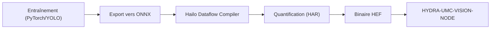

<!-- =============================================================================
HYDRA-UMC-DETECTION-HEF - Compiled-model registry
Copyright (C) JuanenRac (Electro Hobby 3D) <electrohobby3d@gmail.com>
GPL-3.0-or-later - see LICENSE
============================================================================= -->

<p align="center">
  
</p>

# 🎯 HYDRA-UMC-DETECTION-HEF

<p align="center"><a href="README.md">🇺🇸 English</a> | <a href="README_spa.md">🇪🇸 Español</a> | 🇫🇷 <b>Français</b> | <a href="README_ita.md">🇮🇹 Italiano</a> | <a href="README_deu.md">🇩🇪 Deutsch</a> | <a href="README_zho.md">🇨🇳 简体中文</a> | <a href="README_jpn.md">🇯🇵 日本語</a> | <a href="README_por.md">🇵🇹 Português</a></p>

### 📦 Registre de modèles compilés et contrôle de chargement sécurisé pour les modèles Hailo HEF (aucun modèle n'est encore compilé ni exécuté)

<p align="center">
  
  
  
  
  
  
</p>

---

> **État de la sûreté et de la cybersécurité :** cet écosystème n'est pas un système de sécurité certifié. Il n'existe pas encore de chaîne d'E-STOP matérielle, ni de limites ou de verrouillages imposés par le firmware, ni de commande de mouvement vérifiée ; les images de firmware sont contrôlées par CRC-32 et une signature Ed25519, et une compilation de version refuse les clés de développement publiées (les têtes d'outil et les cartes d'extension derrière le relais utilisent encore les chargeurs d'URTC, qui prennent un HMAC-SHA256 à clé partagée au lieu d'une signature) ; TLS et TLS mutuel sont optionnels et désactivés par défaut ; aucune carte propre n'a encore été assemblée ni testée. Lisez la [base de sécurité](https://github.com/JuanenRac/HYDRA-UMC-DOCS/blob/main/docs/SECURITY_BASELINE.md) et le [modèle de menaces](https://github.com/JuanenRac/HYDRA-UMC-DOCS/blob/main/docs/THREAT_MODEL.md) avant de vous fier à une affirmation d'ici pour la sécurité d'une personne.

---

## 📋 En un coup d'œil

| | |
|---|---|
| Version | `0.1.6` |
| Maturité | Fonctionnel |
| Tests | 93 |
| Technologie | Python / Hailo SDK / HEF model registry (no model compiled yet) |
| Cible | Le Raspberry Pi CM5 d'une cellule HYDRA-UMC |
| Sur matériel réel | Pas encore : aucune exécution sur du matériel réel n'est consignée pour cette version |

**Aller à :** [Présentation](#-présentation) · [Architecture](#-architecture) · [Fonctionnalités](#-fonctionnalités) · [Sécurité et protection](#-sécurité-et-protection) · [Interfaces](#-interfaces) · [Configuration](#-configuration) · [Démarrage rapide](#-démarrage-rapide) · [Tests](#-tests) · [Dépannage](#-dépannage) · [Structure du dépôt](#-structure-du-dépôt) · [Projets liés](#-projets-liés)

## 🚦 État du projet

Chaque ligne est une partie de ce dépôt et le feu dit où elle en est aujourd'hui. Elle est écrite d'après ce que le dépôt peut montrer (tests, compilations, exécutions), pas d'après ce qui est prévu.

🟢 Fait et vérifié · 🟡 Fonctionne, avec des limites connues · 🟠 À moitié fait ou pas encore vérifié · 🔴 Pas fait ou ne fonctionne pas

| Domaine | État | Ce que cela veut dire ici |
|---|---|---|
| Logiciel | 🟡 | Fonctionne pour son usage principal ; la vérification d'honnêteté ci-dessus liste ce qui manque encore |
| Tests | 🟢 | 93 tests automatiques, exécutés à chaque modification |
| Matériel réel | 🔴 | Pas encore : aucune exécution sur du matériel réel n'est consignée pour cette version |
| Documentation | 🟢 | README en huit langues, vérifié par rapport au manifeste à chaque modification |

## 🎯 Présentation

**HYDRA-UMC-DETECTION-HEF** est destiné à être une bibliothèque et une chaîne d'outils organisées de modèles de réseaux de neurones haute performance compilés au format **Hailo Executable Format (HEF)**, ajustés pour les environnements de micro-usine industrielle : assemblage électronique, placement SMD et validation de têtes d'outil.

La compilation d'un modèle (ONNX, puis le Hailo Dataflow Compiler, puis un `.hef`) se fait sur un hôte Linux x86_64 avec le Dataflow Compiler installé et un jeu de calibration pour la quantification ; elle n'a pas besoin du Hailo-8 lui-même. Seule l'exécution du modèle compilé nécessite l'accélérateur. `registry load` et `GET /registry/load` refusent un registre ambigu (même nom et même version avec des fichiers différents), acceptent l'architecture telle que le périphérique la rapporte (`HAILO8`) et peuvent figer une version exacte avec `--version` / `?version=` ; `registry add` est sérialisé pour que des ajouts simultanés ne perdent pas d'entrées. Sur la carte, les modèles se trouvent dans `/opt/hydra-umc/detection-hef/models`.

C'est l'un des 4 enfants de **[HYDRA-UMC-VISION-NODE](https://github.com/JuanenRac/HYDRA-UMC-VISION-NODE)**, le parent d'intégration de la famille : ce projet ne possède que la compilation et le versionnement des modèles - la copie servie en exécution d'un modèle `.hef` est chargée et exécutée par le parent, propriétaire du handle du périphérique Hailo-8, pas par ce projet.

## 🧩 Rôle dans HYDRA-UMC

**HYDRA-UMC-DETECTION-HEF** est l'étagère où les modèles compilés du nœud de vision sont rangés : chaque modèle a un nom, une version, une tâche, une forme d'entrée, ses classes et une somme de contrôle, et rien ne peut être chargé s'il ne correspond pas. Aucun modèle n'a encore été compilé ni exécuté sur une puce Hailo.

## 🏛️ Architecture

Le diagramme ci-dessous est la chaîne d'outils de *compilation* cible vers laquelle ce projet est construit - toujours non implémentée, car chaque étape nécessite du vrai matériel Hailo. Le *registre* de modèles (versionnement + vérification d'intégrité des `.hef` que ce pipeline produira un jour) est réel aujourd'hui ; voir « Points Clés » ci-dessus et les décisions de conception ci-dessous.

<p align="center">
  
</p>

<details>
<summary>Version texte du diagramme (Mermaid)</summary>



</details>

**Pourquoi il est construit ainsi**

### Pourquoi il n'y a pas de `hardware/`/`firmware/` ici, et pourquoi `os/`/`models/` restent dans le parent

Ce projet livre des fichiers de modèles et l'outillage qui les compile, pas un périphérique physique - donc, comme le reste de la famille Vision AI Node, il ne porte pas de dossier `hardware/`/`firmware/`. Il ne porte pas non plus `os/` ni `models/`, même si les `.hef` sont littéralement *produits* ici : la copie *servie en exécution* chargée sur le NPU Hailo-8 à l'exécution ne vit que dans le parent d'intégration, [HYDRA-UMC-VISION-NODE](https://github.com/JuanenRac/HYDRA-UMC-VISION-NODE), car c'est le processus propriétaire du handle du périphérique Hailo-8. Le `build/` propre de ce projet est l'endroit où la sortie compilée de la chaîne d'outils est censée atterrir avant d'être publiée là-bas.

### Le flux de compilation est la décision de conception, avant le code

Le diagramme ci-dessus fixe déjà la forme prévue du pipeline : l'entraînement PyTorch/YOLO se passe ailleurs (hors périmètre de ce dépôt), les modèles sont exportés vers ONNX, passent par le Hailo Dataflow Compiler pour une quantification INT8/INT4 (produisant un `.har`), et sont enfin empaquetés en un binaire `.hef` consommé par [HYDRA-UMC-VISION-NODE](https://github.com/JuanenRac/HYDRA-UMC-VISION-NODE). Décider et documenter cette forme maintenant, avant d'écrire le code de la chaîne d'outils, évite à l'implémentation finale d'avoir à improviser plus tard l'histoire du registre/versionnement des modèles.

### Décisions de conception déjà prises

* **Un fichier `.hef` local manquant n'est pas un échec de checksum** - `verify_checksum()` renvoie `None` (pas `False`) quand le fichier décrit par le registre n'est pas présent sous `--models-dir`, et `registry validate` le signale comme « skipped », pas comme une erreur. Le registre est censé décrire des modèles pouvant vivre dans un stockage d'objets séparé, pas nécessairement versionné dans ce dépôt - seul un checksum réellement différent pour un fichier bel et bien présent indique un registre corrompu.
* **Pourquoi `safe_load()` vérifie l'architecture avant le checksum, et pas l'inverse.** La compatibilité d'architecture est de la pure métadonnée (pas d'E/S) ; la vérification du checksum nécessite de lire un fichier réel. Vérifier d'abord la passerelle bon marché et fondamentale signifie qu'un modèle compilé pour la mauvaise puce Hailo est rejeté avant même que le système de fichiers soit touché, et la raison du rejet nomme la vérification fondamentale qui a réellement échoué plutôt qu'un « fichier manquant » trompeur pour un modèle qui n'allait de toute façon jamais tourner sur ce matériel.
* **Pourquoi la compatibilité d'architecture est une correspondance exacte, pas une matrice de compatibilité.** Le Hailo Dataflow Compiler grave la puce cible dans un `.hef` au moment de la compilation - affirmer par exemple qu'un Hailo-15H peut exécuter un `.hef` Hailo-8 nécessiterait une validation croisée d'architectures sur du matériel réel que cet environnement n'a pas. La correspondance exacte est la seule affirmation de compatibilité honnêtement vérifiable à partir des seules métadonnées du registre.

## ✨ Fonctionnalités

* ✅ **Réel v0 - registre de modèles :** `registry.py` analyse et valide par schéma un registre JSON de modèles compilés, détecte les entrées nom+version en double, trouve la dernière version pour un nom/tâche, et vérifie par sha256 les fichiers `.hef` locaux par rapport au registre. Exposé via `registry validate`/`registry latest`/`registry add` ci-dessous - aucun SDK Hailo ni matériel nécessaire pour l'exécuter ou le tester.
* 🔒 **Réel v0 - passerelle de chargement sécurisé :** `safe_load()` dans `compatibility.py` vérifie la compatibilité réelle d'architecture Hailo (`hailo8`/`hailo15h`/etc. - chaque entrée du registre déclare désormais sa puce cible) avant de vérifier le checksum, et ne signale jamais un modèle prêt à déployer à moins que les deux vérifications réelles ne réussissent. Exposé via `registry load` ci-dessous.
* 🌐 **Réel v0 - API JSON/HTTP :** la sous-commande `serve` de `api.py` exécute exactement les mêmes vérifications de registre/chargement sécurisé comme un service local de longue durée (par défaut `127.0.0.1:8093`) via `GET /registry`, `GET /registry/latest`, `GET /registry/load` et `GET /stats` - le registre et le répertoire des modèles sont configurés une seule fois au démarrage, pas à chaque requête. Voir [`docs/CLI_REFERENCE.md`](docs/CLI_REFERENCE.md) pour des exemples réels capturés de chaque endpoint.
* 🛠️ **Détection industrielle (prévu) :** modèles ciblant les composants PCB, les soudures et les défauts mécaniques.
* 📐 **Alignement de fiduciaux (prévu) :** repères de haute précision pour la synchronisation Pick-and-Place.
* ⚡ **Performance quantifiée (prévu) :** variantes INT8/INT4 ciblant les NPU Hailo-8/Hailo-10 pour une inférence sub-10ms. *(travail futur - nécessite la vraie NPU Hailo-8/Hailo-10 et le Dataflow Compiler que cet environnement n'a pas.)*
* 🤖 **Estimation de pose (prévu) :** détection de points clés pour le suivi des articulations du bras robotique. *(travail futur, même raison.)*
* 🧩 **Pourquoi c'est un projet séparé :** compiler et versionner des modèles est un flux de travail data/ML, entièrement différent du processus d'exécution qui les sert - garder la chaîne d'outils ici signifie qu'une mauvaise compilation ne met jamais en danger le nœud de perception en cours d'exécution, et les modèles peuvent être itérés et validés hors ligne avant d'atteindre [HYDRA-UMC-VISION-NODE](https://github.com/JuanenRac/HYDRA-UMC-VISION-NODE).
* 📐 **Contrat d'entrée et de sortie (facultatif) :** une entrée du registre peut porter un `io_contract` qui dit comment alimenter le modèle (disposition, ordre des couleurs, type de donnée, normalisation, redimensionnement ou letterbox, valeur de remplissage) et comment lire sa sortie (format NMS, ordre des boîtes, boîtes normalisées, seuils). Il est validé au chargement du registre, conservé quand le registre est réécrit, et sa somme de contrôle fait partie de l'identité du modèle. Une entrée sans lui se charge comme avant.
* 🔐 **Octets vérifiés :** `safe_load(..., keep_bytes=True)` lit le fichier une fois, vérifie son SHA-256 et renvoie ces mêmes octets, de sorte qu'un consommateur qui construit le modèle à partir d'eux (le streamer de vision et l'API de servo visuel le font) ne peut pas recevoir un fichier modifié après la vérification. `GET /stats` montre des noms de fichier, pas des chemins absolus, sauf avec `serve --stats-full-paths`.

**Vérification d'honnêteté - ce qui fonctionne réellement aujourd'hui :** la moitié réelle et indépendante du matériel du travail de ce projet - le registre de modèles (`registry.py`) et la vraie passerelle de chargement sécurisé (`compatibility.py`), exposés via `registry validate`/`registry latest`/`registry load` et, comme API JSON/HTTP de longue durée, via `serve` (`api.py`) - est implémentée et testée (93 tests). L'export ONNX, la quantification via le Hailo Dataflow Compiler et l'empaquetage HAR/HEF qui produiraient réellement les modèles décrits par ce registre restent un travail futur : ils nécessitent du vrai matériel Hailo que cet environnement n'a pas. Voir [`CHANGELOG.md`](CHANGELOG.md) pour ce qui a été livré exactement jusqu'à présent, et « État Actuel et Prochaines Étapes » ci-dessous pour ce qui reste ouvert.

## 🔒 Sécurité et protection

| Menace | Défense | Où |
|---|---|---|
| Charger un modèle corrompu ou pour une autre puce | La porte de chargement (`compatibility.py`) compare le SHA-256 du `.hef` au registre et l'architecture Hailo à `KNOWN_HAILO_ARCHS` (`hailo8`, `hailo8r`, `hailo8l`, `hailo15h`, `hailo15m`, `hailo15l`, `hailo10h`) ; charger exige `--target-arch` | `compatibility.py`, `registry.py` |
| Une version en double ou mal formée | Le registre valide son schéma, exige des versions de la forme `X.Y.Z` et signale les doublons | `registry.py` |
| Exposition au réseau | L'interface HTTP est en lecture seule et écoute sur `127.0.0.1:8093` par défaut. Elle n'a pas de jeton : savoir si elle en a besoin reste ouvert | `api.py`, `main.py` |

**Ce qu'il ne fait jamais :** il ne compile rien et n'exécute aucun modèle : il ne fait que garder et vérifier le registre des fichiers compilés.

`GET /stats` affiche des noms de fichier et non des chemins absolus, de sorte qu'un appelant n'apprend pas où l'hôte garde son registre et ses modèles ; `serve --stats-full-paths` affiche de nouveau les chemins complets.

## 🔌 Interfaces

HTTP sur `127.0.0.1:8093` par défaut (lecture seule) et une ligne de commande. La référence complète est `docs/CLI_REFERENCE.md`.

| Topic ou route | Ce qu'il porte |
|---|---|
| `GET /registry`, `GET /registry/latest`, `GET /registry/load` | le registre, la dernière version d'un modèle et le résultat de la porte de chargement |
| `GET /stats` | santé |
| `registry validate \| latest \| load \| add` | `--registry`, `--models-dir`, `--hef-path`, `--name`, `--version X.Y.Z`, `--task`, `--input-shape 640,640,3`, `--classes`, `--hailo-arch` |
| `serve` | `--registry FICHIER --models-dir DOSSIER --addr 127.0.0.1 --port 8093` |

## ⚙️ Configuration

Il n'y a pas de variables d'environnement : tout est une option de la ligne de commande (`--registry` est toujours requis, `--models-dir` dépend de la commande).

## 🚀 Démarrage rapide

### Prérequis

* **Python 3.10 ou plus récent** sur le `PATH` (les scripts essaient `python3` puis se replient sur `python`).
* Aucun outillage ONNX/Hailo Dataflow Compiler n'est requis pour l'instant - **zéro dépendance tierce à l'exécution** à ce stade (`dependencies = []` dans `pyproject.toml`).
* Quelques dizaines de Mo d'espace disque pour un environnement virtuel local sous `.venv/`.

### Étape par étape

```bash
# Linux / macOS
./build.sh
```

1. **Lecture de la version** - lit et affiche la version du projet ; compiler ne la change jamais (seule `python tools/hydra_project_tool.py bump` la fait monter).
2. **Environnement virtuel** - crée `.venv/` s'il manque ; le réutilise sinon.
3. **Installation éditable** - `pip install -e ".[dev]"` pour que les modifications sous `src/` prennent effet immédiatement, installe `pytest`, et enregistre le point d'entrée console `hydra-umc-detection-hef`.
4. **Compile-check** - `python -m compileall -q src` compile en bytecode chaque fichier sous `src/`.
5. **Suite de tests réelle** - `python -m pytest tests/ -q` (93 tests couvrant le registre, la passerelle de chargement sécurisé et le CLI).

`set -euo pipefail` arrête le script à la première étape en échec ; le build ne signale un succès que si les 5 étapes réussissent.

```bash
./run.sh
```

Localise l'interpréteur dans `.venv` et exécute `python -m hydra_umc_detection_hef.main`, en relayant tout argument - l'invocation nue affiche nom + version + rôle.

Exemple réel - valider un registre et rechercher la dernière version d'un modèle :

```bash
./run.sh registry validate --registry registry.json --models-dir models/
# 2 entries in registry.json
#   pcb-defect 0.1.0: pcb-defect-0.1.0.hef not present locally, skipped
#   pcb-defect 0.2.0: checksum OK
# registry OK

./run.sh registry latest --registry registry.json --name pcb-defect
# pcb-defect 0.2.0  task=detection  input_shape=(640, 640, 3)
# classes: solder_bridge, missing_component
# hef_path: pcb-defect-0.2.0.hef
# sha256: 1c8a52bb4a34927d55efc913b23f06bd08ff5eeee0aca2ccd8d2c0fd34c81497
```

Chaque entrée du registre déclare aussi son `hailo_arch` cible (ex. `hailo8`). La vraie sous-commande `registry load` combine la vérification de checksum ci-dessus avec une vraie vérification de compatibilité d'architecture, et ne signale un modèle prêt que si les deux réussissent :

```bash
./run.sh registry load --registry registry.json --models-dir models/ --name pcb-defect --target-arch hailo8
# READY: pcb-defect 0.2.0 (hailo8) verified and ready

./run.sh registry load --registry registry.json --models-dir models/ --name pcb-defect --target-arch hailo15h
# REJECTED_ARCH_MISMATCH: model compiled for 'hailo8', this deployment targets 'hailo15h'
```

Ajouter un nouveau modèle ne signifie plus éditer le JSON à la main (y compris le sha256, que `verify_checksum()` ne fait que vérifier, jamais générer) - `registry add` calcule le hash du fichier `.hef` local réel et ajoute une entrée validée :

```bash
./run.sh registry add --registry registry.json --models-dir models/ --hef-path pcb-defect-0.3.0.hef \
  --name pcb-defect --version 0.3.0 --task detection --input-shape 640,640,3 \
  --classes solder_bridge,missing_component --hailo-arch hailo8
# added pcb-defect 0.3.0 to registry.json (sha256=<le digest réel calculé>)
```

Le fichier du registre est réécrit de façon atomique (écrit à côté, synchronisé avec fsync, puis renommé par-dessus), si bien qu'une coupure de courant ou un disque plein lors de l'ajout d'un modèle laisse intact le registre précédent au lieu d'un fichier tronqué.

Les mêmes vérifications de registre/chargement sécurisé sont aussi accessibles comme une API JSON/HTTP de longue durée via `./run.sh serve --registry registry.json --models-dir models/` (par défaut `127.0.0.1:8093`). Voir [`docs/CLI_REFERENCE.md`](docs/CLI_REFERENCE.md) pour la référence complète des commandes et endpoints, avec chaque exemple capturé d'une exécution réelle.

```bat
:: Windows - mêmes étapes, syntaxe batch
build.bat
run.bat
```

## 🧪 Tests

93 tests automatiques s'exécutent avec `python -m pytest tests/ -q` : le registre, la porte de chargement sûr, la ligne de commande et l'interface HTTP. Ils n'utilisent ni outils Hailo, ni matériel, ni réseau extérieur.

La CI exécute `HYDRA_UMC_CI=1 python tools/ci_validate.py`, qui vérifie le manifeste, les documents, les huit README et les images.

## 🏗️ Compilation et publication

Il n'y a rien à compiler pour une publication : `build.sh` / `build.bat` créent l'environnement virtuel, installent le paquet en mode éditable et lancent les tests, et `build-test` ne fait que vérifier. Construire ne change jamais la version ; seul `python tools/hydra_project_tool.py bump` la monte, et il fait avancer aussi le journal des modifications. La version du paquet, du manifeste et du journal doit concorder, sinon `ci_validate.py` échoue.

## 🩺 Dépannage

* **`python`/`python3` introuvable** - installez Python 3.10+ et assurez-vous qu'il est sur le `PATH`.
* **`compileall` échoue** - une vraie erreur de syntaxe a été introduite sous `src/` ; le build s'arrête sans toucher à l'installation, volontairement.
* **« No `.venv` found » depuis `run.sh`/`run.bat`** - exécutez `build.sh`/`build.bat` au moins une fois avant.
* **Installation éditable obsolète** - supprimez `.venv/` et reconstruisez ; rarement nécessaire.

## 📂 Structure du dépôt

<p align="center">
  
</p>

<details>
<summary>Version texte de l'arborescence</summary>

```text
HYDRA-UMC-DETECTION-HEF/
├── src/hydra_umc_detection_hef/
│   ├── registry.py                              le registre des modèles compilés
│   ├── compatibility.py                         la porte de chargement sûr d'un .hef
│   ├── api.py                                   interface HTTP en lecture seule
│   └── main.py                                  ligne de commande et démarrage
├── tests/                                       93 tests
├── docs/                                        la référence de la ligne de commande
├── systemd/                                     unité de service pour la CM5
├── tools/                                       exécuteur de build et de tests, montée de version, validateur CI, générateurs et vérifications des README et des images
├── images/                                      bannière et images du README
├── .github/                                     workflow CI et modèles de tickets
├── pyproject.toml                               métadonnées du paquet et dépendances
├── hydra-umc.project.json                       manifeste : version, maturité, famille
├── CHANGELOG.md                                 ce qui a changé à chaque version
├── build.sh build.bat                           scripts de build (ils ne changent jamais la version)
├── build-test.sh build-test.bat                 scripts de build (ils ne changent jamais la version)
├── test.sh test.bat                             lancent les tests
├── Dockerfile                                   image de conteneur
├── bump_version.py / bump_manifest_version.py   montée de version explicite
├── run.sh run.bat                               démarrer le service
└── SECURITY.md SUPPORT.md CONTRIBUTING.md CODE_OF_CONDUCT.md LICENSE LICENSE.md
```

</details>

## 🗺️ Feuille de route et limites connues

**Limites connues aujourd'hui**

**Ce qui fonctionne aujourd'hui :** le registre de modèles - validation par schéma (incluant des métadonnées d'architecture Hailo requises et validées), détection de versions en double, recherche de la dernière version, et vérification d'intégrité par sha256 (`registry.py`) - plus une vraie passerelle combinée de chargement sécurisé qui vérifie la compatibilité d'architecture et l'intégrité du checksum ensemble et ne signale jamais un modèle prêt à moins que les deux ne réussissent (`compatibility.py`), les mêmes vérifications exposées comme une vraie API JSON/HTTP de longue durée (`api.py`, sous-commande `serve`) aux côtés du CLI ponctuel, 93 tests au total, plus un vrai paquet Python installable avec un point d'entrée vérifié et une commande `bump` explicite, de type compteur kilométrique, qui augmente la version (compiler ne la change jamais). Voir [`CHANGELOG.md`](CHANGELOG.md) pour la sortie de build/run capturée.

**Ce qui reste ouvert, sans ordre particulier, sans calendrier engagé, et bloqué par du vrai matériel Hailo :**

* L'export ONNX réel depuis des modèles PyTorch/YOLO entraînés.
* L'intégration du Hailo Dataflow Compiler pour la quantification INT8/INT4. Les étapes manuelles sont décrites dans [`docs/COMPILING_A_HEF.md`](docs/COMPILING_A_HEF.md) ; le script qui les automatise attend une licence du Dataflow Compiler.
* L'empaquetage HAR/HEF qui peuplerait réellement un fichier de registre que le `registry.py` de ce projet sait déjà lire et valider.
* La publication de la sortie `.hef` compilée dans le dossier `models/` de [HYDRA-UMC-VISION-NODE](https://github.com/JuanenRac/HYDRA-UMC-VISION-NODE).

## 🌍 Langues

Ce README et les documents du dépôt existent en huit langues : anglais, espagnol, allemand, français, italien, japonais, chinois et portugais (Portugal). Ils sont écrits ensemble et la CI vérifie que les huit fichiers ont les mêmes sections et les mêmes liens. Ce dépôt n'a ni écran ni catalogue de messages propre, il n'y a donc aucune chaîne d'interface à traduire.

## 🔗 Projets liés

Ce projet fait partie de l'écosystème robotique HYDRA-UMC du même auteur (JuanenRac / Electro Hobby 3D). Bon à savoir, car une demande pourrait en réalité concerner l'un de ceux-ci plutôt que ce dépôt.

**Projet Parent**
- **[HYDRA-UMC-VISION-NODE](https://github.com/JuanenRac/HYDRA-UMC-VISION-NODE)** — hub d'intégration pour le pipeline de vision Hailo-8, avec une vraie vérification de disponibilité matérielle par étape ; le parent dont ce dépôt est une étape ou un consommateur spécifique, au sein de son propre pipeline de perception.

**Projets Frères** — les autres étapes/consommateurs du propre pipeline de perception Hailo-8 de HYDRA-UMC-VISION-NODE
- **[HYDRA-UMC-VISION-STREAMER](https://github.com/JuanenRac/HYDRA-UMC-VISION-STREAMER)** — générateur réel de pipeline GStreamer + config MediaMTX, avec une vraie frontière d'intégration HailoRT.
- **[HYDRA-UMC-SAFETY-ZONES](https://github.com/JuanenRac/HYDRA-UMC-SAFETY-ZONES)** — logique v0 de violation de zone, de fraîcheur de calibration et de demande d'E-STOP qui lit les positions d'objets dans un fichier ; aucun détecteur ne l'alimente et aucun E-STOP physique n'y est encore relié.
- **[HYDRA-UMC-VISUAL-SERVOING-API](https://github.com/JuanenRac/HYDRA-UMC-VISUAL-SERVOING-API)** — loi de correction Position-Based Visual Servoing avec autorisation conditionnée à l'état de zone ; pas encore d'estimation de pose par caméra.

**Directement Liés**
- **[URTC](https://github.com/JuanenRac/URTC)** — firmware pour la carte physique Universal Robot Tool Controller, plus de 25 profils d'outil sur bus CAN ; la reconnaissance visuelle des propres têtes d'outil d'URTC repose sur les modèles compilés ici.

**Fait Également Partie de l'Écosystème**

*Matériel & Plateforme de Base*
- **[HYDRA-UMC](https://github.com/JuanenRac/HYDRA-UMC)** — la conception de la carte mère du bras robotique : hôte CM5 + coprocesseur STM32H745 double cœur, destinée à coordonner jusqu'à 8 bras-outils via CAN-OTA/SPI-OTA (firmware à un stade précoce ; aucune carte assemblée pour l'instant).
- **[HYDRA-UMC-OS](https://github.com/JuanenRac/HYDRA-UMC-OS)** — couche produit reproductible sur Raspberry Pi OS pour le CM5 : agent en lecture seule, config/profils validés, provisionnement WiFi de premier contact.
- **[HYDRA-UMC-SDK](https://github.com/JuanenRac/HYDRA-UMC-SDK)** — le contrat JSON-Schema partagé et la barrière logicielle de contrôle des jobs contre laquelle chaque bridge valide ses commandes (pas une fonction de sécurité certifiée).
- **[HYDRA-UMC-CONNECTOR-HUB](https://github.com/JuanenRac/HYDRA-UMC-CONNECTOR-HUB)** — registre déclaratif et validateur de manifestes d'adaptateur pour les connecteurs de machines externes ; étend la propre idée de contrat du SDK aux machines externes sans remplacer les projets de passerelle industrielle.

*Backend Central & Clients*
- **[HYDRA-UMC-SERVER](https://github.com/JuanenRac/HYDRA-UMC-SERVER)** — le vrai backend headless (REST/WebSocket) auquel parle réellement chaque client de contrôle.
- **[HYDRA-UMC-STUDIO](https://github.com/JuanenRac/HYDRA-UMC-STUDIO)** — tableau de bord de contrôle web avec visualisation 3D multi-robot en temps réel.
- **[HYDRA-UMC-SUITE](https://github.com/JuanenRac/HYDRA-UMC-SUITE)** — centre de commande d'essaim de bureau (PySide6) pour plusieurs serveurs à la fois, empaqueté en exécutable autonome.
- **[HYDRA-UMC-ANDROID-CONTROL](https://github.com/JuanenRac/HYDRA-UMC-ANDROID-CONTROL)** — application de contrôle Android native avec connexion biométrique et un compagnon Wear OS jumelé.
- **[HYDRA-UMC-IOS-CONTROL](https://github.com/JuanenRac/HYDRA-UMC-IOS-CONTROL)** — application de contrôle iOS/iPadOS (Flutter) avec synchronisation WebSocket en temps réel.
- **[HYDRA-UMC-DSI](https://github.com/JuanenRac/HYDRA-UMC-DSI)** — interface tactile native pour l'écran tactile DSI 7" embarqué, intégrée directement sur le CM5.
- **[HYDRA-UMC-EDITOR-URDF](https://github.com/JuanenRac/HYDRA-UMC-EDITOR-URDF)** — créateur/éditeur graphique de bureau pour URDF qui envoie les modèles terminés vers le propre catalogue de STUDIO.
- **[HYDRA-UMC-EDITOR-STL](https://github.com/JuanenRac/HYDRA-UMC-EDITOR-STL)** — éditeur de bureau de modèles STL, transformant/remplaçant/retirant/ajoutant de vraies pièces dans le même catalogue de modèles qu'édite aussi HYDRA-UMC-EDITOR-URDF.
- **[HYDRA-UMC-BRIDGE-AMR](https://github.com/JuanenRac/HYDRA-UMC-BRIDGE-AMR)** — frontière de coordination pour les flottes AGV/AMR via un éditeur MQTT VDA 5050 (testé uniquement contre une flotte émulée).
- **[HYDRA-UMC-BRIDGE-CNC](https://github.com/JuanenRac/HYDRA-UMC-BRIDGE-CNC)** — coordinateur haut niveau pour cellules CNC avec accès au statut/octets de contrôle GRBL (testé uniquement contre un émulateur).
- **[HYDRA-UMC-BRIDGE-DROIDS](https://github.com/JuanenRac/HYDRA-UMC-BRIDGE-DROIDS)** — frontière de coordination pour droïdes à pattes/humanoïdes, avec un émetteur de commandes Boston Dynamics Spot (testé uniquement contre un émulateur).
- **[HYDRA-UMC-BRIDGE-LASER](https://github.com/JuanenRac/HYDRA-UMC-BRIDGE-LASER)** — coordinateur de cellules laser lisant 3 signaux GPIO de clé/enceinte/verrouillage (testé uniquement contre une puce simulée ; il ne peut ni armer ni tirer un laser).
- **[HYDRA-UMC-BRIDGE-OPENPNP](https://github.com/JuanenRac/HYDRA-UMC-BRIDGE-OPENPNP)** — coordinateur haut niveau sûr pour le flux de cartes du pick-and-place OpenPnP.
- **[HYDRA-UMC-BRIDGE-PRINTER3D](https://github.com/JuanenRac/HYDRA-UMC-BRIDGE-PRINTER3D)** — frontière de coordination sûre pour imprimantes 3D Moonraker/Klipper, avec de vraies commandes de tâche contrôlées.
- **[HYDRA-UMC-BRIDGE-ROS2](https://github.com/JuanenRac/HYDRA-UMC-BRIDGE-ROS2)** — coordinateur avec un transport ROS 2 rclpy à importation paresseuse (pas encore exécuté contre une installation ROS 2).
- **[HYDRA-UMC-BRIDGE-UAV](https://github.com/JuanenRac/HYDRA-UMC-BRIDGE-UAV)** — frontière de coordination pour UAV équipés de caméra, avec un émetteur de commandes MAVLink (testé uniquement contre un émulateur).

*Plateforme d'Outils URTC*
- **[URTC-FLASHER](https://github.com/JuanenRac/URTC-FLASHER)** — outil de bureau à interface graphique pour flasher les cartes URTC, CAN-OTA plus SWD/JTAG puce complète.
- **[URTC-TESTER](https://github.com/JuanenRac/URTC-TESTER)** — outil de bureau de diagnostic CAN-bus en direct pour cartes URTC, un panneau par profil d'outil.
- **[URTC-WEB-STUDIO](https://github.com/JuanenRac/URTC-WEB-STUDIO)** — alternative basée navigateur à URTC-TESTER via la Web Serial API, sans installation locale.
- **[URTC-GATEWAY](https://github.com/JuanenRac/URTC-GATEWAY)** — passerelle devant le bus CAN d'URTC : liste d'identifiants autorisés, limite de débit et clé de session ; logiciel testé sur ordinateur, pas encore sur un bus réel.

*Nœud IA Cognitif (Hailo-10)*
- **[HYDRA-UMC-COGNITIVE-NODE](https://github.com/JuanenRac/HYDRA-UMC-COGNITIVE-NODE)** — hub d'intégration pour le pipeline cognitif Hailo-10 (orchestration LLM/VLA/voix).
- **[HYDRA-UMC-VLA-ENGINE](https://github.com/JuanenRac/HYDRA-UMC-VLA-ENGINE)** — vrai encodage/décodage de jetons d'action et génération de trajectoire pour un modèle Vision-Language-Action.
- **[HYDRA-UMC-VOICE-UI](https://github.com/JuanenRac/HYDRA-UMC-VOICE-UI)** — vrai front-end vocal (VAD + analyseur d'intention) avec un relais Watch borné et soumis à confirmation.
- **[HYDRA-UMC-SEMANTIC-PLANNER](https://github.com/JuanenRac/HYDRA-UMC-SEMANTIC-PLANNER)** — vraie décomposition de tâches basée sur des règles et récupération sémantique d'erreurs sur les codes d'erreur MCU.
- **[HYDRA-UMC-DOCS-QA](https://github.com/JuanenRac/HYDRA-UMC-DOCS-QA)** — vraie recherche documentaire TF-IDF (bibliothèque standard uniquement) sur les propres documents Markdown de cet écosystème.
- **[HYDRA-UMC-LOCAL-TECHNICIAN](https://github.com/JuanenRac/HYDRA-UMC-LOCAL-TECHNICIAN)** — technicien de maintenance IA local et à portes de politique pour l'écosystème lui-même - observe, diagnostique et propose des corrections ; les deux niveaux de risque les plus élevés ne sont délibérément pas encore implémentés.

*Orchestration & Essaim*
- **[HYDRA-UMC-ORCHESTRATOR](https://github.com/JuanenRac/HYDRA-UMC-ORCHESTRATOR)** — hub d'intégration avec un vrai contrat de rapport de santé gRPC/Protobuf et une machine à états de mission.
- **[HYDRA-UMC-JOB-DISPATCHER](https://github.com/JuanenRac/HYDRA-UMC-JOB-DISPATCHER)** — vraie file de tâches basée sur la priorité avec déduplication, via une vraie API HTTP.
- **[HYDRA-UMC-NODE-HEALING](https://github.com/JuanenRac/HYDRA-UMC-NODE-HEALING)** — vrai chien de garde de santé de flotte basé sur gRPC, avec retry/backoff et détection d'incohérence d'identité.
- **[HYDRA-UMC-PATH-PLANNER-3D](https://github.com/JuanenRac/HYDRA-UMC-PATH-PLANNER-3D)** — vrai planificateur de trajectoire 3D basé sur RRT, avec vraie validation des collisions obstacle/espace de travail.
- **[HYDRA-UMC-SWARM-SYNC](https://github.com/JuanenRac/HYDRA-UMC-SWARM-SYNC)** — vraie synchronisation d'état CRDT LWW-Element-Map, testée par propriétés pour la convergence multi-cellule.

*Jumeau Numérique & Simulation*
- **[HYDRA-UMC-TWIN](https://github.com/JuanenRac/HYDRA-UMC-TWIN)** — hub d'intégration pour le moteur de jumeau numérique, avec un vrai contrat de synchronisation par compatibilité de version.
- **[HYDRA-UMC-HIL-BRIDGE](https://github.com/JuanenRac/HYDRA-UMC-HIL-BRIDGE)** — routeur hardware-in-the-loop avec un verrouillage logiciel de collision entre simulation et matériel réel (testé sans matériel réel).
- **[HYDRA-UMC-PHYSICS-REPLICA](https://github.com/JuanenRac/HYDRA-UMC-PHYSICS-REPLICA)** — vraie cinématique directe et validation des limites articulaires sur un vrai sous-ensemble URDF.
- **[HYDRA-UMC-SYNTHETIC-DATA-GEN](https://github.com/JuanenRac/HYDRA-UMC-SYNTHETIC-DATA-GEN)** — vrai générateur procédural de scènes 2D avec export d'annotations YOLO/COCO.

*Données & Analytique*
- **[HYDRA-UMC-DATALAKE](https://github.com/JuanenRac/HYDRA-UMC-DATALAKE)** — vrai magasin de séries temporelles basé sur sqlite3, avec une vraie API HTTP d'ingestion/requête.
- **[HYDRA-UMC-ANOMALY-DETECTOR](https://github.com/JuanenRac/HYDRA-UMC-ANOMALY-DETECTOR)** — vrai détecteur d'anomalies FFT + ligne de base statistique, avec surveillance de dérive.
- **[HYDRA-UMC-PRODUCTION-REPORTS](https://github.com/JuanenRac/HYDRA-UMC-PRODUCTION-REPORTS)** — vrai calcul OEE/disponibilité sur l'historique de DATALAKE, avec export CSV reproductible.
- **[HYDRA-UMC-TELEMETRY-COLLECTOR](https://github.com/JuanenRac/HYDRA-UMC-TELEMETRY-COLLECTOR)** — vrai pipeline d'ingestion CAN/WebSocket vers DATALAKE, avec déduplication par séquence.

*Passerelle Industrielle*
- **[HYDRA-UMC-GATEWAY-INDUSTRIAL](https://github.com/JuanenRac/HYDRA-UMC-GATEWAY-INDUSTRIAL)** — hub d'intégration relayant vers les protocoles industriels, avec une vraie couche de liste blanche de commandes/contre-pression.
- **[HYDRA-UMC-OPCUA-SERVER](https://github.com/JuanenRac/HYDRA-UMC-OPCUA-SERVER)** — vrai espace d'adressage OPC-UA, vérifié avec une vraie session client du protocole binaire.
- **[HYDRA-UMC-MQTT-BROKER](https://github.com/JuanenRac/HYDRA-UMC-MQTT-BROKER)** — vrai broker MQTT avec authentification par client optionnelle et ACL de sujets.
- **[HYDRA-UMC-MTCONNECT-ADAPTER](https://github.com/JuanenRac/HYDRA-UMC-MTCONNECT-ADAPTER)** — vrais points de terminaison XML MTConnect `/probe` et `/current`, avec sortie en mode dégradé.

*Outils Complémentaires & Opérations de l'Écosystème*
- **[HYDRA-UMC-DASHBOARD-AI](https://github.com/JuanenRac/HYDRA-UMC-DASHBOARD-AI)** — panneaux Smart Summaries et Anomaly Highlighting sur DATALAKE/ANOMALY-DETECTOR, avec un repli statistique honnête.
- **[HYDRA-UMC-TOOL-CLI](https://github.com/JuanenRac/HYDRA-UMC-TOOL-CLI)** — CLI de flotte avec un vrai contrat de codes de sortie stable, un vrai client en direct de la propre API de HYDRA-UMC-SERVER.
- **[HYDRA-UMC-WATCH](https://github.com/JuanenRac/HYDRA-UMC-WATCH)** — application compagnon WearOS avec des motifs d'alerte haptique et un relais vocal vers le téléphone jumelé (pas encore exécutée sur une montre physique).
- **[URTC-SMART-RACK](https://github.com/JuanenRac/URTC-SMART-RACK)** — firmware pour un rack de montage de cartes avec décodage réel d'ID d'outil et logique de préchauffage Smart Idle.
- **[URTC-VISION-TOOL](https://github.com/JuanenRac/URTC-VISION-TOOL)** — firmware plus un vrai compagnon de vision Python pour une tête d'outil d'inspection thermique/RGB.
- **[HYDRA-UMC-UPDATER](https://github.com/JuanenRac/HYDRA-UMC-UPDATER)** — outil administratif de bureau qui découvre, clone et met à jour chaque dépôt de cet écosystème.
- **[HYDRA-UMC-OS-REBUILDER](https://github.com/JuanenRac/HYDRA-UMC-OS-REBUILDER)** — outil de bureau Windows/Linux qui construit une image de la CM5 prête à graver, préchargée avec les versions les plus actuelles de l'écosystème, avec une configuration de premier démarrage Wi-Fi/utilisateur/SSH façon Raspberry Pi Imager.
- **[HYDRA-UMC-OPS-AGENT](https://github.com/JuanenRac/HYDRA-UMC-OPS-AGENT)** — coordinateur d'incidents de maintenance : un rôle edge à faible privilège collecte un instantané d'inventaire/santé assaini, un rôle control-plane le rend en lecture seule et demande à un fournisseur d'IA de suggérer un diagnostic - n'applique jamais de correctif ni ne déploie rien.
- **[HYDRA-UMC-DEV-SERVER](https://github.com/JuanenRac/HYDRA-UMC-DEV-SERVER)** — hôte de développement reproductible (Raspberry Pi 5 / CM5) qui héberge le code source de l'écosystème et exécute des tâches de compilation/test délimitées via une file d'attente durable ; un rôle de développement dédié, explicitement distinct d'un CM5 opérationnel.

## 📚 Documentation

Où lire la suite :

* [docs/CLI_REFERENCE.md](docs/CLI_REFERENCE.md) - chaque commande et option, les routes HTTP et les codes de sortie
* [Base de sécurité de l'écosystème](https://github.com/JuanenRac/HYDRA-UMC-DOCS/blob/main/docs/SECURITY_BASELINE.md)
* [Modèle de menaces de l'écosystème](https://github.com/JuanenRac/HYDRA-UMC-DOCS/blob/main/docs/THREAT_MODEL.md)
* [Journal des modifications de ce dépôt](CHANGELOG.md)
* [Licence de ce dépôt](LICENSE.md)

## 🤝 Contribuer et communauté

* Avant une pull request, exécutez `HYDRA_UMC_CI=1 py -3 tools/ci_validate.py` (ou `HYDRA_UMC_CI=1 python3 tools/ci_validate.py`) : il doit afficher `CI_VALIDATION=PASS`. N'exécutez pas `build.sh` ni `build.bat` pour cette vérification ; compiler n'est pas vérifier.
* Les huit README sont écrits à partir d'une source unique dans HYDRA-UMC-DOCS ; ne les modifiez pas à la main. Changez la source et réécrivez-les avec `tools/make_readmes.py`.
* N'affirmez pas dans un README ce qui n'a pas tourné : écrivez « simulé » ou « non essayé sur matériel » quand c'est la vérité.
* Voir [CONTRIBUTING.md](CONTRIBUTING.md), le [code de conduite](CODE_OF_CONDUCT.md), [SECURITY.md](SECURITY.md) et [SUPPORT.md](SUPPORT.md).

## 👤 AUTEUR

**JuanenRac (Electro Hobby 3D)** · electrohobby3d@gmail.com

## 📜 LICENCE

GPL-3.0-or-later - [LICENSE](LICENSE).
