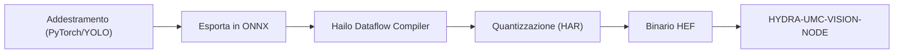

<!-- =============================================================================
HYDRA-UMC-DETECTION-HEF - Compiled-model registry
Copyright (C) JuanenRac (Electro Hobby 3D) <electrohobby3d@gmail.com>
GPL-3.0-or-later - see LICENSE
============================================================================= -->

<p align="center">
  
</p>

# 🎯 HYDRA-UMC-DETECTION-HEF

<p align="center"><a href="README.md">🇺🇸 English</a> | <a href="README_spa.md">🇪🇸 Español</a> | <a href="README_fra.md">🇫🇷 Français</a> | 🇮🇹 <b>Italiano</b> | <a href="README_deu.md">🇩🇪 Deutsch</a> | <a href="README_zho.md">🇨🇳 简体中文</a> | <a href="README_jpn.md">🇯🇵 日本語</a> | <a href="README_por.md">🇵🇹 Português</a></p>

### 📦 Registro di modelli compilati e controllo di caricamento sicuro per modelli Hailo HEF (nessun modello viene ancora compilato o eseguito)

<p align="center">
  
  
  
  
  
  
</p>

---

> **Stato di sicurezza (safety e security):** questo ecosistema non è un sistema di sicurezza certificato. Non esiste ancora un percorso E-STOP hardware, né limiti o interblocchi imposti dal firmware, né un comando di movimento verificato; le immagini firmware sono controllate con CRC-32 e una firma Ed25519, e una compilazione di rilascio rifiuta le chiavi di sviluppo pubblicate (le teste utensile e le schede di espansione dietro il relè usano ancora i bootloader di URTC, che accettano un HMAC-SHA256 a chiave condivisa invece di una firma); TLS e TLS reciproco sono opzionali e disattivati per impostazione predefinita; nessuna scheda propria è stata ancora assemblata o provata. Leggi la [base di sicurezza](https://github.com/JuanenRac/HYDRA-UMC-DOCS/blob/main/docs/SECURITY_BASELINE.md) e il [modello delle minacce](https://github.com/JuanenRac/HYDRA-UMC-DOCS/blob/main/docs/THREAT_MODEL.md) prima di fidarti di qualsiasi affermazione qui per la sicurezza di una persona.

---

## 📋 In breve

| | |
|---|---|
| Versione | `0.1.6` |
| Maturità | Funzionale |
| Test | 93 |
| Tecnologia | Python / Hailo SDK / HEF model registry (no model compiled yet) |
| Destinazione | Il Raspberry Pi CM5 di una cella HYDRA-UMC |
| Su hardware reale | Non ancora: per questa versione non risulta alcuna esecuzione su hardware reale |

**Vai a:** [Panoramica](#-panoramica) · [Architettura](#-architettura) · [Funzionalità](#-funzionalità) · [Sicurezza e protezione](#-sicurezza-e-protezione) · [Interfacce](#-interfacce) · [Configurazione](#-configurazione) · [Avvio rapido](#-avvio-rapido) · [Test](#-test) · [Risoluzione dei problemi](#-risoluzione-dei-problemi) · [Struttura del repository](#-struttura-del-repository) · [Progetti correlati](#-progetti-correlati)

## 🚦 Stato del progetto

Ogni riga è una parte di questo repository e il semaforo dice a che punto è oggi. È scritta in base a ciò che il repository può mostrare (test, compilazioni, esecuzioni), non a ciò che è previsto.

🟢 Fatto e verificato · 🟡 Funziona, con limiti noti · 🟠 Fatto a metà o non ancora verificato · 🔴 Non fatto o non funzionante

| Area | Stato | Cosa significa qui |
|---|---|---|
| Software | 🟡 | Funziona per il suo scopo principale; la verifica di onestà qui sopra elenca ciò che manca ancora |
| Test | 🟢 | 93 test automatici, eseguiti a ogni modifica |
| Hardware reale | 🔴 | Non ancora: per questa versione non risulta alcuna esecuzione su hardware reale |
| Documentazione | 🟢 | README in otto lingue, verificato rispetto al manifesto a ogni modifica |

## 🎯 Panoramica

**HYDRA-UMC-DETECTION-HEF** è pensato per essere una libreria e toolchain curata di modelli di rete neurale ad alte prestazioni compilati nel **Hailo Executable Format (HEF)**, ottimizzati per ambienti di micro-fabbrica industriale: assemblaggio elettronico, posizionamento SMD e validazione di teste utensile.

La compilazione di un modello (ONNX, poi l'Hailo Dataflow Compiler, poi un `.hef`) avviene su un host Linux x86_64 con il Dataflow Compiler installato e un dataset di calibrazione per la quantizzazione; non richiede lo stesso Hailo-8. Solo l'esecuzione del modello compilato richiede l'acceleratore. `registry load` e `GET /registry/load` rifiutano un registro ambiguo (stesso nome e versione con file diversi), accettano l'architettura come la riporta il dispositivo (`HAILO8`) e possono fissare una versione esatta con `--version` / `?version=`; `registry add` è serializzato così le aggiunte simultanee non perdono voci. Sulla scheda i modelli si trovano in `/opt/hydra-umc/detection-hef/models`.

Questo è uno dei 4 figli di **[HYDRA-UMC-VISION-NODE](https://github.com/JuanenRac/HYDRA-UMC-VISION-NODE)**, il genitore di integrazione della famiglia: questo progetto possiede solo la compilazione e il versionamento dei modelli - la copia servita in esecuzione di un modello `.hef` viene caricata ed eseguita dal genitore, proprietario dell'handle del dispositivo Hailo-8, non da questo progetto.

## 🧩 Ruolo in HYDRA-UMC

**HYDRA-UMC-DETECTION-HEF** è lo scaffale dove i modelli compilati del nodo di visione sono tenuti in ordine: ogni modello ha un nome, una versione, un compito, una forma d'ingresso, le sue classi e un checksum, e nulla può essere caricato se non corrisponde. Nessun modello è ancora stato compilato o eseguito su un chip Hailo.

## 🏛️ Architettura

Il diagramma sotto è la toolchain di *compilazione* obiettivo verso cui viene costruito questo progetto - ancora non implementata, perché ogni passo richiede vero hardware Hailo. Il *registro* di modelli (versionamento + verifica di integrità dei `.hef` che questa pipeline produrrà un giorno) è reale oggi; vedi "Punti Chiave" sopra e le decisioni di design più sotto.

<p align="center">
  
</p>

<details>
<summary>Versione testuale del diagramma (Mermaid)</summary>



</details>

**Perché è fatto così**

### Perché non ci sono `hardware/`/`firmware/` qui, e perché `os/`/`models/` restano nel genitore

Questo progetto distribuisce file di modello e gli strumenti che li compilano, non un dispositivo fisico - quindi, come il resto della famiglia Vision AI Node, non porta cartelle `hardware/`/`firmware/`. Non porta nemmeno `os/` o `models/`, anche se i `.hef` vengono letteralmente *prodotti* qui: la copia *servita in esecuzione* caricata sulla NPU Hailo-8 a runtime vive solo nel genitore di integrazione, [HYDRA-UMC-VISION-NODE](https://github.com/JuanenRac/HYDRA-UMC-VISION-NODE), perché è il processo proprietario dell'handle del dispositivo Hailo-8. Il proprio `build/` di questo progetto è dove è previsto che atterri l'output compilato della toolchain prima di essere pubblicato lì.

### Il flusso di compilazione è la decisione di design, prima del codice

Il diagramma sopra fissa già la forma prevista della pipeline: l'addestramento PyTorch/YOLO avviene altrove (fuori dall'ambito di questo repository), i modelli vengono esportati in ONNX, passano per il Hailo Dataflow Compiler per la quantizzazione INT8/INT4 (producendo un `.har`), e infine impacchettati come binario `.hef` consumato da [HYDRA-UMC-VISION-NODE](https://github.com/JuanenRac/HYDRA-UMC-VISION-NODE). Decidere e documentare questa forma ora, prima di scrivere il codice della toolchain, evita che l'implementazione finale debba improvvisare più avanti la storia del registro/versionamento dei modelli.

### Decisioni di design già prese

* **Un file `.hef` locale mancante non è un fallimento di checksum** - `verify_checksum()` restituisce `None` (non `False`) quando il file descritto dal registro non è presente sotto `--models-dir`, e `registry validate` lo segnala come "skipped", non come errore. Il registro è pensato per descrivere modelli che possono vivere in un object store separato, non necessariamente incluso in questo repo - solo un checksum realmente discordante per un file effettivamente presente indica un registro corrotto.
* **Perché `safe_load()` controlla l'architettura prima del checksum, non il contrario.** La compatibilità dell'architettura è pura metadata (nessun I/O); la verifica del checksum deve leggere un file reale. Controllare prima la verifica economica e fondamentale significa che un modello compilato per il chip Hailo sbagliato viene rifiutato prima ancora di toccare il filesystem, e il motivo del rifiuto nomina il controllo fondamentale che è realmente fallito invece di un fuorviante "file mancante" per un modello che comunque non sarebbe mai girato su questo hardware.
* **Perché la compatibilità dell'architettura è corrispondenza esatta, non una matrice di compatibilità.** Il Hailo Dataflow Compiler incide il chip target in un `.hef` al momento della compilazione - affermare ad esempio che un Hailo-15H può eseguire un `.hef` Hailo-8 richiederebbe una validazione incrociata tra architetture su hardware reale che questo ambiente non ha. La corrispondenza esatta è l'unica affermazione di compatibilità onestamente verificabile solo dalla metadata del registro.

## ✨ Funzionalità

* ✅ **Reale v0 - registro modelli:** `registry.py` analizza e valida per schema un registro JSON di modelli compilati, rileva voci duplicate nome+versione, trova l'ultima versione per un nome/task, e verifica i file `.hef` locali tramite checksum sha256 rispetto al registro. Esposto tramite `registry validate`/`registry latest`/`registry add` più sotto - non serve SDK Hailo né hardware per eseguirlo o testarlo.
* 🔒 **Reale v0 - verifica di caricamento sicuro:** `safe_load()` di `compatibility.py` verifica la compatibilità reale dell'architettura Hailo (`hailo8`/`hailo15h`/ecc. - ogni voce del registro ora dichiara il proprio chip target) prima di verificare il checksum, e non riporta mai un modello pronto per il deploy a meno che entrambi i controlli reali non passino. Esposto tramite `registry load` più sotto.
* 🌐 **Reale v0 - API JSON/HTTP:** il sottocomando `serve` di `api.py` esegue esattamente gli stessi controlli di registro/caricamento sicuro come servizio locale di lunga durata (default `127.0.0.1:8093`) tramite `GET /registry`, `GET /registry/latest`, `GET /registry/load` e `GET /stats` - registro e cartella dei modelli si configurano una sola volta all'avvio, non per ogni richiesta. Vedi [`docs/CLI_REFERENCE.md`](docs/CLI_REFERENCE.md) per esempi reali catturati di ogni endpoint.
* 🛠️ **Rilevamento Industriale (previsto):** modelli mirati a componenti PCB, saldature e difetti meccanici.
* 📐 **Allineamento Fiduciali (previsto):** riferimenti ad alta precisione per la sincronizzazione Pick-and-Place.
* ⚡ **Prestazioni Quantizzate (previsto):** varianti INT8/INT4 mirate alle NPU Hailo-8/Hailo-10 per inferenza sub-10ms. *(lavoro futuro - richiede la vera NPU Hailo-8/Hailo-10 e il Dataflow Compiler che questo ambiente non ha.)*
* 🤖 **Stima della Posa (previsto):** rilevamento di keypoint per il tracciamento delle articolazioni del braccio robotico. *(lavoro futuro, stesso motivo.)*
* 🧩 **Perché esiste come progetto separato:** compilare e versionare modelli è un flusso di lavoro dati/ML, completamente diverso dal processo di esecuzione che li serve - mantenere la toolchain qui significa che una compilazione errata non mette mai a rischio il nodo di percezione in esecuzione, e i modelli possono essere iterati e validati offline prima di raggiungere [HYDRA-UMC-VISION-NODE](https://github.com/JuanenRac/HYDRA-UMC-VISION-NODE).
* 📐 **Contratto di ingresso e uscita (facoltativo):** una voce del registro può portare un `io_contract` che dice come alimentare il modello (disposizione, ordine dei colori, tipo di dato, normalizzazione, ridimensionamento o letterbox, valore di riempimento) e come leggere la sua uscita (formato NMS, ordine dei riquadri, riquadri normalizzati, soglie). Viene validato al caricamento del registro, conservato quando il registro viene riscritto e il suo checksum fa parte dell'identità del modello. Una voce senza di esso si carica come prima.
* 🔐 **Byte verificati:** `safe_load(..., keep_bytes=True)` legge il file una volta, controlla il suo SHA-256 e restituisce quegli stessi byte, così un consumatore che costruisce il modello da essi (lo fanno lo streamer di visione e l'API di servoing visivo) non può ricevere un file cambiato dopo il controllo. `GET /stats` mostra nomi di file, non percorsi assoluti, salvo `serve --stats-full-paths`.

**Verifica di onestà - cosa funziona davvero oggi:** la metà reale e indipendente dall'hardware del lavoro di questo progetto - il registro di modelli (`registry.py`) e la reale verifica di caricamento sicuro (`compatibility.py`), esposti tramite `registry validate`/`registry latest`/`registry load` e, come API JSON/HTTP di lunga durata, tramite `serve` (`api.py`) - è implementata e testata (93 test). L'esportazione ONNX, la quantizzazione tramite Hailo Dataflow Compiler e il pacchettizzazione HAR/HEF che produrrebbero davvero i modelli descritti da questo registro restano lavoro futuro: richiedono vero hardware Hailo che questo ambiente non ha. Vedi [`CHANGELOG.md`](CHANGELOG.md) per ciò che è stato consegnato esattamente finora, e "Stato Attuale e Prossimi Passi" più sotto per ciò che resta aperto.

## 🔒 Sicurezza e protezione

| Minaccia | Difesa | Dove |
|---|---|---|
| Caricare un modello corrotto o per un altro chip | La porta di caricamento (`compatibility.py`) confronta lo SHA-256 del `.hef` con il registro e l'architettura Hailo con `KNOWN_HAILO_ARCHS` (`hailo8`, `hailo8r`, `hailo8l`, `hailo15h`, `hailo15m`, `hailo15l`, `hailo10h`); caricare richiede `--target-arch` | `compatibility.py`, `registry.py` |
| Una versione duplicata o malformata | Il registro valida il suo schema, richiede versioni della forma `X.Y.Z` e segnala i duplicati | `registry.py` |
| Esposizione alla rete | L'interfaccia HTTP è di sola lettura e ascolta su `127.0.0.1:8093` per impostazione predefinita. Non ha token: se ne abbia bisogno è ancora aperto | `api.py`, `main.py` |

**Cosa non fa mai:** non compila nulla né esegue alcun modello: conserva e controlla soltanto il registro dei file compilati.

## 🔌 Interfacce

HTTP su `127.0.0.1:8093` per impostazione predefinita (sola lettura) e una riga di comando. Il riferimento completo è `docs/CLI_REFERENCE.md`.

| Topic o rotta | Cosa porta |
|---|---|
| `GET /registry`, `GET /registry/latest`, `GET /registry/load` | il registro, l'ultima versione di un modello e il risultato della porta di caricamento |
| `GET /stats` | stato |
| `registry validate \| latest \| load \| add` | `--registry`, `--models-dir`, `--hef-path`, `--name`, `--version X.Y.Z`, `--task`, `--input-shape 640,640,3`, `--classes`, `--hailo-arch` |
| `serve` | `--registry FILE --models-dir DIR --addr 127.0.0.1 --port 8093` |

## ⚙️ Configurazione

Non ci sono variabili d'ambiente: tutto è un'opzione della riga di comando (`--registry` serve sempre, `--models-dir` dipende dal comando).

## 🚀 Avvio rapido

### Prerequisiti

* **Python 3.10 o superiore** nel `PATH` (gli script provano `python3` poi ripiegano su `python`).
* Non serve ancora ONNX né il Hailo Dataflow Compiler - **zero dipendenze di terze parti a runtime** in questa fase (`dependencies = []` in `pyproject.toml`).
* Poche decine di MB di spazio su disco per un ambiente virtuale locale sotto `.venv/`.

### Passo dopo passo

```bash
# Linux / macOS
./build.sh
```

1. **Lettura della versione** - legge e stampa la versione del progetto; compilare non la cambia mai (solo `python tools/hydra_project_tool.py bump` la alza).
2. **Ambiente virtuale** - crea `.venv/` se manca; lo riutilizza altrimenti.
3. **Installazione editabile** - `pip install -e ".[dev]"` così le modifiche sotto `src/` hanno effetto immediato, installa `pytest`, e registra l'entry point da console `hydra-umc-detection-hef`.
4. **Compile-check** - `python -m compileall -q src` compila in bytecode ogni file sotto `src/`.
5. **Suite di test reale** - `python -m pytest tests/ -q` (93 test che coprono il registro, la verifica di caricamento sicuro e il CLI).

`set -euo pipefail` ferma lo script al primo passo che fallisce; il build segnala successo solo se tutti e 5 i passi hanno successo.

```bash
./run.sh
```

Individua l'interprete dentro `.venv` ed esegue `python -m hydra_umc_detection_hef.main`, inoltrando qualsiasi argomento - l'invocazione nuda stampa nome + versione + ruolo.

Esempio reale - validare un registro e cercare l'ultima versione di un modello:

```bash
./run.sh registry validate --registry registry.json --models-dir models/
# 2 entries in registry.json
#   pcb-defect 0.1.0: pcb-defect-0.1.0.hef not present locally, skipped
#   pcb-defect 0.2.0: checksum OK
# registry OK

./run.sh registry latest --registry registry.json --name pcb-defect
# pcb-defect 0.2.0  task=detection  input_shape=(640, 640, 3)
# classes: solder_bridge, missing_component
# hef_path: pcb-defect-0.2.0.hef
# sha256: 1c8a52bb4a34927d55efc913b23f06bd08ff5eeee0aca2ccd8d2c0fd34c81497
```

Ogni voce del registro dichiara anche il proprio `hailo_arch` target (es. `hailo8`). Il vero sottocomando `registry load` combina la verifica del checksum di cui sopra con una vera verifica di compatibilità dell'architettura, e riporta un modello pronto solo se entrambe passano:

```bash
./run.sh registry load --registry registry.json --models-dir models/ --name pcb-defect --target-arch hailo8
# READY: pcb-defect 0.2.0 (hailo8) verified and ready

./run.sh registry load --registry registry.json --models-dir models/ --name pcb-defect --target-arch hailo15h
# REJECTED_ARCH_MISMATCH: model compiled for 'hailo8', this deployment targets 'hailo15h'
```

Aggiungere un nuovo modello non significa più modificare il JSON a mano (incluso lo sha256, che `verify_checksum()` verifica soltanto, senza mai generarlo) - `registry add` calcola l'hash del vero file `.hef` locale e aggiunge una voce validata:

```bash
./run.sh registry add --registry registry.json --models-dir models/ --hef-path pcb-defect-0.3.0.hef \
  --name pcb-defect --version 0.3.0 --task detection --input-shape 640,640,3 \
  --classes solder_bridge,missing_component --hailo-arch hailo8
# added pcb-defect 0.3.0 to registry.json (sha256=<il vero digest calcolato>)
```

Il file del registro viene riscritto in modo atomico (scritto accanto, sincronizzato con fsync, poi rinominato sopra), così un'interruzione di corrente o un disco pieno durante l'aggiunta di un modello lascia intatto il registro precedente invece di un file troncato.

Gli stessi controlli di registro/caricamento sicuro sono raggiungibili anche come API JSON/HTTP di lunga durata tramite `./run.sh serve --registry registry.json --models-dir models/` (default `127.0.0.1:8093`). Vedi [`docs/CLI_REFERENCE.md`](docs/CLI_REFERENCE.md) per il riferimento completo di comandi ed endpoint, con ogni esempio catturato da un'esecuzione reale.

```bat
:: Windows - stessi passi, sintassi batch
build.bat
run.bat
```

## 🧪 Test

93 test automatici si eseguono con `python -m pytest tests/ -q`: il registro, la porta di caricamento sicuro, la riga di comando e l'interfaccia HTTP. Non usano strumenti Hailo, hardware né rete esterna.

La CI esegue `HYDRA_UMC_CI=1 python tools/ci_validate.py`, che controlla il manifesto, i documenti, gli otto README e le immagini.

## 🏗️ Compilazione e rilascio

Per un rilascio non c'è nulla da compilare: `build.sh` / `build.bat` creano l'ambiente virtuale, installano il pacchetto in modalità modificabile ed eseguono i test, e `build-test` si limita a controllare. Compilare non cambia mai la versione; la alza soltanto `python tools/hydra_project_tool.py bump`, che sposta anche il registro delle modifiche. La versione del pacchetto, del manifesto e del registro deve coincidere, altrimenti `ci_validate.py` fallisce.

## 🩺 Risoluzione dei problemi

* **`python`/`python3` non trovato** - installa Python 3.10+ e assicurati che sia nel `PATH`.
* **`compileall` fallisce** - è stato introdotto un vero errore di sintassi sotto `src/`; il build si ferma senza toccare l'installazione, di proposito.
* **"No `.venv` found" da `run.sh`/`run.bat`** - esegui `build.sh`/`build.bat` almeno una volta prima.
* **Installazione editabile obsoleta** - elimina `.venv/` e ricostruisci; raramente necessario.

## 📂 Struttura del repository

<p align="center">
  
</p>

<details>
<summary>Versione testuale dell'albero</summary>

```text
HYDRA-UMC-DETECTION-HEF/
├── src/hydra_umc_detection_hef/
│   ├── registry.py                              il registro dei modelli compilati
│   ├── compatibility.py                         la porta di caricamento sicuro di un .hef
│   ├── api.py                                   interfaccia HTTP di sola lettura
│   └── main.py                                  riga di comando e avvio
├── tests/                                       93 test
├── docs/                                        il riferimento della riga di comando
├── systemd/                                     unità di servizio per la CM5
├── tools/                                       esecutore di build e test, aumento di versione, validatore CI, generatori e controlli di README e immagini
├── images/                                      banner e immagini del README
├── .github/                                     workflow CI e modelli di segnalazione
├── pyproject.toml                               metadati del pacchetto e dipendenze
├── hydra-umc.project.json                       manifesto: versione, maturità, famiglia
├── CHANGELOG.md                                 cosa è cambiato in ogni versione
├── build.sh build.bat                           script di build (non cambiano mai la versione)
├── build-test.sh build-test.bat                 script di build (non cambiano mai la versione)
├── test.sh test.bat                             eseguono i test
├── Dockerfile                                   immagine di container
├── bump_version.py / bump_manifest_version.py   aumento di versione esplicito
├── run.sh run.bat                               avviare il servizio
└── SECURITY.md SUPPORT.md CONTRIBUTING.md CODE_OF_CONDUCT.md LICENSE LICENSE.md
```

</details>

## 🗺️ Roadmap e limiti noti

**Limiti noti oggi**

**Cosa funziona oggi:** il registro di modelli - validazione per schema (inclusi metadati di architettura Hailo richiesti e validati), rilevamento versioni duplicate, ricerca dell'ultima versione, e verifica di integrità tramite sha256 (`registry.py`) - più una vera verifica combinata di caricamento sicuro che controlla compatibilità dell'architettura e integrità del checksum insieme e non riporta mai un modello pronto a meno che entrambi non passino (`compatibility.py`), gli stessi controlli esposti anche come vera API JSON/HTTP di lunga durata (`api.py`, sottocomando `serve`) accanto alla CLI a esecuzione singola, 93 test in totale, più un vero pacchetto Python installabile con un entry point verificato e un comando `bump` esplicito, in stile contachilometri, che aumenta la versione (compilare non la cambia mai). Vedi [`CHANGELOG.md`](CHANGELOG.md) per l'output di build/run catturato.

**Cosa resta aperto, senza ordine particolare, senza calendario impegnato, e bloccato da vero hardware Hailo:**

* La vera esportazione ONNX da modelli PyTorch/YOLO addestrati.
* L'integrazione con il Hailo Dataflow Compiler per la quantizzazione INT8/INT4.
* Il pacchettizzazione HAR/HEF che popolerebbe davvero un file di registro che il `registry.py` di questo progetto sa già leggere e validare.
* Pubblicare l'output `.hef` compilato nella cartella `models/` di [HYDRA-UMC-VISION-NODE](https://github.com/JuanenRac/HYDRA-UMC-VISION-NODE).

## 🌍 Lingue

Questo README e i documenti del repository esistono in otto lingue: inglese, spagnolo, tedesco, francese, italiano, giapponese, cinese e portoghese (Portogallo). Sono scritti insieme e la CI verifica che gli otto file abbiano le stesse sezioni e gli stessi link. Questo repository non ha uno schermo né un catalogo di messaggi propri, quindi non ci sono stringhe di interfaccia da tradurre.

## 🔗 Progetti correlati

Questo progetto fa parte dell'ecosistema robotico HYDRA-UMC dello stesso autore (JuanenRac / Electro Hobby 3D). Vale la pena conoscerlo, poiché una richiesta potrebbe in realtà riguardare uno di questi invece di questo repository.

**Progetto Padre**
- **[HYDRA-UMC-VISION-NODE](https://github.com/JuanenRac/HYDRA-UMC-VISION-NODE)** — hub di integrazione per la pipeline di visione Hailo-8, con un vero controllo di prontezza hardware per fase; il genitore di cui questo repository è una fase o un consumatore specifico, all'interno della propria pipeline di percezione.

**Progetti Fratelli** — le altre fasi/consumatori della pipeline di percezione Hailo-8 propria di HYDRA-UMC-VISION-NODE
- **[HYDRA-UMC-VISION-STREAMER](https://github.com/JuanenRac/HYDRA-UMC-VISION-STREAMER)** — generatore reale di pipeline GStreamer + config MediaMTX, con una vera barriera di integrazione HailoRT.
- **[HYDRA-UMC-SAFETY-ZONES](https://github.com/JuanenRac/HYDRA-UMC-SAFETY-ZONES)** — logica v0 di violazione zona, freschezza di calibrazione e richiesta E-STOP che legge le posizioni degli oggetti da un file; nessun rilevatore la alimenta e nessun E-STOP fisico è ancora collegato.
- **[HYDRA-UMC-VISUAL-SERVOING-API](https://github.com/JuanenRac/HYDRA-UMC-VISUAL-SERVOING-API)** — legge di correzione Position-Based Visual Servoing con autorizzazione condizionata allo stato di zona; ancora nessuna stima di posa da telecamera.

**Direttamente Correlati**
- **[URTC](https://github.com/JuanenRac/URTC)** — firmware per la scheda fisica dell'Universal Robot Tool Controller, oltre 25 profili utensile su bus CAN; il riconoscimento visivo delle proprie teste utensile di URTC si basa sui modelli compilati qui.

**Fa Anche Parte dell'Ecosistema**

*Hardware e Piattaforma di Base*
- **[HYDRA-UMC](https://github.com/JuanenRac/HYDRA-UMC)** — il progetto della scheda madre del braccio robotico: host CM5 + coprocessore STM32H745 dual-core, pensato per coordinare fino a 8 bracci utensile via CAN-OTA/SPI-OTA (firmware in fase iniziale; nessuna scheda assemblata per ora).
- **[HYDRA-UMC-OS](https://github.com/JuanenRac/HYDRA-UMC-OS)** — livello prodotto riproducibile su Raspberry Pi OS per il CM5: agente in sola lettura, config/profili validati, provisioning WiFi al primo contatto.
- **[HYDRA-UMC-SDK](https://github.com/JuanenRac/HYDRA-UMC-SDK)** — il contratto JSON-Schema condiviso e la barriera software di controllo dei job contro cui ogni bridge valida i propri comandi (non è una funzione di sicurezza certificata).
- **[HYDRA-UMC-CONNECTOR-HUB](https://github.com/JuanenRac/HYDRA-UMC-CONNECTOR-HUB)** — registro dichiarativo e validatore di manifesti adattatore per connettori di macchine esterne; estende la propria idea di contratto dell'SDK alle macchine esterne senza sostituire i progetti di gateway industriale.

*Backend Centrale e Client*
- **[HYDRA-UMC-SERVER](https://github.com/JuanenRac/HYDRA-UMC-SERVER)** — il vero backend headless (REST/WebSocket) con cui parla davvero ogni client di controllo.
- **[HYDRA-UMC-STUDIO](https://github.com/JuanenRac/HYDRA-UMC-STUDIO)** — dashboard di controllo web con visualizzazione 3D multi-robot in tempo reale.
- **[HYDRA-UMC-SUITE](https://github.com/JuanenRac/HYDRA-UMC-SUITE)** — centro di comando sciame desktop (PySide6) per più server contemporaneamente, pacchettizzato come eseguibile standalone.
- **[HYDRA-UMC-ANDROID-CONTROL](https://github.com/JuanenRac/HYDRA-UMC-ANDROID-CONTROL)** — app di controllo nativa per Android con login biometrico e un companion Wear OS abbinato.
- **[HYDRA-UMC-IOS-CONTROL](https://github.com/JuanenRac/HYDRA-UMC-IOS-CONTROL)** — app di controllo per iOS/iPadOS (Flutter) con sincronizzazione WebSocket in tempo reale.
- **[HYDRA-UMC-DSI](https://github.com/JuanenRac/HYDRA-UMC-DSI)** — interfaccia touch nativa per il touchscreen DSI da 7" a bordo, incorporata direttamente nel CM5.
- **[HYDRA-UMC-EDITOR-URDF](https://github.com/JuanenRac/HYDRA-UMC-EDITOR-URDF)** — creatore/editor grafico desktop di URDF che invia i modelli finiti al catalogo di STUDIO.
- **[HYDRA-UMC-EDITOR-STL](https://github.com/JuanenRac/HYDRA-UMC-EDITOR-STL)** — editor desktop di modelli STL, che trasforma/sostituisce/rimuove/aggiunge veri pezzi nello stesso catalogo di modelli modificato anche da HYDRA-UMC-EDITOR-URDF.
- **[HYDRA-UMC-BRIDGE-AMR](https://github.com/JuanenRac/HYDRA-UMC-BRIDGE-AMR)** — barriera di coordinamento per flotte AGV/AMR tramite un publisher MQTT VDA 5050 (testato solo contro una flotta emulata).
- **[HYDRA-UMC-BRIDGE-CNC](https://github.com/JuanenRac/HYDRA-UMC-BRIDGE-CNC)** — coordinatore ad alto livello per celle CNC con accesso a stato/byte di controllo GRBL (testato solo contro un emulatore).
- **[HYDRA-UMC-BRIDGE-DROIDS](https://github.com/JuanenRac/HYDRA-UMC-BRIDGE-DROIDS)** — barriera di coordinamento per droidi con zampe/umanoidi, con un mittente di comandi per Boston Dynamics Spot (testato solo contro un emulatore).
- **[HYDRA-UMC-BRIDGE-LASER](https://github.com/JuanenRac/HYDRA-UMC-BRIDGE-LASER)** — coordinatore per celle laser che legge 3 segnali GPIO di chiave/involucro/interblocco (testato solo contro un chip simulato; non può armare né far partire un laser).
- **[HYDRA-UMC-BRIDGE-OPENPNP](https://github.com/JuanenRac/HYDRA-UMC-BRIDGE-OPENPNP)** — coordinatore ad alto livello sicuro per il flusso schede del pick-and-place OpenPnP.
- **[HYDRA-UMC-BRIDGE-PRINTER3D](https://github.com/JuanenRac/HYDRA-UMC-BRIDGE-PRINTER3D)** — barriera di coordinamento sicura per stampanti 3D Moonraker/Klipper, con comandi di lavoro reali e controllati.
- **[HYDRA-UMC-BRIDGE-ROS2](https://github.com/JuanenRac/HYDRA-UMC-BRIDGE-ROS2)** — coordinatore con un trasporto ROS 2 rclpy importato in modo lazy (non ancora eseguito contro un'installazione ROS 2).
- **[HYDRA-UMC-BRIDGE-UAV](https://github.com/JuanenRac/HYDRA-UMC-BRIDGE-UAV)** — barriera di coordinamento per UAV dotati di fotocamera, con un mittente di comandi MAVLink (testato solo contro un emulatore).

*Piattaforma Strumenti URTC*
- **[URTC-FLASHER](https://github.com/JuanenRac/URTC-FLASHER)** — strumento desktop con GUI per il flashing delle schede URTC, CAN-OTA più SWD/JTAG a chip intero.
- **[URTC-TESTER](https://github.com/JuanenRac/URTC-TESTER)** — strumento desktop di diagnostica CAN-bus dal vivo per schede URTC, un pannello per profilo utensile.
- **[URTC-WEB-STUDIO](https://github.com/JuanenRac/URTC-WEB-STUDIO)** — alternativa basata su browser a URTC-TESTER tramite la Web Serial API, senza installazione locale.
- **[URTC-GATEWAY](https://github.com/JuanenRac/URTC-GATEWAY)** — gateway davanti al bus CAN di URTC: elenco di identificatori consentiti, limite di frequenza e chiave di sessione; software provato su computer, non ancora su un bus reale.

*Nodo IA Cognitivo (Hailo-10)*
- **[HYDRA-UMC-COGNITIVE-NODE](https://github.com/JuanenRac/HYDRA-UMC-COGNITIVE-NODE)** — hub di integrazione per la pipeline cognitiva Hailo-10 (orchestrazione LLM/VLA/voce).
- **[HYDRA-UMC-VLA-ENGINE](https://github.com/JuanenRac/HYDRA-UMC-VLA-ENGINE)** — vera codifica/decodifica di token d'azione e generazione di traiettoria per un modello Vision-Language-Action.
- **[HYDRA-UMC-VOICE-UI](https://github.com/JuanenRac/HYDRA-UMC-VOICE-UI)** — vero front-end vocale (VAD + parser di intenti) con un relay verso Watch limitato e soggetto a conferma.
- **[HYDRA-UMC-SEMANTIC-PLANNER](https://github.com/JuanenRac/HYDRA-UMC-SEMANTIC-PLANNER)** — vera scomposizione dei task basata su regole e recupero semantico degli errori sui codici errore MCU.
- **[HYDRA-UMC-DOCS-QA](https://github.com/JuanenRac/HYDRA-UMC-DOCS-QA)** — vera ricerca documentale TF-IDF (solo libreria standard) sui documenti Markdown di questo ecosistema.
- **[HYDRA-UMC-LOCAL-TECHNICIAN](https://github.com/JuanenRac/HYDRA-UMC-LOCAL-TECHNICIAN)** — tecnico di manutenzione IA locale e con cancelli di policy per l'ecosistema stesso - osserva, diagnostica e propone correzioni; i due livelli di rischio più alti non sono deliberatamente ancora implementati.

*Orchestrazione e Sciame*
- **[HYDRA-UMC-ORCHESTRATOR](https://github.com/JuanenRac/HYDRA-UMC-ORCHESTRATOR)** — hub di integrazione con un vero contratto di health-report gRPC/Protobuf e una macchina a stati di missione.
- **[HYDRA-UMC-JOB-DISPATCHER](https://github.com/JuanenRac/HYDRA-UMC-JOB-DISPATCHER)** — vera coda di lavori basata su priorità con deduplicazione, su una vera API HTTP.
- **[HYDRA-UMC-NODE-HEALING](https://github.com/JuanenRac/HYDRA-UMC-NODE-HEALING)** — vero watchdog di salute della flotta basato su gRPC, con retry/backoff e rilevamento di discrepanza d'identità.
- **[HYDRA-UMC-PATH-PLANNER-3D](https://github.com/JuanenRac/HYDRA-UMC-PATH-PLANNER-3D)** — vero pianificatore di percorsi 3D basato su RRT, con vera validazione delle collisioni ostacolo/spazio di lavoro.
- **[HYDRA-UMC-SWARM-SYNC](https://github.com/JuanenRac/HYDRA-UMC-SWARM-SYNC)** — vera sincronizzazione di stato CRDT LWW-Element-Map, con property test per la convergenza multi-cella.

*Gemello Digitale e Simulazione*
- **[HYDRA-UMC-TWIN](https://github.com/JuanenRac/HYDRA-UMC-TWIN)** — hub di integrazione per il motore di gemello digitale, con un vero contratto di sincronizzazione per compatibilità di versione.
- **[HYDRA-UMC-HIL-BRIDGE](https://github.com/JuanenRac/HYDRA-UMC-HIL-BRIDGE)** — router hardware-in-the-loop con un interblocco software di collisione tra simulazione e hardware reale (testato senza hardware reale).
- **[HYDRA-UMC-PHYSICS-REPLICA](https://github.com/JuanenRac/HYDRA-UMC-PHYSICS-REPLICA)** — vera cinematica diretta e validazione dei limiti articolari su un vero sottoinsieme URDF.
- **[HYDRA-UMC-SYNTHETIC-DATA-GEN](https://github.com/JuanenRac/HYDRA-UMC-SYNTHETIC-DATA-GEN)** — vero generatore procedurale di scene 2D con esportazione di annotazioni YOLO/COCO.

*Dati e Analisi*
- **[HYDRA-UMC-DATALAKE](https://github.com/JuanenRac/HYDRA-UMC-DATALAKE)** — vero archivio di serie temporali basato su sqlite3, con una vera API HTTP di ingestione/query.
- **[HYDRA-UMC-ANOMALY-DETECTOR](https://github.com/JuanenRac/HYDRA-UMC-ANOMALY-DETECTOR)** — vero rilevatore di anomalie FFT + baseline statistica, con monitoraggio della deriva.
- **[HYDRA-UMC-PRODUCTION-REPORTS](https://github.com/JuanenRac/HYDRA-UMC-PRODUCTION-REPORTS)** — vero calcolo OEE/disponibilità sullo storico di DATALAKE, con esportazione CSV riproducibile.
- **[HYDRA-UMC-TELEMETRY-COLLECTOR](https://github.com/JuanenRac/HYDRA-UMC-TELEMETRY-COLLECTOR)** — vera pipeline di ingestione CAN/WebSocket verso DATALAKE, con deduplicazione per sequenza.

*Gateway Industriale*
- **[HYDRA-UMC-GATEWAY-INDUSTRIAL](https://github.com/JuanenRac/HYDRA-UMC-GATEWAY-INDUSTRIAL)** — hub di integrazione che inoltra ai protocolli industriali, con un vero livello di allowlist dei comandi/backpressure.
- **[HYDRA-UMC-OPCUA-SERVER](https://github.com/JuanenRac/HYDRA-UMC-OPCUA-SERVER)** — vero spazio di indirizzi OPC-UA, verificato con una vera sessione client del protocollo binario.
- **[HYDRA-UMC-MQTT-BROKER](https://github.com/JuanenRac/HYDRA-UMC-MQTT-BROKER)** — vero broker MQTT con autenticazione opzionale per client e ACL sui topic.
- **[HYDRA-UMC-MTCONNECT-ADAPTER](https://github.com/JuanenRac/HYDRA-UMC-MTCONNECT-ADAPTER)** — veri endpoint XML `/probe` e `/current` di MTConnect, con output in modalità degradata.

*Strumenti Complementari e Operazioni dell'Ecosistema*
- **[HYDRA-UMC-DASHBOARD-AI](https://github.com/JuanenRac/HYDRA-UMC-DASHBOARD-AI)** — pannelli Smart Summaries e Anomaly Highlighting su DATALAKE/ANOMALY-DETECTOR, con un fallback statistico onesto.
- **[HYDRA-UMC-TOOL-CLI](https://github.com/JuanenRac/HYDRA-UMC-TOOL-CLI)** — CLI di flotta con un vero e stabile contratto di exit-code, un client live reale della stessa API di HYDRA-UMC-SERVER.
- **[HYDRA-UMC-WATCH](https://github.com/JuanenRac/HYDRA-UMC-WATCH)** — app companion WearOS con schemi di avviso aptico e un relay vocale verso il telefono abbinato (non ancora eseguita su un orologio fisico).
- **[URTC-SMART-RACK](https://github.com/JuanenRac/URTC-SMART-RACK)** — firmware per un rack di montaggio schede con decodifica reale dell'ID utensile e logica di preriscaldamento Smart Idle.
- **[URTC-VISION-TOOL](https://github.com/JuanenRac/URTC-VISION-TOOL)** — firmware più un vero companion di visione Python per una testa utensile di ispezione termica/RGB.
- **[HYDRA-UMC-UPDATER](https://github.com/JuanenRac/HYDRA-UMC-UPDATER)** — strumento amministrativo desktop che scopre, clona e aggiorna ogni repository di questo ecosistema.
- **[HYDRA-UMC-OS-REBUILDER](https://github.com/JuanenRac/HYDRA-UMC-OS-REBUILDER)** — strumento desktop Windows/Linux che costruisce un'immagine della CM5 pronta da scrivere, precaricata con le versioni più aggiornate dell'ecosistema, con configurazione di primo avvio Wi-Fi/utente/SSH in stile Raspberry Pi Imager.
- **[HYDRA-UMC-OPS-AGENT](https://github.com/JuanenRac/HYDRA-UMC-OPS-AGENT)** — coordinatore di incidenti di manutenzione: un ruolo edge a basso privilegio raccoglie uno snapshot di inventario/salute sanificato, un ruolo control-plane lo rende in sola lettura e chiede a un provider di IA di suggerire una diagnosi - non applica mai una patch né distribuisce nulla.
- **[HYDRA-UMC-DEV-SERVER](https://github.com/JuanenRac/HYDRA-UMC-DEV-SERVER)** — host di sviluppo riproducibile (Raspberry Pi 5 / CM5) che conserva il codice sorgente dell'ecosistema ed esegue attività delimitate di build/test tramite una coda durevole; un ruolo di sviluppo dedicato, esplicitamente distinto da un CM5 operativo.

## 📚 Documentazione

Dove leggere di più:

* [docs/CLI_REFERENCE.md](docs/CLI_REFERENCE.md) - ogni comando e opzione, le rotte HTTP e i codici di uscita
* [Base di sicurezza dell'ecosistema](https://github.com/JuanenRac/HYDRA-UMC-DOCS/blob/main/docs/SECURITY_BASELINE.md)
* [Modello delle minacce dell'ecosistema](https://github.com/JuanenRac/HYDRA-UMC-DOCS/blob/main/docs/THREAT_MODEL.md)
* [Registro delle modifiche di questo repository](CHANGELOG.md)
* [Licenza di questo repository](LICENSE.md)

## 🤝 Contribuire e comunità

* Prima di una pull request esegui `HYDRA_UMC_CI=1 py -3 tools/ci_validate.py` (oppure `HYDRA_UMC_CI=1 python3 tools/ci_validate.py`): deve stampare `CI_VALIDATION=PASS`. Non eseguire `build.sh` né `build.bat` per questa verifica; compilare non è verificare.
* I otto README sono scritti da un'unica fonte in HYDRA-UMC-DOCS; non modificarli a mano. Cambia la fonte e riscrivili con `tools/make_readmes.py`.
* Non affermare in un README ciò che non è stato eseguito: scrivi «simulato» o «non provato su hardware» quando è la verità.
* Vedi [CONTRIBUTING.md](CONTRIBUTING.md), il [codice di condotta](CODE_OF_CONDUCT.md), [SECURITY.md](SECURITY.md) e [SUPPORT.md](SUPPORT.md).

## 👤 AUTORE

**JuanenRac (Electro Hobby 3D)** · electrohobby3d@gmail.com

## 📜 LICENZA

GPL-3.0-or-later - [LICENSE](LICENSE).
