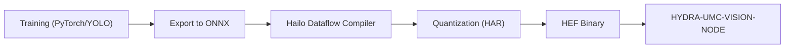

<!-- =============================================================================
HYDRA-UMC-DETECTION-HEF - Compiled-model registry
Copyright (C) JuanenRac (Electro Hobby 3D) <electrohobby3d@gmail.com>
GPL-3.0-or-later - see LICENSE
============================================================================= -->

<p align="center">
  
</p>

# 🎯 HYDRA-UMC-DETECTION-HEF

<p align="center"><a href="README.md">🇺🇸 English</a> | <a href="README_spa.md">🇪🇸 Español</a> | <a href="README_fra.md">🇫🇷 Français</a> | <a href="README_ita.md">🇮🇹 Italiano</a> | <a href="README_deu.md">🇩🇪 Deutsch</a> | <a href="README_zho.md">🇨🇳 简体中文</a> | 🇯🇵 <b>日本語</b> | <a href="README_por.md">🇵🇹 Português</a></p>

### 📦 Hailo HEF モデルのコンパイル済みモデルレジストリとセーフロード検査（モデルのコンパイルも実行もまだ行っていません）

<p align="center">
  
  
  
  
  
  
</p>

---

> **安全性とセキュリティの現状:** このエコシステムは認証された安全システムではありません。ハードウェアの E-STOP 経路、ファームウェアが強制する制限やインターロック、検証済みの動作コマンドはまだありません。ファームウェアイメージは CRC-32 と Ed25519 署名で検査し、リリースビルドは公開済みの開発用鍵を拒否します(リレーの先のツールヘッドと拡張ボードは引き続き URTC のブートローダーを使い、署名ではなく共有鍵の HMAC-SHA256 を使います)。TLS と相互 TLS は任意で、既定では無効です。独自基板はまだ実装も試験もされていません。ここに書かれた内容を人の安全のために頼る前に、[セキュリティベースライン](https://github.com/JuanenRac/HYDRA-UMC-DOCS/blob/main/docs/SECURITY_BASELINE.md)と[脅威モデル](https://github.com/JuanenRac/HYDRA-UMC-DOCS/blob/main/docs/THREAT_MODEL.md)をお読みください。

---

## 📋 ひと目で

| | |
|---|---|
| バージョン | `0.1.5` |
| 成熟度 | 機能する |
| テスト | 70 |
| 技術 | Python / Hailo SDK / HEF model registry (no model compiled yet) |
| 対象 | HYDRA-UMC セルの Raspberry Pi CM5 |
| 実機での確認 | まだです：このバージョンについて実機での動作記録はありません |

**移動：** [概要](#-概要) · [アーキテクチャ](#-アーキテクチャ) · [機能](#-機能) · [セキュリティと安全](#-セキュリティと安全) · [インターフェース](#-インターフェース) · [設定](#-設定) · [クイックスタート](#-クイックスタート) · [テスト](#-テスト) · [トラブルシューティング](#-トラブルシューティング) · [リポジトリの構成](#-リポジトリの構成) · [関連プロジェクト](#-関連プロジェクト)

## 🚦 プロジェクトの状況

各行はこのリポジトリの一部分で、信号は今日どこまで進んでいるかを示します。計画ではなく、リポジトリが示せるもの（テスト、ビルド、実行）に基づいて書かれています。

🟢 完了・検証済み · 🟡 動作する（既知の制限あり） · 🟠 一部のみ、または未検証 · 🔴 未実装または動作しない

| 領域 | 状態 | ここでの意味 |
|---|---|---|
| ソフトウェア | 🟡 | 主な目的では動作します。足りない点は上の正直さの確認に書かれています |
| テスト | 🟢 | 自動テスト 70 件。変更のたびに実行されます |
| 実機 | 🔴 | まだです：このバージョンについて実機での動作記録はありません |
| ドキュメント | 🟢 | 8 言語の README。変更のたびにマニフェストと照合されます |

## 🎯 概要

**HYDRA-UMC-DETECTION-HEF** は、**Hailo Executable Format（HEF）** に
コンパイルされた高性能ニューラルネットワークモデルの厳選されたライブラリ
とツールチェーンとなることを目指しており、産業用マイクロファクトリー
環境（電子部品組立、SMD 実装、工具ヘッド検証）向けに調整されています。

これは、ファミリーの統合親プロジェクトである
**[HYDRA-UMC-VISION-NODE](https://github.com/JuanenRac/HYDRA-UMC-VISION-NODE)** の 4 つの子プロジェクトの 1 つです：本プロジェクトはモデルのコンパイルとバージョン管理のみを担当します——実際に配信され実行される `.hef` モデルのコピーは、Hailo-8 デバイスハンドルを保持する親プロジェクトによってロードおよび実行され、本プロジェクト自体は行いません。

モデルのコンパイル（ONNX から Hailo Dataflow Compiler を経て `.hef` へ）は、Dataflow Compiler をインストールした x86_64 Linux ホストと量子化用のキャリブレーションデータセットで行い、Hailo-8 自体は必要ありません。コンパイル済みモデルを実行するときだけアクセラレーターが必要です。`registry load` と `GET /registry/load` は曖昧なレジストリ（同じ名前とバージョンで異なるファイル）を拒否し、デバイスが報告するとおりのアーキテクチャ（`HAILO8`）を受け付け、`--version` / `?version=` で正確なバージョンを固定できます。`registry add` は直列化されており、同時に追加しても項目が失われません。ボード上のモデルは `/opt/hydra-umc/detection-hef/models` にあります。

## 🧩 HYDRA-UMC での役割

**HYDRA-UMC-DETECTION-HEF** は、ビジョンノードのコンパイル済みモデルを整理して置く棚です。各モデルには名前、バージョン、タスク、入力形状、クラス、チェックサムがあり、一致しないものはロードできません。Hailo チップ上でモデルをコンパイル・実行したことはまだありません。

## 🏛️ アーキテクチャ

下図は、本プロジェクトが構築を目指している目標*コンパイル*ツールチェーンです——各ステップが実際の Hailo ハードウェアを必要とするため、依然として未実装です。モデル*レジストリ*（このパイプラインが将来生成する `.hef` のバージョン管理と整合性検証）は今日すでに実際に動作します。上記の「要点」と下記の設計上の決定を参照してください。

<p align="center">
  
</p>

<details>
<summary>図のテキスト版（Mermaid）</summary>



</details>

**この作りにした理由**

### なぜここに `hardware/`/`firmware/` がなく、なぜ `os/`/`models/` は依然として親プロジェクトに存在するのか

本プロジェクトはモデルファイルとそれをコンパイルするツールを提供する
ものであり、物理デバイスではありません——そのため、Vision AI Node
ファミリーの他のプロジェクトと同様に、`hardware/`/`firmware/` フォルダを
携えていません。`.hef` ファイルが文字通りここで*生成される*にもかかわ
らず、`os/` や `models/` も携えていません：ランタイム時に Hailo-8 NPU に
ロードされる*配信され実行される*コピーは、Hailo-8 デバイスハンドルを
保持するプロセスである統合親プロジェクト [HYDRA-UMC-VISION-NODE](https://github.com/JuanenRac/HYDRA-UMC-VISION-NODE) にのみ存在するためです。本プロジェクト自身の `build/` は、コンパイルされたツールチェーンの出力がそこに公開される前に到達する場所です。

### コンパイルフローはコードに先立つ設計上の決定である

上図は、意図されたパイプラインの形をすでに確定しています：PyTorch/YOLO
のトレーニングは他の場所で行われ（本リポジトリの範囲外）、モデルは
ONNX にエクスポートされ、Hailo Dataflow Compiler を通じて INT8/INT4
量子化が行われ（`.har` を生成）、最終的に [HYDRA-UMC-VISION-NODE](https://github.com/JuanenRac/HYDRA-UMC-VISION-NODE) が消費する `.hef` バイナリとしてパッケージ化されます。ツールチェーンのコードを書く前に、今のうちにこの形を決定し文書化しておくことで、最終的な実装が後でモデルレジストリ/バージョン管理の方法を即興で考案する必要がなくなります。

### 既に行われた設計上の決定

* **ローカルの `.hef` ファイルが存在しないことはチェックサムの失敗にはなりません** —— レジストリが記述するファイルが `--models-dir` の下に存在しない場合、`verify_checksum()` はエラーではなく `None`（`False` ではない）を返し、`registry validate` はこれを "skipped" として報告します。レジストリは、このリポジトリに必ずしもチェックインされていない別のオブジェクトストアに存在しうるモデルを記述することを想定しています——実際に存在するファイルのチェックサムが本当に一致しない場合のみ、レジストリが壊れていることを示します。
* **`safe_load()` がチェックサムより先にアーキテクチャをチェックする理由(その逆ではない)。** アーキテクチャ互換性は純粋なメタデータです(I/O なし)——チェックサム検証は実際のファイルを読む必要があります。まず安価で根本的なゲートをチェックすることで、間違った Hailo チップ向けにコンパイルされたモデルは、ファイルシステムに触れる前に拒否されます。そして拒否理由は、どのみちこのハードウェアでは決して動かなかったモデルに対する紛らわしい「ファイルが見つかりません」ではなく、実際に失敗した根本的なチェックを示します。
* **アーキテクチャ互換性が互換性マトリクスではなく完全一致である理由。** Hailo Dataflow Compiler はコンパイル時にターゲットチップを `.hef` に焼き込みます——例えば Hailo-15H が Hailo-8 の `.hef` を実行できると主張するには、この環境にはない実際のハードウェア上での実際のクロスアーキテクチャ検証が必要になります。完全一致は、レジストリのメタデータだけから正直に検証できる唯一の互換性の主張です。

## ✨ 機能

* ✅ **実装済み v0 —— モデルレジストリ：** `registry.py` はコンパイル済みモデルの JSON レジストリを解析・スキーマ検証し、重複した名前+バージョンのエントリを検出し、名前/タスクに対する最新バージョンを検索し、ローカルの `.hef` ファイルをレジストリと照合して sha256 チェックサムを検証します。下記の `registry validate`/`registry latest`/`registry add` から利用可能で、実行にもテストにも Hailo SDK やハードウェアは不要です。
* 🔒 **実装済み v0 —— 安全なロードのゲート：** `compatibility.py` の `safe_load()` は、チェックサムを検証する前に実際の Hailo アーキテクチャ互換性(`hailo8`/`hailo15h` など——各レジストリエントリは今やターゲットチップを宣言します)を検証し、両方の実際のチェックが通った場合にのみモデルをデプロイ準備完了として報告します。下記の `registry load` から利用可能です。
* 🌐 **実装済み v0 —— JSON/HTTP API：** `api.py` の `serve` サブコマンドは、同じレジストリ/安全なロードのチェックを長時間稼働するローカルサービス(デフォルト `127.0.0.1:8093`)として実行し、`GET /registry`、`GET /registry/latest`、`GET /registry/load`、`GET /stats` を公開します——レジストリとモデルディレクトリは起動時に一度だけ設定され、リクエストごとではありません。各エンドポイントの実際にキャプチャされた例は [`docs/CLI_REFERENCE.md`](docs/CLI_REFERENCE.md) を参照してください。
* 🛠️ **産業用検知（計画中）：** PCB 部品、はんだ接合部、機械的欠陥を対象としたモデル。
* 📐 **フィデューシャルアライメント（計画中）：** ピック＆プレース同期のための高精度アンカー。
* ⚡ **量子化パフォーマンス（計画中）：** Hailo-8/Hailo-10 NPU を対象としたサブ 10ms 推論のための INT8/INT4 バリアント。*（将来の作業——この環境にはまだない実際の Hailo-8/Hailo-10 NPU と Dataflow Compiler が必要です。）*
* 🤖 **姿勢推定（計画中）：** ロボットアームの関節追跡のためのキーポイント検出。*（同じ理由で将来の作業です。）*
* 🧩 **独立したプロジェクトとして存在する理由：** モデルのコンパイルとバージョン管理はデータ/ML ワークフローであり、それらを提供するランタイムプロセスとは完全に異なります——ツールチェーンをここに保つことで、不良なコンパイルが実行中の知覚ノードを危険にさらすことは決してなく、モデルは [HYDRA-UMC-VISION-NODE](https://github.com/JuanenRac/HYDRA-UMC-VISION-NODE) に到達する前にオフラインで反復・検証できます。

**正直な現状確認 —— 今日実際に動くもの：** 本プロジェクトの仕事のうち、実際にハードウェアに依存しない半分——モデルレジストリ（`registry.py`）と実際の安全なロードのゲート（`compatibility.py`）——は、`registry validate`/`registry latest`/`registry load`、および長時間稼働する JSON/HTTP API としての `serve`（`api.py`）を通じて公開され、実装され、テストされています（70 個のテスト）。このレジストリが記述するモデルを実際に*生成*する ONNX エクスポート、Hailo Dataflow Compiler による量子化、HAR/HEF パッケージングは、依然として将来の作業です：いずれもこの環境にはない実際の Hailo ハードウェアを必要とします。
実際に出荷済みの内容は [`CHANGELOG.md`](CHANGELOG.md) を、まだ残っている
作業は下記の「現在の状況と次のステップ」セクションを参照してください。

## 🔒 セキュリティと安全

| 脅威 | 防御 | 場所 |
|---|---|---|
| 破損したモデルや別チップ用のモデルのロード | ロードのゲート（`compatibility.py`）は `.hef` の SHA-256 をレジストリと、Hailo のアーキテクチャを `KNOWN_HAILO_ARCHS`（`hailo8`・`hailo8r`・`hailo8l`・`hailo15h`・`hailo15m`・`hailo15l`・`hailo10h`）と照合し、ロードには `--target-arch` が必要です | `compatibility.py`, `registry.py` |
| 重複または不正なバージョン | レジストリはスキーマを検証し、`X.Y.Z` 形式のバージョンを要求し、重複を報告します | `registry.py` |
| ネットワークへの露出 | HTTP の窓口は読み取り専用で、既定は `127.0.0.1:8093` で待ち受けます。トークンはなく、必要かどうかはまだ未定です | `api.py`, `main.py` |

**絶対にしないこと：** 何もコンパイルせず、モデルも実行しません。コンパイル済みファイルのレジストリを保持・検査するだけです。

## 🔌 インターフェース

既定は `127.0.0.1:8093` の HTTP（読み取り専用）とコマンドライン。詳しくは `docs/CLI_REFERENCE.md` を参照してください。

| トピックまたはルート | 内容 |
|---|---|
| `GET /registry`, `GET /registry/latest`, `GET /registry/load` | レジストリ、モデルの最新バージョン、ロードゲートの結果 |
| `GET /stats` | 稼働状況 |
| `registry validate \| latest \| load \| add` | `--registry`, `--models-dir`, `--hef-path`, `--name`, `--version X.Y.Z`, `--task`, `--input-shape 640,640,3`, `--classes`, `--hailo-arch` |
| `serve` | `--registry FILE --models-dir DIR --addr 127.0.0.1 --port 8093` |

## ⚙️ 設定

環境変数はありません。すべてコマンドラインのオプションです（`--registry` は常に必要で、`--models-dir` はコマンドによります）。

## 🚀 クイックスタート

### 前提条件

* `PATH` 上に **Python 3.10 以降**があること（スクリプトは先に `python3` を試し、次に `python` にフォールバックします）。
* ONNX/Hailo Dataflow Compiler ツールは現時点では不要です——この段階では**サードパーティのランタイム依存関係が一切ありません**（`pyproject.toml` の `dependencies = []`）。
* ローカル仮想環境（`.venv/` 下）には数十 MB のディスク容量が必要です。

### ステップバイステップ

```bash
# Linux / macOS
./build.sh
```

1. **バージョンの確認** — プロジェクトのバージョンを読み取って表示します。ビルドがバージョンを変更することはありません（上げるのは `python tools/hydra_project_tool.py bump` だけです）。
2. **仮想環境** — `.venv/` が存在しない場合は作成し、存在する場合は再利用します。
3. **Editable インストール** — `pip install -e ".[dev]"` により `src/` 下の変更が即座に反映され、`pytest` がインストールされ、`hydra-umc-detection-hef` コンソールエントリポイントが登録されます。
4. **コンパイルチェック** — `python -m compileall -q src` が `src/` 下の各ファイルをバイトコンパイルし、エコシステム全体にわたる構文エラーを検出します。
5. **実際のテストスイート** — `python -m pytest tests/ -q`（レジストリ、安全なロードのゲート、CLI をカバーする 70 個のテスト）。

`set -euo pipefail` は最初に失敗したステップでスクリプトを停止させます。
5 つのステップすべてが成功した場合にのみビルドは成功を報告します。

```bash
./run.sh
```

`.venv` 内のインタープリタを特定し（POSIX と Windows 両方の `.venv`
ディレクトリ構造を処理）、`python -m hydra_umc_detection_hef.main` を
実行してすべての引数を転送します——素の呼び出しは名前・バージョン・役割
を表示します。

実際の例 —— レジストリを検証し、モデルの最新バージョンを検索する：

```bash
./run.sh registry validate --registry registry.json --models-dir models/
# 2 entries in registry.json
#   pcb-defect 0.1.0: pcb-defect-0.1.0.hef not present locally, skipped
#   pcb-defect 0.2.0: checksum OK
# registry OK

./run.sh registry latest --registry registry.json --name pcb-defect
# pcb-defect 0.2.0  task=detection  input_shape=(640, 640, 3)
# classes: solder_bridge, missing_component
# hef_path: pcb-defect-0.2.0.hef
# sha256: 1c8a52bb4a34927d55efc913b23f06bd08ff5eeee0aca2ccd8d2c0fd34c81497
```

各レジストリエントリはターゲットの `hailo_arch`(例：`hailo8`)も宣言します。
実際の `registry load` サブコマンドは、上記のチェックサム検証と実際の
アーキテクチャ互換性検証を組み合わせ、両方が通った場合にのみモデルを
準備完了として報告します：

```bash
./run.sh registry load --registry registry.json --models-dir models/ --name pcb-defect --target-arch hailo8
# READY: pcb-defect 0.2.0 (hailo8) verified and ready

./run.sh registry load --registry registry.json --models-dir models/ --name pcb-defect --target-arch hailo15h
# REJECTED_ARCH_MISMATCH: model compiled for 'hailo8', this deployment targets 'hailo15h'
```

新しいモデルを追加するのに、もう JSON を手で編集する必要はありません(`verify_checksum()` が検証するだけで生成することのない sha256 を含めて)—— `registry add` は実際のローカル `.hef` ファイルをハッシュ化し、検証済みのエントリを追加します:

```bash
./run.sh registry add --registry registry.json --models-dir models/ --hef-path pcb-defect-0.3.0.hef \
  --name pcb-defect --version 0.3.0 --task detection --input-shape 640,640,3 \
  --classes solder_bridge,missing_component --hailo-arch hailo8
# added pcb-defect 0.3.0 to registry.json (sha256=<実際に計算されたダイジェスト>)
```

レジストリファイルはアトミックに書き直されます（隣に書き込み、fsync し、その上にリネーム）。そのため、モデルの追加中に停電やディスク満杯が起きても、切り詰められたファイルではなく以前のレジストリがそのまま残ります。

同じレジストリ/安全なロードのチェックは、`./run.sh serve --registry registry.json --models-dir models/`（デフォルト `127.0.0.1:8093`）を通じて、長時間稼働する JSON/HTTP API としても利用できます。すべてのコマンドとエンドポイントの完全なリファレンス（各例は実際の実行から取得）については [`docs/CLI_REFERENCE.md`](docs/CLI_REFERENCE.md) を参照してください。

```bat
:: Windows - 手順は同じ、バッチ構文
build.bat
run.bat
```

## 🧪 テスト

`python -m pytest tests/ -q` で自動テスト 70 件を実行します。レジストリ、安全なロードのゲート、コマンドライン、HTTP の窓口が対象で、Hailo のツール、ハードウェア、外部ネットワークは使いません。

CI は `HYDRA_UMC_CI=1 python tools/ci_validate.py` を実行し、マニフェスト、文書、8 つの README、図を検査します。

## 🏗️ ビルドとリリース

リリースのためにコンパイルするものはありません。`build.sh` / `build.bat` は仮想環境を作り、パッケージを編集可能モードでインストールし、テストを実行します。`build-test` は検査だけです。ビルドでバージョンが変わることはなく、上げるのは `python tools/hydra_project_tool.py bump` だけで、変更履歴も一緒に進めます。パッケージ、マニフェスト、変更履歴のバージョンは一致する必要があり、一致しなければ `ci_validate.py` が失敗します。

## 🩺 トラブルシューティング

* **`python`/`python3` が見つからない** —— Python 3.10+ をインストールし `PATH` に含まれていることを確認してください。
* **`compileall` が失敗する** —— `src/` 下に実際の構文エラーが導入されたことを意味します。ビルドは意図的にインストールに触れることなく停止します。
* **`run.sh`/`run.bat` が「`.venv` が見つかりません」と表示する** —— 先に少なくとも 1 回 `build.sh`/`build.bat` を実行してください。
* **editable インストールが古いままになる** —— `.venv/` を削除して再構築してください。これが必要になることはまれです。

## 📂 リポジトリの構成

<p align="center">
  
</p>

<details>
<summary>ツリーのテキスト版</summary>

```text
HYDRA-UMC-DETECTION-HEF/
├── src/hydra_umc_detection_hef/
│   ├── registry.py                              コンパイル済みモデルのレジストリ
│   ├── compatibility.py                         .hef の安全なロードのゲート
│   ├── api.py                                   読み取り専用の HTTP 窓口
│   └── main.py                                  コマンドラインと起動
├── tests/                                       70 件
├── docs/                                        コマンドラインのリファレンス
├── systemd/                                     CM5 用のサービスユニット
├── tools/                                       ビルド・テスト実行、バージョン引き上げ、CI 検証、README と図の生成・検査
├── images/                                      バナーと README の図
├── .github/                                     CI ワークフローと Issue テンプレート
├── pyproject.toml                               パッケージのメタデータと依存関係
├── hydra-umc.project.json                       マニフェスト：バージョン・成熟度・ファミリー
├── CHANGELOG.md                                 各バージョンの変更点
├── build.sh build.bat                           ビルドスクリプト（バージョンは変えません）
├── build-test.sh build-test.bat                 ビルドスクリプト（バージョンは変えません）
├── test.sh test.bat                             テストを実行
├── Dockerfile                                   コンテナイメージ
├── bump_version.py / bump_manifest_version.py   明示的なバージョン引き上げ
├── run.sh run.bat                               サービスを起動
└── SECURITY.md SUPPORT.md CONTRIBUTING.md CODE_OF_CONDUCT.md LICENSE LICENSE.md
```

</details>

## 🗺️ ロードマップと既知の制限

**現時点の既知の制限**

**今日実現していること：** モデルレジストリ——スキーマ検証(必須の、検証済みの Hailo アーキテクチャメタデータを含む)、重複バージョンの検出、最新バージョンの検索、sha256 による整合性検証（`registry.py`）——に加え、アーキテクチャ互換性とチェックサムの整合性を一緒にチェックし、両方が通った場合にのみモデルを準備完了として報告する実際の組み合わせ安全ロードゲート（`compatibility.py`）、同じチェックを一回限りの CLI と並んで実際の長時間稼働 JSON/HTTP API（`api.py`、`serve` サブコマンド）としても公開、合計 70 個のテスト、さらに検証済みのエントリポイントを持つ実際のインストール
可能な Python パッケージ、そして、バージョンを上げる明示的な `bump` コマンド（ビルドがバージョンを変えることはありません）。実際に取得されたビルド/実行出力については
[`CHANGELOG.md`](CHANGELOG.md) を参照してください。

**まだ残っている作業（順不同、確定した期限なし、実際の Hailo ハードウェアに阻まれている）：**

* 訓練済みの PyTorch/YOLO モデルからの実際の ONNX エクスポートステップ。
* INT8/INT4 量子化のための Hailo Dataflow Compiler 統合。
* HAR/HEF パッケージング——これが実現すれば、本プロジェクトの `registry.py` が既に読み取り・検証できるレジストリファイルを実際に埋めることになります。
* コンパイルされた `.hef` 出力を [HYDRA-UMC-VISION-NODE](https://github.com/JuanenRac/HYDRA-UMC-VISION-NODE) の `models/` フォルダへ公開すること。

## 🌍 言語

この README とリポジトリの文書は、英語・スペイン語・ドイツ語・フランス語・イタリア語・日本語・中国語・ポルトガル語（ポルトガル）の 8 言語で提供されています。8 つのファイルは同時に書かれ、同じ節と同じリンクを持つことを CI が確認します。 このリポジトリには独自の画面もメッセージカタログもないため、翻訳すべきインターフェース文字列はありません。

## 🔗 関連プロジェクト

本プロジェクトは、同じ作者(JuanenRac / Electro Hobby 3D)による HYDRA-UMC ロボティクスエコシステムの一部です。リクエストが実はこの中のどれかについてのものである可能性があるため、知っておく価値があります。

**親プロジェクト**
- **[HYDRA-UMC-VISION-NODE](https://github.com/JuanenRac/HYDRA-UMC-VISION-NODE)** — Hailo-8 ビジョンパイプラインの統合ハブ、段階ごとの実際のハードウェア準備状況チェック付き。本リポジトリは、その自身の知覚パイプライン内における特定の段階・消費者として、この親の一部を成す。

**兄弟プロジェクト** —— HYDRA-UMC-VISION-NODE 自身の Hailo-8 知覚パイプラインにおける他の段階・消費者
- **[HYDRA-UMC-VISION-STREAMER](https://github.com/JuanenRac/HYDRA-UMC-VISION-STREAMER)** — 実際の HailoRT 統合境界を持つ、実際の GStreamer パイプライン + MediaMTX 設定生成器。
- **[HYDRA-UMC-SAFETY-ZONES](https://github.com/JuanenRac/HYDRA-UMC-SAFETY-ZONES)** — ファイルから物体位置を受け取る、ゾーン侵入・キャリブレーション鮮度・E-STOP 要求の v0 ロジック。検出器は接続されておらず、物理 E-STOP もまだ配線されていない。
- **[HYDRA-UMC-VISUAL-SERVOING-API](https://github.com/JuanenRac/HYDRA-UMC-VISUAL-SERVOING-API)** — ゾーン状態を条件に承認する Position-Based Visual Servoing 補正則。カメラによる姿勢推定はまだない。

**直接関連**
- **[URTC](https://github.com/JuanenRac/URTC)** — 物理的な Universal Robot Tool Controller 基板向けファームウェア、CAN バス経由の 25 以上のツールプロファイル。URTC 自身のツールヘッドの視覚認識は、ここでコンパイルされたモデルに依存している。

**エコシステムの他のプロジェクト**

*コアハードウェア&プラットフォーム*
- **[HYDRA-UMC](https://github.com/JuanenRac/HYDRA-UMC)** — ロボットアームのマザーボードの設計——CM5 ホスト + デュアルコア STM32H745、CAN-OTA/SPI-OTA 経由で最大 8 本のツールアームを統括することを目指す(ファームウェアは初期段階で、実装済みの基板はまだない)。
- **[HYDRA-UMC-OS](https://github.com/JuanenRac/HYDRA-UMC-OS)** — CM5 向けの再現可能な Raspberry Pi OS プロダクト層——読み取り専用エージェント、検証済み設定/プロファイル、WiFi 初回接続プロビジョニング。
- **[HYDRA-UMC-SDK](https://github.com/JuanenRac/HYDRA-UMC-SDK)** — すべてのブリッジが自身のコマンドを検証する共有 JSON-Schema 契約とソフトウェアのジョブゲート境界(認証済みの安全機能ではない)。
- **[HYDRA-UMC-CONNECTOR-HUB](https://github.com/JuanenRac/HYDRA-UMC-CONNECTOR-HUB)** — 外部マシン用コネクタのための宣言的アダプターマニフェストのレジストリとバリデーター。SDK 自身の契約という発想を外部マシンにまで拡張し、産業用ゲートウェイ系のプロジェクトを置き換えることはありません。

*コアバックエンド&クライアント*
- **[HYDRA-UMC-SERVER](https://github.com/JuanenRac/HYDRA-UMC-SERVER)** — すべての制御クライアントが実際に通信する、本物のヘッドレスバックエンド(REST/WebSocket)。
- **[HYDRA-UMC-STUDIO](https://github.com/JuanenRac/HYDRA-UMC-STUDIO)** — リアルタイムのマルチロボット 3D 可視化を備えたウェブ制御ダッシュボード。
- **[HYDRA-UMC-SUITE](https://github.com/JuanenRac/HYDRA-UMC-SUITE)** — 複数のサーバーを同時に扱えるデスクトップ(PySide6)スウォームコマンドセンター、スタンドアロン実行ファイルとしてパッケージ化。
- **[HYDRA-UMC-ANDROID-CONTROL](https://github.com/JuanenRac/HYDRA-UMC-ANDROID-CONTROL)** — 生体認証ログインとペアリングされた Wear OS コンパニオンを備えたネイティブ Android 制御アプリ。
- **[HYDRA-UMC-IOS-CONTROL](https://github.com/JuanenRac/HYDRA-UMC-IOS-CONTROL)** — リアルタイム WebSocket 同期を備えた iOS/iPadOS 制御アプリ(Flutter)。
- **[HYDRA-UMC-DSI](https://github.com/JuanenRac/HYDRA-UMC-DSI)** — 本体搭載の 7 インチ DSI タッチスクリーン向けネイティブタッチ UI、CM5 自体に組み込み。
- **[HYDRA-UMC-EDITOR-URDF](https://github.com/JuanenRac/HYDRA-UMC-EDITOR-URDF)** — 完成したモデルを STUDIO 自身のカタログへ送信するデスクトップ用グラフィカル URDF 作成/編集ツール。
- **[HYDRA-UMC-EDITOR-STL](https://github.com/JuanenRac/HYDRA-UMC-EDITOR-STL)** — HYDRA-UMC-EDITOR-URDF も編集する同じモデルカタログ内で、実在するパーツを変換/置換/削除/追加するデスクトップ STL モデルエディタ。
- **[HYDRA-UMC-BRIDGE-AMR](https://github.com/JuanenRac/HYDRA-UMC-BRIDGE-AMR)** — VDA 5050 MQTT パブリッシャーによる AGV/AMR フリートの調整境界(エミュレートしたフリートに対してのみテスト済み)。
- **[HYDRA-UMC-BRIDGE-CNC](https://github.com/JuanenRac/HYDRA-UMC-BRIDGE-CNC)** — GRBL ステータス/制御バイトへのアクセスを持つ、CNC セルの高レベルコーディネーター(エミュレーターに対してのみテスト済み)。
- **[HYDRA-UMC-BRIDGE-DROIDS](https://github.com/JuanenRac/HYDRA-UMC-BRIDGE-DROIDS)** — Boston Dynamics Spot コマンド送信機能を持つ、脚型/ヒューマノイドドロイドの調整境界(エミュレーターに対してのみテスト済み)。
- **[HYDRA-UMC-BRIDGE-LASER](https://github.com/JuanenRac/HYDRA-UMC-BRIDGE-LASER)** — キー/筐体/インターロックの GPIO 信号 3 系統を読み取るレーザーセルのコーディネーター(模擬チップに対してのみテスト済み。レーザーの武装や発射はできない)。
- **[HYDRA-UMC-BRIDGE-OPENPNP](https://github.com/JuanenRac/HYDRA-UMC-BRIDGE-OPENPNP)** — OpenPnP ピックアンドプレースの基板フローを安全に統括する高レベルコーディネーター。
- **[HYDRA-UMC-BRIDGE-PRINTER3D](https://github.com/JuanenRac/HYDRA-UMC-BRIDGE-PRINTER3D)** — 実際にゲート制御されたジョブコマンドを持つ、Moonraker/Klipper 3D プリンター向けの安全な調整境界。
- **[HYDRA-UMC-BRIDGE-ROS2](https://github.com/JuanenRac/HYDRA-UMC-BRIDGE-ROS2)** — 遅延インポートの rclpy ROS 2 トランスポートを持つコーディネーター(ROS 2 環境ではまだ実行していない)。
- **[HYDRA-UMC-BRIDGE-UAV](https://github.com/JuanenRac/HYDRA-UMC-BRIDGE-UAV)** — MAVLink コマンド送信機能を持つ、カメラ搭載 UAV の調整境界(エミュレーターに対してのみテスト済み)。

*URTC ツールプラットフォーム*
- **[URTC-FLASHER](https://github.com/JuanenRac/URTC-FLASHER)** — URTC 基板用のデスクトップ GUI 書き込みツール、CAN-OTA およびフルチップ SWD/JTAG。
- **[URTC-TESTER](https://github.com/JuanenRac/URTC-TESTER)** — URTC 基板向けのデスクトップ CAN バスライブ診断ツール、ツールプロファイルごとに 1 パネル。
- **[URTC-WEB-STUDIO](https://github.com/JuanenRac/URTC-WEB-STUDIO)** — Web Serial API を使ったブラウザベースの URTC-TESTER の代替、ローカルインストール不要。
- **[URTC-GATEWAY](https://github.com/JuanenRac/URTC-GATEWAY)** — URTC の CAN バスの前に置くゲートウェイ：許可する識別子のリスト、レート制限、セッション鍵。コンピューター上でテスト済みで、実際のバスではまだ試していません。

*コグニティブ AI ノード(Hailo-10)*
- **[HYDRA-UMC-COGNITIVE-NODE](https://github.com/JuanenRac/HYDRA-UMC-COGNITIVE-NODE)** — Hailo-10 コグニティブパイプライン(LLM/VLA/音声オーケストレーション)の統合ハブ。
- **[HYDRA-UMC-VLA-ENGINE](https://github.com/JuanenRac/HYDRA-UMC-VLA-ENGINE)** — Vision-Language-Action モデル向けの、実際のアクショントークンのエンコード/デコードと軌道生成。
- **[HYDRA-UMC-VOICE-UI](https://github.com/JuanenRac/HYDRA-UMC-VOICE-UI)** — 確認ゲート付きの限定的な Watch リレーを備えた、実際の音声フロントエンド(VAD + 意図解析)。
- **[HYDRA-UMC-SEMANTIC-PLANNER](https://github.com/JuanenRac/HYDRA-UMC-SEMANTIC-PLANNER)** — MCU エラーコードに対する、実際のルールベースのタスク分解と意味的エラー復旧。
- **[HYDRA-UMC-DOCS-QA](https://github.com/JuanenRac/HYDRA-UMC-DOCS-QA)** — このエコシステム自身の Markdown ドキュメントに対する、標準ライブラリのみの実際の TF-IDF 文書検索。
- **[HYDRA-UMC-LOCAL-TECHNICIAN](https://github.com/JuanenRac/HYDRA-UMC-LOCAL-TECHNICIAN)** — エコシステム自身のための、ローカルでポリシーゲート付きのAIメンテナンス技術者 — 観察、診断し、修正を提案する;最上位の2つのリスクレベルは意図的にまだ実装されていない。

*オーケストレーション&スウォーム*
- **[HYDRA-UMC-ORCHESTRATOR](https://github.com/JuanenRac/HYDRA-UMC-ORCHESTRATOR)** — 実際の gRPC/Protobuf ヘルスレポート契約とミッションステートマシンを持つ統合ハブ。
- **[HYDRA-UMC-JOB-DISPATCHER](https://github.com/JuanenRac/HYDRA-UMC-JOB-DISPATCHER)** — 実際の HTTP API 上に構築された、優先度ベースの実際のジョブキュー(重複排除付き)。
- **[HYDRA-UMC-NODE-HEALING](https://github.com/JuanenRac/HYDRA-UMC-NODE-HEALING)** — リトライ/バックオフとアイデンティティ不一致検出を備えた、実際の gRPC ベースのフリートヘルスウォッチドッグ。
- **[HYDRA-UMC-PATH-PLANNER-3D](https://github.com/JuanenRac/HYDRA-UMC-PATH-PLANNER-3D)** — 実際の障害物/ワークスペース衝突検証を備えた、実際の RRT ベースの 3D 経路プランナー。
- **[HYDRA-UMC-SWARM-SYNC](https://github.com/JuanenRac/HYDRA-UMC-SWARM-SYNC)** — 複数セルの収束についてプロパティテストされた、実際の CRDT LWW-Element-Map 状態同期。

*デジタルツイン&シミュレーション*
- **[HYDRA-UMC-TWIN](https://github.com/JuanenRac/HYDRA-UMC-TWIN)** — 実際のバージョン互換性同期契約を持つ、デジタルツインエンジンの統合ハブ。
- **[HYDRA-UMC-HIL-BRIDGE](https://github.com/JuanenRac/HYDRA-UMC-HIL-BRIDGE)** — シミュレーションと実機の間にソフトウェアの衝突インターロックを備えたハードウェア・イン・ザ・ループのルーター(実機なしでテスト済み)。
- **[HYDRA-UMC-PHYSICS-REPLICA](https://github.com/JuanenRac/HYDRA-UMC-PHYSICS-REPLICA)** — 実際の URDF サブセットに対する、実際の順運動学と関節限界検証。
- **[HYDRA-UMC-SYNTHETIC-DATA-GEN](https://github.com/JuanenRac/HYDRA-UMC-SYNTHETIC-DATA-GEN)** — YOLO/COCO アノテーションのエクスポート機能を持つ、実際のプロシージャル 2D シーンジェネレーター。

*データ&分析*
- **[HYDRA-UMC-DATALAKE](https://github.com/JuanenRac/HYDRA-UMC-DATALAKE)** — 実際の取り込み/クエリ HTTP API を備えた、実際の sqlite3 ベースの時系列ストア。
- **[HYDRA-UMC-ANOMALY-DETECTOR](https://github.com/JuanenRac/HYDRA-UMC-ANOMALY-DETECTOR)** — ドリフト監視を備えた、実際の FFT + 統計ベースラインによる異常検知器。
- **[HYDRA-UMC-PRODUCTION-REPORTS](https://github.com/JuanenRac/HYDRA-UMC-PRODUCTION-REPORTS)** — DATALAKE の履歴に対する実際の OEE/稼働率計算、再現可能な CSV エクスポート付き。
- **[HYDRA-UMC-TELEMETRY-COLLECTOR](https://github.com/JuanenRac/HYDRA-UMC-TELEMETRY-COLLECTOR)** — シーケンス重複排除機能を備えた、DATALAKE への実際の CAN/WebSocket 取り込みパイプライン。

*産業用ゲートウェイ*
- **[HYDRA-UMC-GATEWAY-INDUSTRIAL](https://github.com/JuanenRac/HYDRA-UMC-GATEWAY-INDUSTRIAL)** — 実際のコマンド許可リスト/バックプレッシャー層を持つ、産業用プロトコルへ中継する統合ハブ。
- **[HYDRA-UMC-OPCUA-SERVER](https://github.com/JuanenRac/HYDRA-UMC-OPCUA-SERVER)** — 実際のバイナリプロトコルクライアントセッションで検証された、実際の OPC-UA アドレス空間。
- **[HYDRA-UMC-MQTT-BROKER](https://github.com/JuanenRac/HYDRA-UMC-MQTT-BROKER)** — クライアント単位のオプション認証とトピック ACL を備えた、実際の MQTT ブローカー。
- **[HYDRA-UMC-MTCONNECT-ADAPTER](https://github.com/JuanenRac/HYDRA-UMC-MTCONNECT-ADAPTER)** — 縮退モード出力を備えた、実際の MTConnect `/probe` および `/current` XML エンドポイント。

*補完ツール&エコシステム運用*
- **[HYDRA-UMC-DASHBOARD-AI](https://github.com/JuanenRac/HYDRA-UMC-DASHBOARD-AI)** — 誠実な統計フォールバックを備えた、DATALAKE/ANOMALY-DETECTOR 上のスマートサマリーと異常ハイライトパネル。
- **[HYDRA-UMC-TOOL-CLI](https://github.com/JuanenRac/HYDRA-UMC-TOOL-CLI)** — 実際の安定した終了コード契約を持つフリート CLI、HYDRA-UMC-SERVER 自身の API の本物のライブクライアント。
- **[HYDRA-UMC-WATCH](https://github.com/JuanenRac/HYDRA-UMC-WATCH)** — 触覚アラートのパターンとペアリング済みスマートフォンへの音声リレーを備えた WearOS コンパニオンアプリ(物理的なウォッチではまだ実行していない)。
- **[URTC-SMART-RACK](https://github.com/JuanenRac/URTC-SMART-RACK)** — 実際の工具 ID デコードと Smart Idle 予熱ロジックを備えた、基板搭載ラック用ファームウェア。
- **[URTC-VISION-TOOL](https://github.com/JuanenRac/URTC-VISION-TOOL)** — サーマル/RGB 検査ツールヘッド向けの、ファームウェアと実際の Python ビジョンコンパニオン。
- **[HYDRA-UMC-UPDATER](https://github.com/JuanenRac/HYDRA-UMC-UPDATER)** — このエコシステム内のすべてのリポジトリを検出・クローン・更新する、管理用デスクトップツール。
- **[HYDRA-UMC-OS-REBUILDER](https://github.com/JuanenRac/HYDRA-UMC-OS-REBUILDER)** — エコシステムの最新バージョンをプリロードした、書き込み可能なCM5イメージを構築するWindows/Linuxデスクトップツール。Raspberry Pi Imager方式の初回起動Wi-Fi/ユーザー/SSH設定を備える。
- **[HYDRA-UMC-OPS-AGENT](https://github.com/JuanenRac/HYDRA-UMC-OPS-AGENT)** — 保守インシデントコーディネーター: 低権限のエッジ役割がサニタイズされたインベントリ/ヘルスのスナップショットを収集し、コントロールプレーン役割がそれを読み取り専用でレンダリングして AI プロバイダーに診断の提案を依頼します - パッチを適用することも、何かをデプロイすることも決してありません。
- **[HYDRA-UMC-DEV-SERVER](https://github.com/JuanenRac/HYDRA-UMC-DEV-SERVER)** — 再現可能な開発ホスト（Raspberry Pi 5 / CM5）。エコシステムのソースコードを保管し、永続キューのもとで境界の明確なビルド/テストタスクを実行する。運用中の CM5 とは明確に異なる、開発専用の役割。

## 📚 ドキュメント

さらに読むには：

* [docs/CLI_REFERENCE.md](docs/CLI_REFERENCE.md) - 全コマンドとオプション、HTTP ルート、終了コード
* [エコシステムのセキュリティ基準](https://github.com/JuanenRac/HYDRA-UMC-DOCS/blob/main/docs/SECURITY_BASELINE.md)
* [エコシステムの脅威モデル](https://github.com/JuanenRac/HYDRA-UMC-DOCS/blob/main/docs/THREAT_MODEL.md)
* [このリポジトリの変更履歴](CHANGELOG.md)
* [このリポジトリのライセンス](LICENSE.md)

## 🤝 コントリビュートとコミュニティ

* プルリクエストの前に `HYDRA_UMC_CI=1 py -3 tools/ci_validate.py`（または `HYDRA_UMC_CI=1 python3 tools/ci_validate.py`）を実行してください。`CI_VALIDATION=PASS` と表示される必要があります。この確認に `build.sh` や `build.bat` は使わないでください。ビルドは検査ではありません。
* 8 つの README は HYDRA-UMC-DOCS の 1 つのソースから書かれます。手で編集しないでください。ソースを変更し、`tools/make_readmes.py` で書き直します。
* 実行していないことを README に書かないでください。事実であれば「シミュレーションのみ」「実機では未確認」と書きます。
* [CONTRIBUTING.md](CONTRIBUTING.md)、[行動規範](CODE_OF_CONDUCT.md)、[SECURITY.md](SECURITY.md)、[SUPPORT.md](SUPPORT.md) を参照してください。

## 👤 作者

**JuanenRac (Electro Hobby 3D)** · electrohobby3d@gmail.com

## 📜 ライセンス

GPL-3.0-or-later - [LICENSE](LICENSE).
