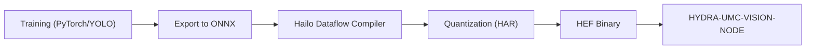

<!-- =============================================================================
HYDRA-UMC-DETECTION-HEF - Compiled-model registry
Copyright (C) JuanenRac (Electro Hobby 3D) <electrohobby3d@gmail.com>
GPL-3.0-or-later - see LICENSE
============================================================================= -->

<p align="center">
  
</p>

# 🎯 HYDRA-UMC-DETECTION-HEF

<p align="center"><a href="README.md">🇺🇸 English</a> | <a href="README_spa.md">🇪🇸 Español</a> | <a href="README_fra.md">🇫🇷 Français</a> | <a href="README_ita.md">🇮🇹 Italiano</a> | <a href="README_deu.md">🇩🇪 Deutsch</a> | <a href="README_zho.md">🇨🇳 简体中文</a> | <a href="README_jpn.md">🇯🇵 日本語</a> | 🇵🇹 <b>Português</b></p>

### 📦 Registo de modelos compilados e verificação de carga segura para modelos Hailo HEF (ainda não se compila nem se executa nenhum modelo)

<p align="center">
  
  
  
  
  
  
</p>

---

> **Estado de segurança (safety e security):** este ecossistema não é um sistema de segurança certificado. Ainda não existe um caminho de E-STOP por hardware, nem limites ou interlocks impostos pelo firmware, nem um comando de movimento verificado; as imagens de firmware são verificadas com CRC-32 e uma assinatura Ed25519, e uma compilação de versão recusa as chaves de desenvolvimento publicadas (as cabeças de ferramenta e as placas de expansão atrás do relé ainda usam os bootloaders do URTC, que aceitam um HMAC-SHA256 de chave partilhada em vez de uma assinatura); TLS e TLS mútuo são opcionais e estão desativados por defeito; nenhuma placa própria foi ainda montada ou testada. Leia a [base de segurança](https://github.com/JuanenRac/HYDRA-UMC-DOCS/blob/main/docs/SECURITY_BASELINE.md) e o [modelo de ameaças](https://github.com/JuanenRac/HYDRA-UMC-DOCS/blob/main/docs/THREAT_MODEL.md) antes de confiar em qualquer afirmação aqui para a segurança de uma pessoa.

---

## 📋 Num relance

| | |
|---|---|
| Versão | `0.1.7` |
| Maturidade | Funcional |
| Testes | 150 |
| Tecnologia | Python / Hailo SDK / HEF model registry (no model compiled yet) |
| Destino | O Raspberry Pi CM5 de uma célula HYDRA-UMC |
| Em hardware real | Ainda não: não há registo de execução em hardware real para esta versão |

**Ir para:** [Visão geral](#-visão-geral) · [Arquitetura](#-arquitetura) · [Funcionalidades](#-funcionalidades) · [Segurança e proteção](#-segurança-e-proteção) · [Interfaces](#-interfaces) · [Configuração](#-configuração) · [Início rápido](#-início-rápido) · [Testes](#-testes) · [Resolução de problemas](#-resolução-de-problemas) · [Estrutura do repositório](#-estrutura-do-repositório) · [Projetos relacionados](#-projetos-relacionados)

## 🚦 Estado do projeto

Cada linha é uma parte deste repositório e a luz diz até onde chega hoje. É escrita com o que o repositório consegue demonstrar (testes, compilações, execuções), não com o que está previsto.

🟢 Feito e verificado · 🟡 Funciona, com limites conhecidos · 🟠 Feito a meio ou ainda por verificar · 🔴 Por fazer ou a não funcionar

| Área | Estado | O que significa aqui |
|---|---|---|
| Software | 🟡 | Funciona para o seu propósito principal; a verificação de honestidade acima lista o que ainda falta |
| Testes | 🟢 | 150 testes automáticos, executados a cada alteração |
| Hardware real | 🔴 | Ainda não: não há registo de execução em hardware real para esta versão |
| Documentação | 🟢 | README em oito idiomas, verificado contra o manifesto a cada alteração |

## 🎯 Visão geral

O **HYDRA-UMC-DETECTION-HEF** destina-se a ser uma biblioteca e cadeia de ferramentas curadas para modelos de redes neuronais de alto desempenho compilados para o **Hailo Executable Format (HEF)**, afinados para ambientes industriais de microfábrica: montagem eletrónica, colocação de SMD e validação de cabeças de ferramenta.

É um dos 4 filhos do **[HYDRA-UMC-VISION-NODE](https://github.com/JuanenRac/HYDRA-UMC-VISION-NODE)**, o pai de integração da família: este projeto é dono apenas da compilação e do versionamento de modelos - a cópia servida e em execução de um modelo `.hef` é carregada e executada pelo pai, que detém o identificador do dispositivo Hailo-8, e não por este projeto.

## 🧩 Papel no HYDRA-UMC

O **HYDRA-UMC-DETECTION-HEF** é a prateleira onde os modelos compilados do nó de visão se guardam por ordem: cada modelo tem nome, versão, tarefa, forma de entrada, as suas classes e uma soma de verificação, e nada pode ser carregado se não corresponder. Ainda não foi compilado nem executado nenhum modelo num chip Hailo.

## 🏛️ Arquitetura

O diagrama abaixo é a cadeia de ferramentas de *compilação* de destino para que este projeto está a ser construído - ainda não implementada, já que cada passo precisa de hardware Hailo real. O *registo* de modelos (versionamento + verificação de integridade de quaisquer ficheiros `.hef` que este pipeline venha a produzir) é real hoje; veja "Pontos principais" acima e as decisões de desenho abaixo.

<p align="center">
  
</p>

<details>
<summary>Versão em texto do diagrama (Mermaid)</summary>



</details>

**Porque é construído assim**

### Porque não há `hardware/`/`firmware/` aqui, e porque `os/`/`models/` continuam a viver no pai

Este projeto entrega ficheiros de modelos e as ferramentas que os compilam, não um dispositivo físico - pelo que, como o resto da família do Nó de IA de Visão, não leva pasta `hardware/`/`firmware/`. Também não leva `os/` nem `models/`, apesar de os ficheiros `.hef` serem literalmente *produzidos* aqui: a cópia *servida e em execução* carregada na NPU Hailo-8 em tempo de execução vive apenas no pai de integração, [HYDRA-UMC-VISION-NODE](https://github.com/JuanenRac/HYDRA-UMC-VISION-NODE), porque é esse o processo que detém o identificador do dispositivo Hailo-8. O `build/` deste projeto é onde a saída compilada da cadeia de ferramentas deverá aterrar antes de ser publicada lá.

### O fluxo de compilação é a decisão de desenho, à frente do código

O diagrama acima já fixa a forma prevista do pipeline: o treino em PyTorch/YOLO acontece noutro sítio (fora do âmbito deste repositório), os modelos são exportados para ONNX, passam pelo Hailo Dataflow Compiler para quantização INT8/INT4 (produzindo um `.har`) e são finalmente empacotados como um binário `.hef` que o [HYDRA-UMC-VISION-NODE](https://github.com/JuanenRac/HYDRA-UMC-VISION-NODE) consome. Decidir e documentar esta forma agora, antes de escrever o código da cadeia de ferramentas, evita que a implementação futura tenha de improvisar mais tarde a história do registo/versionamento de modelos.

### Decisões de desenho já tomadas

* **Um `.hef` local em falta não é uma falha de soma de verificação** - o `verify_checksum()` devolve `None` (e não `False`) quando o ficheiro que o registo descreve não está presente em `--models-dir`, e o `registry validate` reporta-o como "ignorado", não como erro. Espera-se que o registo descreva modelos que podem viver num armazém de objetos separado, não necessariamente guardados neste repositório - só uma soma de verificação que realmente difere para um ficheiro que *está* presente indica um registo corrompido.
* **Porque o `safe_load()` verifica a arquitetura antes da soma de verificação, e não o contrário.** A compatibilidade de arquitetura são metadados puros (sem E/S); a verificação da soma precisa de ler um ficheiro real. Verificar primeiro a porta barata e fundamental significa que um modelo compilado para o chip Hailo errado é rejeitado antes de o sistema de ficheiros ser sequer tocado, e o motivo da rejeição nomeia a verificação falhada mais fundamental em vez de um enganador "ficheiro em falta" para um modelo que nunca ia correr neste hardware de qualquer forma.
* **Porque a compatibilidade de arquitetura é de correspondência exata, e não uma matriz de compatibilidade.** O Hailo Dataflow Compiler fixa o chip de destino num `.hef` em tempo de compilação - afirmar, por exemplo, que um Hailo-15H pode executar um `.hef` do Hailo-8 exigiria validação real entre arquiteturas em hardware real que este ambiente não tem. A correspondência exata é a única afirmação de compatibilidade honestamente verificável apenas a partir dos metadados do registo.

## ✨ Funcionalidades

* ✅ **Real v0 - registo de modelos:** o `registry.py` analisa e valida por esquema um registo JSON de modelos compilados, deteta entradas duplicadas de nome+versão, encontra a versão mais recente para um nome/tarefa e verifica por sha256 os ficheiros `.hef` locais contra ele. Exposto através de `registry validate`/`registry latest`/`registry add` abaixo - não precisa de SDK Hailo nem de hardware para ser executado ou testado.
* 🔒 **Real v0 - porta de carregamento seguro:** o `safe_load()` do `compatibility.py` verifica a compatibilidade real de arquitetura Hailo (`hailo8`/`hailo15h`/etc. - cada entrada do registo declara agora o seu chip de destino) antes de verificar a soma de verificação, e nunca reporta um modelo como pronto a implementar a menos que ambas as verificações reais passem. Exposto através de `registry load` abaixo.
* 🌐 **Real v0 - API JSON/HTTP:** o subcomando `serve` do `api.py` executa exatamente as mesmas verificações de registo/carregamento seguro como um serviço local de execução prolongada (por omissão `127.0.0.1:8093`) através de `GET /registry`, `GET /registry/latest`, `GET /registry/load` e `GET /stats` - o registo e o diretório de modelos são configurados uma só vez no arranque, não por pedido. Veja [`docs/CLI_REFERENCE.md`](docs/CLI_REFERENCE.md) para exemplos reais capturados de cada endpoint.
* 🛠️ **Deteção industrial (planeado):** modelos orientados para componentes de PCB, juntas de soldadura e defeitos mecânicos.
* 📐 **Alinhamento de fiduciais (planeado):** âncoras de alta precisão para a sincronização do Pick-and-Place.
* ⚡ **Desempenho quantizado (planeado):** variantes INT8/INT4 orientadas para as NPUs Hailo-8/Hailo-10 para inferência abaixo de 10 ms. *(trabalho futuro - precisa da NPU Hailo-8/Hailo-10 real e do Dataflow Compiler que este ambiente não tem.)*
* 🤖 **Estimação de pose (planeado):** deteção de pontos-chave para o seguimento das juntas de braços robóticos. *(trabalho futuro, pelo mesmo motivo.)*
* 🧩 **Porque existe como projeto próprio:** compilar e versionar modelos é um fluxo de dados/ML, inteiramente diferente do processo de execução que os serve - manter a cadeia de ferramentas aqui significa que uma má compilação nunca põe em risco o nó de perceção em execução, e que os modelos podem ser iterados e validados offline antes de alguma vez chegarem ao [HYDRA-UMC-VISION-NODE](https://github.com/JuanenRac/HYDRA-UMC-VISION-NODE).
* 📐 **Contrato de entrada e saída (opcional):** uma entrada do registo pode levar um `io_contract` que diz como alimentar o modelo (disposição, ordem das cores, tipo de dados, normalização, redimensionamento ou letterbox, valor de preenchimento) e como ler a sua saída (formato NMS, ordem das caixas, caixas normalizadas, limiares). É validado ao carregar o registo, mantido quando o registo é reescrito e a sua soma de verificação faz parte da identidade do modelo. Uma entrada sem ele carrega como antes.
* 🔐 **Bytes verificados:** `safe_load(..., keep_bytes=True)` lê o ficheiro uma vez, verifica o seu SHA-256 e devolve esses mesmos bytes, pelo que um consumidor que constrói o modelo a partir deles (o streamer de visão e a API de servo visual fazem-no) não pode receber um ficheiro que mudou depois da verificação. O `GET /stats` mostra nomes de ficheiro, não caminhos absolutos, a menos que se passe `serve --stats-full-paths`.

**Verificação de honestidade - o que realmente funciona hoje:** a metade real e independente do hardware da tarefa deste projeto - o registo de modelos (`registry.py`) e a porta real de carregamento seguro (`compatibility.py`), expostos através de `registry validate`/`registry latest`/`registry load` e, como API JSON/HTTP de execução prolongada, através de `serve` (`api.py`) - está implementada e testada (150 testes). Os passos de exportação ONNX, quantização com o Hailo Dataflow Compiler e empacotamento HAR/HEF que realmente *produziriam* os modelos que este registo descreve continuam a ser trabalho futuro: precisam de hardware Hailo real que este ambiente não tem. Veja o [`CHANGELOG.md`](CHANGELOG.md) para saber exatamente o que foi entregue até agora e "Estado atual e próximos passos" abaixo para o que continua em aberto.

Compilar um modelo (ONNX, depois o Hailo Dataflow Compiler e por fim um `.hef`) faz-se num anfitrião Linux x86_64 com o Dataflow Compiler instalado e um conjunto de calibração para a quantização; não precisa do próprio Hailo-8. Só executar o modelo compilado precisa do acelerador. `registry load` e `GET /registry/load` recusam um registo ambíguo (mesmo nome e versão com ficheiros diferentes), aceitam a arquitetura tal como o dispositivo a reporta (`HAILO8`) e permitem fixar uma versão exata com `--version` / `?version=`; `registry add` é serializado para que adições simultâneas não percam entradas. Na placa os modelos estão em `/opt/hydra-umc/detection-hef/models`.

## 🔒 Segurança e proteção

| Ameaça | Defesa | Onde |
|---|---|---|
| Carregar um modelo corrompido ou de outro chip | A porta de carga (`compatibility.py`) compara o SHA-256 do `.hef` com o registo e a arquitetura Hailo com `KNOWN_HAILO_ARCHS` (`hailo8`, `hailo8r`, `hailo8l`, `hailo15h`, `hailo15m`, `hailo15l`, `hailo10h`); carregar exige `--target-arch` | `compatibility.py`, `registry.py` |
| Uma versão duplicada ou malformada | O registo valida o seu esquema, exige versões da forma `X.Y.Z` e comunica duplicados | `registry.py` |
| Exposição à rede | A interface HTTP é só de leitura e escuta em `127.0.0.1:8093` por predefinição. Não tem token: se precisa de um ainda está em aberto | `api.py`, `main.py` |

**O que nunca faz:** não compila nada nem executa nenhum modelo: só guarda e verifica o registo de ficheiros compilados.

`GET /stats` mostra nomes de ficheiro e não caminhos absolutos, pelo que quem consulta não fica a saber onde o anfitrião guarda o seu registo e os seus modelos; `serve --stats-full-paths` volta a mostrar os caminhos completos.

## 🔌 Interfaces

HTTP em `127.0.0.1:8093` por predefinição (só leitura) e uma linha de comandos. A referência completa é `docs/CLI_REFERENCE.md`.

| Tópico ou rota | O que leva |
|---|---|
| `GET /registry`, `GET /registry/latest`, `GET /registry/load` | o registo, a última versão de um modelo e o resultado da porta de carga |
| `GET /stats` | saúde |
| `registry validate \| latest \| load \| add` | `--registry`, `--models-dir`, `--hef-path`, `--name`, `--version X.Y.Z`, `--task`, `--input-shape 640,640,3`, `--classes`, `--hailo-arch` |
| `serve` | `--registry FICHEIRO --models-dir DIR --addr 127.0.0.1 --port 8093` |

## ⚙️ Configuração

Não há variáveis de ambiente: tudo é uma opção da linha de comandos (`--registry` é sempre necessária, `--models-dir` depende do comando).

## 🚀 Início rápido

### Pré-requisitos

* **Python 3.10 ou superior** no seu `PATH` (os scripts tentam `python3` e depois recorrem a `python`).
* Ainda não é necessária nenhuma ferramenta ONNX/Hailo Dataflow Compiler - **zero dependências de execução de terceiros** nesta fase (`dependencies = []` no `pyproject.toml`).
* Algumas dezenas de MB de espaço em disco para um ambiente virtual local em `.venv/`.

### Passo a passo

```bash
# Linux / macOS
./build.sh
```

1. **Leitura da versão** - lê e mostra a versão do projeto; compilar nunca a altera (só `python tools/hydra_project_tool.py bump` a sobe).
2. **Ambiente virtual** - cria o `.venv/` se não existir; reutiliza-o caso contrário.
3. **Instalação editável** - `pip install -e ".[dev]"` para que as edições em `src/` tenham efeito de imediato, instala o `pytest` e regista o ponto de entrada de consola `hydra-umc-detection-hef`.
4. **Verificação de compilação** - `python -m compileall -q src` compila para bytecode todos os ficheiros de `src/`, apanhando erros de sintaxe em todo o ecossistema.
5. **Suite de testes real** - `python -m pytest tests/ -q` (150 testes que cobrem o registo, a porta de carregamento seguro e a CLI).

O `set -euo pipefail` pára o script no primeiro passo que falhar; a compilação só reporta êxito se os 5 passarem.

```bash
./run.sh
```

Localiza o interpretador dentro do `.venv` (tratando as estruturas POSIX e Windows do `.venv`) e executa `python -m hydra_umc_detection_hef.main`, reencaminhando quaisquer argumentos - a invocação simples imprime nome + versão + papel.

Exemplo real - validar um registo e procurar a versão mais recente de um modelo:

```bash
./run.sh registry validate --registry registry.json --models-dir models/
# 2 entries in registry.json
#   pcb-defect 0.1.0: pcb-defect-0.1.0.hef not present locally, skipped
#   pcb-defect 0.2.0: checksum OK
# registry OK

./run.sh registry latest --registry registry.json --name pcb-defect
# pcb-defect 0.2.0  task=detection  input_shape=(640, 640, 3)
# classes: solder_bridge, missing_component
# hef_path: pcb-defect-0.2.0.hef
# sha256: 1c8a52bb4a34927d55efc913b23f06bd08ff5eeee0aca2ccd8d2c0fd34c81497
```

Cada entrada do registo declara também o seu `hailo_arch` de destino (por exemplo `hailo8`). O subcomando real `registry load` combina a verificação da soma acima com uma verificação real de compatibilidade de arquitetura, e só reporta um modelo como pronto se ambas passarem:

```bash
./run.sh registry load --registry registry.json --models-dir models/ --name pcb-defect --target-arch hailo8
# READY: pcb-defect 0.2.0 (hailo8) verified and ready

./run.sh registry load --registry registry.json --models-dir models/ --name pcb-defect --target-arch hailo15h
# REJECTED_ARCH_MISMATCH: model compiled for 'hailo8', this deployment targets 'hailo15h'
```

Acrescentar um modelo novo já não significa editar o JSON à mão (incluindo o sha256 que o `verify_checksum()` apenas verificava e nunca gerava) - o `registry add` calcula o hash do ficheiro `.hef` local real e acrescenta uma entrada validada:

```bash
./run.sh registry add --registry registry.json --models-dir models/ --hef-path pcb-defect-0.3.0.hef \
  --name pcb-defect --version 0.3.0 --task detection --input-shape 640,640,3 \
  --classes solder_bridge,missing_component --hailo-arch hailo8
# added pcb-defect 0.3.0 to registry.json (sha256=<the real computed digest>)
```

O ficheiro do registo é reescrito de forma atómica (escrito ao lado, sincronizado com fsync e depois renomeado por cima), pelo que um corte de energia ou um disco cheio ao acrescentar um modelo deixa intacto o registo anterior, em vez de um ficheiro truncado.

As mesmas verificações de registo/carregamento seguro estão também acessíveis como uma API JSON/HTTP de execução prolongada através de `./run.sh serve --registry registry.json --models-dir models/` (por omissão `127.0.0.1:8093`). Veja o [`docs/CLI_REFERENCE.md`](docs/CLI_REFERENCE.md) para a referência completa de comandos e endpoints, com cada exemplo capturado de uma execução real.

```bat
:: Windows - passos idênticos, sintaxe batch
build.bat
run.bat
```

## 🧪 Testes

150 testes automáticos correm com `python -m pytest tests/ -q`: o registo, a porta de carga segura, a linha de comandos e a interface HTTP. Não usam ferramentas Hailo, hardware nem rede externa.

A CI executa `HYDRA_UMC_CI=1 python tools/ci_validate.py`, que verifica o manifesto, os documentos, os oito README e as imagens.

## 🏗️ Compilação e publicação

Não há nada para compilar numa publicação: `build.sh` / `build.bat` criam o ambiente virtual, instalam o pacote em modo editável e executam os testes, e `build-test` apenas verifica. Compilar nunca muda a versão; só a sobe `python tools/hydra_project_tool.py bump`, que também avança o registo de alterações. A versão do pacote, do manifesto e do registo tem de coincidir, senão o `ci_validate.py` falha.

## 🩺 Resolução de problemas

* **`python`/`python3` não encontrado** - instale o Python 3.10+ e confirme que está no `PATH`.
* **O `compileall` falha** - foi introduzido um erro de sintaxe real em `src/`; a compilação pára sem tocar na instalação, de propósito.
* **"No `.venv` found" do `run.sh`/`run.bat`** - execute primeiro o `build.sh`/`build.bat` pelo menos uma vez.
* **Instalação editável obsoleta** - apague o `.venv/` e recompile; raramente necessário.

## 📂 Estrutura do repositório

<p align="center">
  
</p>

<details>
<summary>Versão em texto da árvore</summary>

```text
HYDRA-UMC-DETECTION-HEF/
├── src/hydra_umc_detection_hef/
│   ├── registry.py                              o registo de modelos compilados
│   ├── compatibility.py                         a porta de carga segura de um .hef
│   ├── api.py                                   interface HTTP só de leitura
│   └── main.py                                  linha de comandos e arranque
├── tests/                                       93 testes
├── docs/                                        a referência da linha de comandos
├── systemd/                                     unidade de serviço para o CM5
├── tools/                                       executor de compilação e testes, subida de versão, validador de CI, geradores e verificações de README e imagens
├── images/                                      faixa e imagens do README
├── .github/                                     fluxo de CI e modelos de questões
├── pyproject.toml                               metadados do pacote e dependências
├── hydra-umc.project.json                       manifesto: versão, maturidade, família
├── CHANGELOG.md                                 o que mudou em cada versão
├── build.sh build.bat                           scripts de compilação (nunca mudam a versão)
├── build-test.sh build-test.bat                 scripts de compilação (nunca mudam a versão)
├── test.sh test.bat                             executam os testes
├── Dockerfile                                   imagem de contentor
├── bump_version.py / bump_manifest_version.py   subida de versão explícita
├── run.sh run.bat                               arrancar o serviço
└── SECURITY.md SUPPORT.md CONTRIBUTING.md CODE_OF_CONDUCT.md LICENSE LICENSE.md
```

</details>

## 🗺️ Roteiro e limites conhecidos

**Limites conhecidos hoje**

**O que funciona hoje:** o registo de modelos - validação de esquema (incluindo metadados de arquitetura Hailo obrigatórios e validados), deteção de versões duplicadas, procura da versão mais recente e verificação de integridade sha256 (`registry.py`) - mais uma porta de carregamento seguro real e combinada, que verifica em conjunto a compatibilidade de arquitetura e a integridade da soma de verificação e nunca reporta um modelo como pronto a menos que ambas passem (`compatibility.py`), as mesmas verificações expostas como uma API JSON/HTTP real de execução prolongada (`api.py`, subcomando `serve`) a par da CLI de uma só execução, 150 testes no total, e um pacote Python real e instalável com um ponto de entrada verificado e um comando `bump` explícito, ao estilo conta-quilómetros, que sobe a versão (compilar nunca a altera). Veja o [`CHANGELOG.md`](CHANGELOG.md) para a saída capturada de compilação/execução.

**O que continua em aberto, sem ordem particular, sem calendário comprometido e dependente de hardware Hailo real:**

* O passo real de exportação ONNX a partir de modelos PyTorch/YOLO treinados.
* A integração do Hailo Dataflow Compiler para quantização INT8/INT4. Os passos manuais estão descritos em [`docs/COMPILING_A_HEF.md`](docs/COMPILING_A_HEF.md); o script que os automatiza aguarda uma licença do Dataflow Compiler.
* O empacotamento HAR/HEF que realmente preencheria um ficheiro de registo que o `registry.py` deste projeto já sabe ler e validar.
* A publicação da saída `.hef` compilada na pasta `models/` do [HYDRA-UMC-VISION-NODE](https://github.com/JuanenRac/HYDRA-UMC-VISION-NODE).

## 🌍 Idiomas

Este README e os documentos do repositório existem em oito idiomas: inglês, espanhol, alemão, francês, italiano, japonês, chinês e português (Portugal). São escritos em conjunto e a CI verifica que os oito ficheiros têm as mesmas secções e as mesmas ligações. Este repositório não tem ecrã nem catálogo de mensagens próprios, por isso não há textos de interface para traduzir.

## 🔗 Projetos relacionados

Este projeto faz parte do ecossistema de robótica HYDRA-UMC do mesmo autor (JuanenRac / Electro Hobby 3D). Vale a pena conhecê-los, porque um pedido pode ser, na verdade, sobre um destes e não sobre este repositório.

**Projeto-mãe**
- **[HYDRA-UMC-VISION-NODE](https://github.com/JuanenRac/HYDRA-UMC-VISION-NODE)** — centro de integração do pipeline de visão Hailo-8, com uma verificação real de prontidão de hardware por etapa; o projeto-mãe de que este repositório é uma etapa ou consumidor específico, dentro do seu próprio pipeline de perceção.

**Projetos irmãos** — as outras etapas/consumidores do próprio pipeline de perceção Hailo-8 do HYDRA-UMC-VISION-NODE
- **[HYDRA-UMC-VISION-STREAMER](https://github.com/JuanenRac/HYDRA-UMC-VISION-STREAMER)** — pipeline GStreamer real e gerador de configuração MediaMTX com uma fronteira de integração HailoRT real.
- **[HYDRA-UMC-SAFETY-ZONES](https://github.com/JuanenRac/HYDRA-UMC-SAFETY-ZONES)** — lógica v0 de violação de zonas, atualidade da calibração e pedido de E-STOP que lê as posições dos objetos de um ficheiro; nenhum detetor a alimenta e ainda não há E-STOP físico ligado.
- **[HYDRA-UMC-VISUAL-SERVOING-API](https://github.com/JuanenRac/HYDRA-UMC-VISUAL-SERVOING-API)** — lei de correção de servovisão baseada em posição com autorização condicionada ao estado da zona; ainda sem estimativa de pose por câmara.

**Diretamente relacionados**
- **[URTC](https://github.com/JuanenRac/URTC)** — firmware da placa física Universal Robot Tool Controller, mais de 25 perfis de ferramenta por barramento CAN; o reconhecimento visual das próprias cabeças de ferramenta do URTC depende de modelos compilados aqui.

**Também fazem parte do ecossistema**

*Hardware e plataforma centrais*
- **[HYDRA-UMC](https://github.com/JuanenRac/HYDRA-UMC)** — o desenho da placa-mãe do braço robótico: anfitrião CM5 + STM32H745 de dois núcleos, pensado para orquestrar até 8 braços de ferramenta por CAN-OTA/SPI-OTA (firmware numa fase inicial; ainda sem placa montada).
- **[HYDRA-UMC-OS](https://github.com/JuanenRac/HYDRA-UMC-OS)** — camada de produto reproduzível do Raspberry Pi OS para o CM5: agente só de leitura, configuração/perfis validados, aprovisionamento Wi-Fi de primeiro contacto.
- **[HYDRA-UMC-SDK](https://github.com/JuanenRac/HYDRA-UMC-SDK)** — o contrato JSON-Schema partilhado e a fronteira de software de controlo de trabalhos contra a qual cada bridge valida os seus comandos (não é uma função de segurança certificada).
- **[HYDRA-UMC-CONNECTOR-HUB](https://github.com/JuanenRac/HYDRA-UMC-CONNECTOR-HUB)** — registo declarativo de manifestos de adaptador e validador para conectores de máquinas externas; estende a ideia de contrato do SDK a máquinas externas sem substituir os projetos de gateway industrial.

*Backend central e clientes*
- **[HYDRA-UMC-SERVER](https://github.com/JuanenRac/HYDRA-UMC-SERVER)** — o back-end headless real (REST/WebSocket) com que todos os clientes de controlo realmente comunicam.
- **[HYDRA-UMC-STUDIO](https://github.com/JuanenRac/HYDRA-UMC-STUDIO)** — painel web de controlo com visualização 3D em tempo real de vários robôs.
- **[HYDRA-UMC-SUITE](https://github.com/JuanenRac/HYDRA-UMC-SUITE)** — centro de comando de enxame para desktop (PySide6) para vários servidores ao mesmo tempo, empacotado como executável independente.
- **[HYDRA-UMC-ANDROID-CONTROL](https://github.com/JuanenRac/HYDRA-UMC-ANDROID-CONTROL)** — aplicação Android nativa de controlo, com início de sessão biométrico e um companheiro Wear OS emparelhado.
- **[HYDRA-UMC-IOS-CONTROL](https://github.com/JuanenRac/HYDRA-UMC-IOS-CONTROL)** — aplicação de controlo para iOS/iPadOS (Flutter) com sincronização WebSocket em tempo real.
- **[HYDRA-UMC-DSI](https://github.com/JuanenRac/HYDRA-UMC-DSI)** — interface tátil nativa para o ecrã tátil DSI de 7" integrado, executada no próprio CM5.
- **[HYDRA-UMC-EDITOR-URDF](https://github.com/JuanenRac/HYDRA-UMC-EDITOR-URDF)** — criador/editor gráfico de URDF para desktop que envia os modelos concluídos para o catálogo do STUDIO.
- **[HYDRA-UMC-EDITOR-STL](https://github.com/JuanenRac/HYDRA-UMC-EDITOR-STL)** — editor de modelos STL para desktop que transforma/substitui/remove/adiciona peças reais no mesmo catálogo de modelos que o HYDRA-UMC-EDITOR-URDF também edita.
- **[HYDRA-UMC-BRIDGE-AMR](https://github.com/JuanenRac/HYDRA-UMC-BRIDGE-AMR)** — fronteira de coordenação para frotas AGV/AMR através de um publicador MQTT VDA 5050 (testado apenas contra uma frota emulada).
- **[HYDRA-UMC-BRIDGE-CNC](https://github.com/JuanenRac/HYDRA-UMC-BRIDGE-CNC)** — coordenador de células CNC de alto nível com acesso ao estado GRBL e aos bytes de controlo (testado apenas contra um emulador).
- **[HYDRA-UMC-BRIDGE-DROIDS](https://github.com/JuanenRac/HYDRA-UMC-BRIDGE-DROIDS)** — fronteira de coordenação para droides com patas/humanoides, com um emissor de comandos para o Boston Dynamics Spot (testado apenas contra um emulador).
- **[HYDRA-UMC-BRIDGE-LASER](https://github.com/JuanenRac/HYDRA-UMC-BRIDGE-LASER)** — coordenador de células laser que lê 3 sinais GPIO (chave, caixa e interlock) (testado apenas contra um chip simulado; não pode armar nem disparar um laser).
- **[HYDRA-UMC-BRIDGE-OPENPNP](https://github.com/JuanenRac/HYDRA-UMC-BRIDGE-OPENPNP)** — coordenador seguro de fluxo de placa de alto nível para pick-and-place com OpenPnP.
- **[HYDRA-UMC-BRIDGE-PRINTER3D](https://github.com/JuanenRac/HYDRA-UMC-BRIDGE-PRINTER3D)** — fronteira de coordenação segura para impressoras 3D Moonraker/Klipper, com comandos de trabalho reais protegidos por portas.
- **[HYDRA-UMC-BRIDGE-ROS2](https://github.com/JuanenRac/HYDRA-UMC-BRIDGE-ROS2)** — coordenador com um transporte ROS 2 baseado em rclpy importado sob demanda (ainda não executado contra uma instalação ROS 2).
- **[HYDRA-UMC-BRIDGE-UAV](https://github.com/JuanenRac/HYDRA-UMC-BRIDGE-UAV)** — fronteira de coordenação para UAV com câmara, com um emissor de comandos MAVLink (testado apenas contra um emulador).

*Plataforma de ferramentas URTC*
- **[URTC-FLASHER](https://github.com/JuanenRac/URTC-FLASHER)** — ferramenta gráfica de gravação para desktop das placas URTC, por CAN-OTA e também SWD/JTAG de chip completo.
- **[URTC-TESTER](https://github.com/JuanenRac/URTC-TESTER)** — ferramenta de diagnóstico CAN em tempo real para desktop das placas URTC, com um painel por perfil de ferramenta.
- **[URTC-WEB-STUDIO](https://github.com/JuanenRac/URTC-WEB-STUDIO)** — alternativa no navegador ao URTC-TESTER através da Web Serial API, sem instalação local.
- **[URTC-GATEWAY](https://github.com/JuanenRac/URTC-GATEWAY)** — gateway à frente do barramento CAN do URTC: lista de identificadores permitidos, limite de taxa e chave de sessão; software testado num computador, ainda não num barramento real.

*Nó de IA cognitiva (Hailo-10)*
- **[HYDRA-UMC-COGNITIVE-NODE](https://github.com/JuanenRac/HYDRA-UMC-COGNITIVE-NODE)** — centro de integração do pipeline cognitivo do Hailo-10 (orquestração de LLM/VLA/voz).
- **[HYDRA-UMC-VLA-ENGINE](https://github.com/JuanenRac/HYDRA-UMC-VLA-ENGINE)** — codificação/descodificação real de tokens de ação e geração de trajetórias para um modelo Visão-Linguagem-Ação.
- **[HYDRA-UMC-VOICE-UI](https://github.com/JuanenRac/HYDRA-UMC-VOICE-UI)** — front-end de voz real (VAD + analisador de intenções) com um relé para o relógio limitado e protegido por confirmação.
- **[HYDRA-UMC-SEMANTIC-PLANNER](https://github.com/JuanenRac/HYDRA-UMC-SEMANTIC-PLANNER)** — decomposição real de tarefas baseada em regras e recuperação semântica de erros sobre os códigos de erro do MCU.
- **[HYDRA-UMC-DOCS-QA](https://github.com/JuanenRac/HYDRA-UMC-DOCS-QA)** — pesquisa real de documentos TF-IDF só com a biblioteca padrão sobre a documentação Markdown deste ecossistema.
- **[HYDRA-UMC-LOCAL-TECHNICIAN](https://github.com/JuanenRac/HYDRA-UMC-LOCAL-TECHNICIAN)** — técnico de manutenção de IA local, protegido por políticas, para o próprio ecossistema: observa, diagnostica e propõe correções; os dois níveis de maior risco não estão implementados de propósito.

*Orquestração e enxame*
- **[HYDRA-UMC-ORCHESTRATOR](https://github.com/JuanenRac/HYDRA-UMC-ORCHESTRATOR)** — centro de integração com um contrato real de relatório de saúde gRPC/Protobuf e uma máquina de estados de missões.
- **[HYDRA-UMC-JOB-DISPATCHER](https://github.com/JuanenRac/HYDRA-UMC-JOB-DISPATCHER)** — fila real de trabalhos por prioridade com deduplicação, sobre uma API HTTP real.
- **[HYDRA-UMC-NODE-HEALING](https://github.com/JuanenRac/HYDRA-UMC-NODE-HEALING)** — vigilante real de saúde da frota por gRPC com repetição/recuo e deteção de identidade incoerente.
- **[HYDRA-UMC-PATH-PLANNER-3D](https://github.com/JuanenRac/HYDRA-UMC-PATH-PLANNER-3D)** — planeador real de trajetórias 3D baseado em RRT com validação real de colisões com obstáculos e espaço de trabalho.
- **[HYDRA-UMC-SWARM-SYNC](https://github.com/JuanenRac/HYDRA-UMC-SWARM-SYNC)** — sincronização real de estado CRDT LWW-Element-Map, testada por propriedades para a convergência de várias células.

*Gémeo digital e simulação*
- **[HYDRA-UMC-TWIN](https://github.com/JuanenRac/HYDRA-UMC-TWIN)** — centro de integração do motor de gémeo digital, com um contrato real de sincronização de compatibilidade de versões.
- **[HYDRA-UMC-HIL-BRIDGE](https://github.com/JuanenRac/HYDRA-UMC-HIL-BRIDGE)** — encaminhador hardware-in-the-loop com um interlock de software de colisão entre a simulação e o hardware real (testado sem hardware real).
- **[HYDRA-UMC-PHYSICS-REPLICA](https://github.com/JuanenRac/HYDRA-UMC-PHYSICS-REPLICA)** — cinemática direta real e validação de limites de juntas sobre um subconjunto real de URDF.
- **[HYDRA-UMC-SYNTHETIC-DATA-GEN](https://github.com/JuanenRac/HYDRA-UMC-SYNTHETIC-DATA-GEN)** — gerador procedural real de cenas 2D com exportação de anotações YOLO/COCO.

*Dados e análise*
- **[HYDRA-UMC-DATALAKE](https://github.com/JuanenRac/HYDRA-UMC-DATALAKE)** — armazém real de séries temporais sobre sqlite3 com uma API HTTP real de ingestão/consulta.
- **[HYDRA-UMC-ANOMALY-DETECTOR](https://github.com/JuanenRac/HYDRA-UMC-ANOMALY-DETECTOR)** — detetor real de anomalias por FFT e linha de base estatística, com monitorização de deriva.
- **[HYDRA-UMC-PRODUCTION-REPORTS](https://github.com/JuanenRac/HYDRA-UMC-PRODUCTION-REPORTS)** — cálculo real de OEE/disponibilidade sobre o histórico do DATALAKE, com exportação CSV reprodutível.
- **[HYDRA-UMC-TELEMETRY-COLLECTOR](https://github.com/JuanenRac/HYDRA-UMC-TELEMETRY-COLLECTOR)** — pipeline real de ingestão CAN/WebSocket para o DATALAKE, com deduplicação por sequência.

*Gateway industrial*
- **[HYDRA-UMC-GATEWAY-INDUSTRIAL](https://github.com/JuanenRac/HYDRA-UMC-GATEWAY-INDUSTRIAL)** — centro de integração que retransmite para protocolos industriais, com uma camada real de lista de comandos permitidos e contrapressão.
- **[HYDRA-UMC-OPCUA-SERVER](https://github.com/JuanenRac/HYDRA-UMC-OPCUA-SERVER)** — espaço de endereços OPC-UA real, verificado com uma sessão de cliente real do protocolo binário.
- **[HYDRA-UMC-MQTT-BROKER](https://github.com/JuanenRac/HYDRA-UMC-MQTT-BROKER)** — broker MQTT real com autenticação opcional por cliente e ACL de tópicos.
- **[HYDRA-UMC-MTCONNECT-ADAPTER](https://github.com/JuanenRac/HYDRA-UMC-MTCONNECT-ADAPTER)** — endpoints XML MTConnect `/probe` e `/current` reais com saída em modo degradado.

*Ferramentas complementares e operações do ecossistema*
- **[HYDRA-UMC-DASHBOARD-AI](https://github.com/JuanenRac/HYDRA-UMC-DASHBOARD-AI)** — painéis de Resumos Inteligentes e Realce de Anomalias sobre o DATALAKE/ANOMALY-DETECTOR, com um recurso estatístico honesto.
- **[HYDRA-UMC-TOOL-CLI](https://github.com/JuanenRac/HYDRA-UMC-TOOL-CLI)** — CLI da frota com um contrato de códigos de saída real e estável, um cliente vivo genuíno da API do HYDRA-UMC-SERVER.
- **[HYDRA-UMC-WATCH](https://github.com/JuanenRac/HYDRA-UMC-WATCH)** — aplicação companheira WearOS com padrões de alerta tátil e um relé de voz para o telemóvel emparelhado (ainda não executada num relógio físico).
- **[URTC-SMART-RACK](https://github.com/JuanenRac/URTC-SMART-RACK)** — firmware de um rack de montagem de placas com descodificação real do ID da ferramenta e lógica de pré-aquecimento Smart Idle.
- **[URTC-VISION-TOOL](https://github.com/JuanenRac/URTC-VISION-TOOL)** — firmware mais um companheiro de visão em Python real para uma cabeça de ferramenta de inspeção térmica/RGB.
- **[HYDRA-UMC-UPDATER](https://github.com/JuanenRac/HYDRA-UMC-UPDATER)** — ferramenta administrativa de desktop que descobre, clona e atualiza todos os repositórios deste ecossistema.
- **[HYDRA-UMC-OS-REBUILDER](https://github.com/JuanenRac/HYDRA-UMC-OS-REBUILDER)** — ferramenta de desktop para Windows/Linux que constrói uma imagem do CM5 pronta a gravar com as versões mais recentes do ecossistema, com configuração de primeiro arranque de Wi-Fi/utilizador/SSH ao estilo do Raspberry Pi Imager.
- **[HYDRA-UMC-OPS-AGENT](https://github.com/JuanenRac/HYDRA-UMC-OPS-AGENT)** — coordenador de incidentes de manutenção: um papel de borda de poucos privilégios recolhe um inventário/estado higienizado, um papel de plano de controlo mostra-o só de leitura e pede a um fornecedor de IA que sugira um diagnóstico; nunca aplica um patch nem implanta nada.
- **[HYDRA-UMC-DEV-SERVER](https://github.com/JuanenRac/HYDRA-UMC-DEV-SERVER)** — anfitrião de desenvolvimento reproduzível (Raspberry Pi 5 / CM5) que guarda o código-fonte do ecossistema e executa tarefas limitadas de compilação/teste numa fila durável; um papel de desenvolvimento dedicado, explicitamente não um CM5 operacional.

## 📚 Documentação

Onde ler mais:

* [docs/CLI_REFERENCE.md](docs/CLI_REFERENCE.md) - cada comando e opção, as rotas HTTP e os códigos de saída
* [Base de segurança do ecossistema](https://github.com/JuanenRac/HYDRA-UMC-DOCS/blob/main/docs/SECURITY_BASELINE.md)
* [Modelo de ameaças do ecossistema](https://github.com/JuanenRac/HYDRA-UMC-DOCS/blob/main/docs/THREAT_MODEL.md)
* [Registo de alterações deste repositório](CHANGELOG.md)
* [Licença deste repositório](LICENSE.md)

## 🤝 Contribuir e comunidade

* Antes de um pull request execute `HYDRA_UMC_CI=1 py -3 tools/ci_validate.py` (ou `HYDRA_UMC_CI=1 python3 tools/ci_validate.py`): tem de imprimir `CI_VALIDATION=PASS`. Não execute `build.sh` nem `build.bat` para esta verificação; compilar não é verificar.
* Os oito README são escritos a partir de uma única fonte em HYDRA-UMC-DOCS; não os edite à mão. Altere a fonte e escreva-os de novo com `tools/make_readmes.py`.
* Não afirme num README o que não foi executado: diga «simulado» ou «não testado em hardware» quando for a verdade.
* Consulte [CONTRIBUTING.md](CONTRIBUTING.md), o [código de conduta](CODE_OF_CONDUCT.md), [SECURITY.md](SECURITY.md) e [SUPPORT.md](SUPPORT.md).

## 👤 AUTOR

**JuanenRac (Electro Hobby 3D)** · electrohobby3d@gmail.com

## 📜 LICENÇA

GPL-3.0-or-later - [LICENSE](LICENSE).
