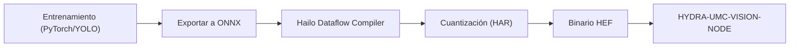

<!-- =============================================================================
HYDRA-UMC-DETECTION-HEF - Compiled-model registry
Copyright (C) JuanenRac (Electro Hobby 3D) <electrohobby3d@gmail.com>
GPL-3.0-or-later - see LICENSE
============================================================================= -->

<p align="center">
  
</p>

# 🎯 HYDRA-UMC-DETECTION-HEF

<p align="center"><a href="README.md">🇺🇸 English</a> | 🇪🇸 <b>Español</b> | <a href="README_fra.md">🇫🇷 Français</a> | <a href="README_ita.md">🇮🇹 Italiano</a> | <a href="README_deu.md">🇩🇪 Deutsch</a> | <a href="README_zho.md">🇨🇳 简体中文</a> | <a href="README_jpn.md">🇯🇵 日本語</a> | <a href="README_por.md">🇵🇹 Português</a></p>

### 📦 Registro de modelos compilados y control de carga segura para modelos Hailo HEF (todavía no se compila ni se ejecuta ningún modelo)

<p align="center">
  
  
  
  
  
  
</p>

---

> **Estado de seguridad física y de ciberseguridad:** este ecosistema no es un sistema de seguridad certificado. Todavía no existe una ruta de E-STOP por hardware, ni límites ni enclavamientos aplicados por el firmware, ni un comando de movimiento verificado; las imágenes de firmware se comprueban con CRC-32 y una firma Ed25519, y una compilación de versión rechaza las claves de desarrollo publicadas (los cabezales de herramienta y las placas de expansión detrás del relé siguen con cargadores de URTC, que usan un HMAC-SHA256 de clave compartida en lugar de una firma); TLS y TLS mutuo son opcionales y están desactivados por defecto; aún no se ha poblado ni probado ninguna placa propia. Lee la [línea base de seguridad](https://github.com/JuanenRac/HYDRA-UMC-DOCS/blob/main/docs/SECURITY_BASELINE.md) y el [modelo de amenazas](https://github.com/JuanenRac/HYDRA-UMC-DOCS/blob/main/docs/THREAT_MODEL.md) antes de fiarte de cualquier afirmación de aquí para la seguridad de una persona.

---

## 📋 De un vistazo

| | |
|---|---|
| Versión | `0.1.6` |
| Madurez | Funcional |
| Tests | 93 |
| Tecnología | Python / Hailo SDK / HEF model registry (no model compiled yet) |
| Destino | La Raspberry Pi CM5 de una celda HYDRA-UMC |
| En hardware real | Todavía no: no consta ninguna ejecución en hardware real para esta versión |

**Ir a:** [Resumen](#-resumen) · [Arquitectura](#-arquitectura) · [Funciones](#-funciones) · [Seguridad y protección](#-seguridad-y-protección) · [Interfaces](#-interfaces) · [Configuración](#-configuración) · [Inicio rápido](#-inicio-rápido) · [Pruebas](#-pruebas) · [Resolución de problemas](#-resolución-de-problemas) · [Estructura del repositorio](#-estructura-del-repositorio) · [Proyectos relacionados](#-proyectos-relacionados)

## 🚦 Estado del proyecto

Cada línea es una parte de este repositorio y la luz dice hasta dónde llega hoy. Se escribe con lo que el repositorio puede demostrar (pruebas, compilaciones, ejecuciones), no con lo previsto.

🟢 Hecho y verificado · 🟡 Funciona, con límites conocidos · 🟠 Hecho a medias o sin verificar · 🔴 Sin hacer o sin funcionar

| Área | Estado | Qué significa aquí |
|---|---|---|
| Software | 🟡 | Funciona para su propósito principal; la comprobación de honestidad de arriba lista lo que aún falta |
| Pruebas | 🟢 | 93 pruebas automáticas, ejecutadas en cada cambio |
| Hardware real | 🔴 | Todavía no: no consta ninguna ejecución en hardware real para esta versión |
| Documentación | 🟢 | README en ocho idiomas, comprobado contra el manifiesto en cada cambio |

## 🎯 Resumen

**HYDRA-UMC-DETECTION-HEF** está pensado para ser una librería y toolchain curada de modelos de red neuronal de alto rendimiento compilados al **Hailo Executable Format (HEF)**, ajustados para entornos de micro-fábrica industrial: ensamblaje de electrónica, colocación SMD y validación de cabezales de herramienta.

Compilar un modelo (ONNX, luego el Hailo Dataflow Compiler y por último un `.hef`) se hace en un equipo Linux x86_64 con el Dataflow Compiler instalado y un conjunto de calibración para la cuantización; no necesita el propio Hailo-8. Solo ejecutar el modelo compilado necesita el acelerador. `registry load` y `GET /registry/load` rechazan un registro ambiguo (mismo nombre y versión con ficheros distintos), aceptan la arquitectura tal como la informa el dispositivo (`HAILO8`) y permiten fijar una versión exacta con `--version` / `?version=`; `registry add` se serializa para que las altas simultáneas no pierdan entradas. En la placa los modelos están en `/opt/hydra-umc/detection-hef/models`.

Este es uno de los 4 hijos de **[HYDRA-UMC-VISION-NODE](https://github.com/JuanenRac/HYDRA-UMC-VISION-NODE)**, el padre de integración de la familia: este proyecto solo posee la compilación y versionado de modelos - la copia servida en ejecución de un modelo `.hef` la carga y ejecuta el padre, que posee el handle del dispositivo Hailo-8, no este proyecto.

## 🧩 Papel en HYDRA-UMC

**HYDRA-UMC-DETECTION-HEF** es el estante donde se guardan en orden los modelos compilados del nodo de visión: cada modelo tiene un nombre, una versión, una tarea, una forma de entrada, sus clases y una suma de comprobación, y no se puede cargar nada que no coincida. Todavía no se ha compilado ni ejecutado ningún modelo en un chip Hailo.

## 🏛️ Arquitectura

El diagrama de abajo es el toolchain de *compilación* objetivo hacia el que se construye este proyecto - todavía sin implementar, porque cada paso necesita hardware Hailo real. El *registro* de modelos (versionado + verificación de integridad de los `.hef` que este pipeline eventualmente produzca) es real hoy; ver "Puntos Clave" arriba y las decisiones de diseño más abajo.

<p align="center">
  
</p>

<details>
<summary>Versión en texto del diagrama (Mermaid)</summary>



</details>

**Por qué está hecho así**

### Por qué no hay `hardware/`/`firmware/` aquí, y por qué `os/`/`models/` siguen viviendo en el padre

Este proyecto distribuye archivos de modelo y las herramientas que los compilan, no un dispositivo físico - así que, como el resto de la familia Vision AI Node, no lleva carpeta `hardware/`/`firmware/`. Tampoco lleva `os/` ni `models/`, aunque los `.hef` se *producen* literalmente aquí: la copia *servida en ejecución* cargada en la NPU Hailo-8 en tiempo de ejecución vive solo en el padre de integración, [HYDRA-UMC-VISION-NODE](https://github.com/JuanenRac/HYDRA-UMC-VISION-NODE), porque es el proceso dueño del handle del dispositivo Hailo-8. El propio `build/` de este proyecto es donde está pensado que aterrice la salida compilada del toolchain antes de publicarse allí.

### El flujo de compilación es la decisión de diseño, antes que el código

El diagrama de arriba ya fija la forma prevista del pipeline: el entrenamiento PyTorch/YOLO ocurre en otro lugar (fuera del alcance de este repositorio), los modelos se exportan a ONNX, pasan por el Hailo Dataflow Compiler para cuantización INT8/INT4 (produciendo un `.har`), y finalmente se empaquetan como un binario `.hef` que consume [HYDRA-UMC-VISION-NODE](https://github.com/JuanenRac/HYDRA-UMC-VISION-NODE). Decidir y documentar esta forma ahora, antes de escribir el código del toolchain, evita que la implementación final tenga que improvisar más adelante la historia del registro/versionado de modelos.

### Decisiones de diseño ya tomadas

* **Un archivo `.hef` local ausente no es un fallo de checksum** - `verify_checksum()` devuelve `None` (no `False`) cuando el archivo que describe el registro no está presente bajo `--models-dir`, y `registry validate` lo reporta como "skipped", no como error. Se espera que el registro describa modelos que pueden vivir en un almacén de objetos separado, no necesariamente incluido en este repo - solo un checksum que realmente no coincide para un archivo que sí está presente indica un registro corrupto.
* **Por qué `safe_load()` comprueba arquitectura antes que checksum, no al revés.** La compatibilidad de arquitectura es metadata pura (sin I/O); la verificación de checksum necesita leer un archivo real. Comprobar primero la verja barata y fundamental significa que un modelo compilado para el chip Hailo equivocado se rechaza antes de tocar siquiera el sistema de archivos, y la razón del rechazo nombra la comprobación fundamental que realmente falló en vez de un "archivo ausente" engañoso para un modelo que nunca iba a correr en este hardware de todas formas.
* **Por qué la compatibilidad de arquitectura es coincidencia exacta, no una matriz de compatibilidad.** El Hailo Dataflow Compiler graba el chip objetivo en el `.hef` en tiempo de compilación - afirmar que, por ejemplo, un Hailo-15H puede correr un `.hef` de Hailo-8 necesitaría validación cruzada de arquitecturas en hardware real que este entorno no tiene. La coincidencia exacta es la única afirmación de compatibilidad honestamente verificable solo con la metadata del registro.

## ✨ Funciones

* ✅ **Real v0 - registro de modelos:** `registry.py` parsea y valida por esquema un registro JSON de modelos compilados, detecta entradas duplicadas nombre+versión, encuentra la última versión para un nombre/tarea, y verifica archivos `.hef` locales por checksum sha256 contra el registro. Expuesto vía `registry validate`/`registry latest`/`registry add` más abajo - no hace falta el SDK de Hailo ni hardware para ejecutarlo ni testearlo.
* 🔒 **Real v0 - verja de carga segura:** `safe_load()` de `compatibility.py` comprueba la compatibilidad real de arquitectura Hailo (`hailo8`/`hailo15h`/etc. - cada entrada del registro ahora declara su chip objetivo) antes de verificar el checksum, y nunca reporta un modelo listo para desplegar a menos que ambas comprobaciones reales pasen. Expuesto vía `registry load` más abajo.
* 🌐 **Real v0 - API JSON/HTTP:** el subcomando `serve` de `api.py` ejecuta exactamente las mismas comprobaciones de registro/carga segura como un servicio local de larga duración (por defecto `127.0.0.1:8093`) vía `GET /registry`, `GET /registry/latest`, `GET /registry/load` y `GET /stats` - el registro y el directorio de modelos se configuran una sola vez al arrancar, no por petición. Ver [`docs/CLI_REFERENCE.md`](docs/CLI_REFERENCE.md) para ejemplos reales capturados de cada endpoint.
* 🛠️ **Detección Industrial (previsto):** modelos orientados a componentes de PCB, soldaduras y defectos mecánicos.
* 📐 **Alineación de Fiduciales (previsto):** anclas de alta precisión para sincronización Pick-and-Place.
* ⚡ **Rendimiento Cuantizado (previsto):** variantes INT8/INT4 orientadas a las NPU Hailo-8/Hailo-10 para inferencia sub-10ms. *(trabajo futuro - necesita la NPU Hailo-8/Hailo-10 real y el Dataflow Compiler que este entorno no tiene.)*
* 🤖 **Estimación de Pose (previsto):** detección de puntos clave para seguimiento de articulaciones del brazo robótico. *(trabajo futuro, mismo motivo.)*
* 🧩 **Por qué existe como proyecto separado:** compilar y versionar modelos es un flujo de trabajo de datos/ML, completamente distinto del proceso en tiempo de ejecución que los sirve - mantener el toolchain aquí significa que una compilación fallida nunca pone en riesgo el nodo de percepción en ejecución, y los modelos se pueden iterar y validar offline antes de llegar a [HYDRA-UMC-VISION-NODE](https://github.com/JuanenRac/HYDRA-UMC-VISION-NODE).
* 📐 **Contrato de entrada y salida (opcional):** una entrada del registro puede llevar un `io_contract` que dice cómo alimentar el modelo (disposición, orden de colores, tipo de dato, normalización, redimensionado o letterbox, valor de relleno) y cómo leer su salida (formato NMS, orden de las cajas, cajas normalizadas, umbrales). Se valida al cargar el registro, se conserva cuando el registro se reescribe y su suma de comprobación forma parte de la identidad del modelo. Una entrada sin él se carga como antes.
* 🔐 **Bytes verificados:** `safe_load(..., keep_bytes=True)` lee el fichero una vez, comprueba su SHA-256 y devuelve esos mismos bytes, de modo que un consumidor que construye el modelo a partir de ellos (lo hacen el streamer de visión y la API de servo visual) no puede recibir un fichero que cambió tras la comprobación. `GET /stats` muestra nombres de fichero, no rutas absolutas, salvo que se pase `serve --stats-full-paths`.

**Comprobación de honestidad - qué funciona hoy de verdad:** la mitad real e independiente de hardware del trabajo de este proyecto - el registro de modelos (`registry.py`) y la verja real de carga segura (`compatibility.py`), expuestos vía `registry validate`/`registry latest`/`registry load` y, como API JSON/HTTP de larga duración, vía `serve` (`api.py`) - está implementada y testeada (93 tests). La exportación ONNX, la cuantización con el Hailo Dataflow Compiler y el empaquetado HAR/HEF que producirían de verdad los modelos que describe este registro siguen siendo trabajo futuro: necesitan hardware Hailo real que este entorno no tiene. Ver [`CHANGELOG.md`](CHANGELOG.md) para lo entregado exactamente hasta ahora, y "Estado Actual y Próximos Pasos" más abajo para lo que sigue abierto.

## 🔒 Seguridad y protección

| Amenaza | Defensa | Dónde |
|---|---|---|
| Cargar un modelo corrupto o de otro chip | La puerta de carga (`compatibility.py`) compara el SHA-256 del `.hef` con el registro y la arquitectura Hailo con `KNOWN_HAILO_ARCHS` (`hailo8`, `hailo8r`, `hailo8l`, `hailo15h`, `hailo15m`, `hailo15l`, `hailo10h`); cargar exige `--target-arch` | `compatibility.py`, `registry.py` |
| Una versión duplicada o mal formada | El registro valida su esquema, exige versiones de la forma `X.Y.Z` e informa de duplicados | `registry.py` |
| Exposición a la red | La interfaz HTTP es de solo lectura y escucha en `127.0.0.1:8093` por defecto. No tiene token: si lo necesita sigue abierto | `api.py`, `main.py` |

**Lo que nunca hace:** no compila nada ni ejecuta ningún modelo: solo guarda y comprueba el registro de ficheros compilados.

## 🔌 Interfaces

HTTP en `127.0.0.1:8093` por defecto (solo lectura) y una línea de órdenes. La referencia completa es `docs/CLI_REFERENCE.md`.

| Topic o ruta | Qué lleva |
|---|---|
| `GET /registry`, `GET /registry/latest`, `GET /registry/load` | el registro, la última versión de un modelo y el resultado de la puerta de carga |
| `GET /stats` | salud |
| `registry validate \| latest \| load \| add` | `--registry`, `--models-dir`, `--hef-path`, `--name`, `--version X.Y.Z`, `--task`, `--input-shape 640,640,3`, `--classes`, `--hailo-arch` |
| `serve` | `--registry FICHERO --models-dir DIR --addr 127.0.0.1 --port 8093` |

## ⚙️ Configuración

No hay variables de entorno: todo es una opción de la línea de órdenes (`--registry` siempre hace falta, `--models-dir` depende de la orden).

## 🚀 Inicio rápido

### Requisitos previos

* **Python 3.10 o superior** en el `PATH` (los scripts prueban `python3` y luego `python`).
* No hace falta todavía ONNX ni el Hailo Dataflow Compiler - **cero dependencias de terceros en tiempo de ejecución** en esta etapa (`dependencies = []` en `pyproject.toml`).
* Unas pocas decenas de MB de espacio en disco para un entorno virtual local en `.venv/`.

### Paso a paso

```bash
# Linux / macOS
./build.sh
```

1. **Lectura de la versión** - lee e imprime la versión del proyecto; compilar nunca la cambia (solo `python tools/hydra_project_tool.py bump` la sube).
2. **Entorno virtual** - crea `.venv/` si falta; lo reutiliza si ya existe.
3. **Instalación editable** - `pip install -e ".[dev]"` para que los cambios en `src/` tengan efecto inmediato, instala `pytest`, y registra el entry point de consola `hydra-umc-detection-hef`.
4. **Compile-check** - `python -m compileall -q src` compila a bytecode cada archivo bajo `src/`.
5. **Suite de tests real** - `python -m pytest tests/ -q` (93 tests que cubren el registro, la verja de carga segura y el CLI).

`set -euo pipefail` detiene el script en el primer paso que falle; el build solo reporta éxito si los 5 pasos tienen éxito.

```bash
./run.sh
```

Localiza el intérprete dentro de `.venv` y ejecuta `python -m hydra_umc_detection_hef.main`, reenviando cualquier argumento - la invocación desnuda imprime nombre + versión + rol.

Ejemplo real - validar un registro y buscar la última versión de un modelo:

```bash
./run.sh registry validate --registry registry.json --models-dir models/
# 2 entries in registry.json
#   pcb-defect 0.1.0: pcb-defect-0.1.0.hef not present locally, skipped
#   pcb-defect 0.2.0: checksum OK
# registry OK

./run.sh registry latest --registry registry.json --name pcb-defect
# pcb-defect 0.2.0  task=detection  input_shape=(640, 640, 3)
# classes: solder_bridge, missing_component
# hef_path: pcb-defect-0.2.0.hef
# sha256: 1c8a52bb4a34927d55efc913b23f06bd08ff5eeee0aca2ccd8d2c0fd34c81497
```

Cada entrada del registro también declara su `hailo_arch` objetivo (p. ej. `hailo8`). El subcomando real `registry load` combina la comprobación de checksum de arriba con una comprobación real de compatibilidad de arquitectura, y solo reporta un modelo como listo si ambas pasan:

```bash
./run.sh registry load --registry registry.json --models-dir models/ --name pcb-defect --target-arch hailo8
# READY: pcb-defect 0.2.0 (hailo8) verified and ready

./run.sh registry load --registry registry.json --models-dir models/ --name pcb-defect --target-arch hailo15h
# REJECTED_ARCH_MISMATCH: model compiled for 'hailo8', this deployment targets 'hailo15h'
```

Añadir un modelo nuevo ya no significa editar el JSON a mano (incluido el sha256, que `verify_checksum()` solo comprueba, nunca genera) - `registry add` calcula el hash del archivo `.hef` local real y añade una entrada validada:

```bash
./run.sh registry add --registry registry.json --models-dir models/ --hef-path pcb-defect-0.3.0.hef \
  --name pcb-defect --version 0.3.0 --task detection --input-shape 640,640,3 \
  --classes solder_bridge,missing_component --hailo-arch hailo8
# added pcb-defect 0.3.0 to registry.json (sha256=<el digest real calculado>)
```

El archivo del registro se reescribe de forma atómica (se escribe a su lado, se hace fsync y se renombra sobre él), de modo que un corte de luz o un disco lleno al añadir un modelo deja intacto el registro anterior en lugar de un archivo truncado.

Las mismas comprobaciones de registro/carga segura también se pueden usar como una API JSON/HTTP de larga duración vía `./run.sh serve --registry registry.json --models-dir models/` (por defecto `127.0.0.1:8093`). Ver [`docs/CLI_REFERENCE.md`](docs/CLI_REFERENCE.md) para la referencia completa de comandos y endpoints, con cada ejemplo capturado de una ejecución real.

```bat
:: Windows - mismos pasos, sintaxis batch
build.bat
run.bat
```

## 🧪 Pruebas

93 pruebas automáticas se ejecutan con `python -m pytest tests/ -q`: el registro, la puerta de carga segura, la línea de órdenes y la interfaz HTTP. No usan herramientas de Hailo, hardware ni red externa.

El CI ejecuta `HYDRA_UMC_CI=1 python tools/ci_validate.py`, que comprueba el manifiesto, los documentos, los ocho README y las imágenes.

## 🏗️ Compilación y publicación

No hay nada que compilar para publicar: `build.sh` / `build.bat` crean el entorno virtual, instalan el paquete en modo editable y ejecutan las pruebas, y `build-test` solo comprueba. Compilar nunca cambia la versión; solo la sube `python tools/hydra_project_tool.py bump`, que también mueve el registro de cambios. La versión del paquete, la del manifiesto y la del registro de cambios deben coincidir, y `ci_validate.py` falla si no lo hacen.

## 🩺 Resolución de problemas

* **No se encuentra `python`/`python3`** - instala Python 3.10+ y asegúrate de que está en el `PATH`.
* **`compileall` falla** - se introdujo un error de sintaxis real bajo `src/`; el build se detiene sin tocar la instalación, a propósito.
* **"No `.venv` found" en `run.sh`/`run.bat`** - ejecuta `build.sh`/`build.bat` al menos una vez antes.
* **Instalación editable desactualizada** - borra `.venv/` y reconstruye; rara vez hace falta.

## 📂 Estructura del repositorio

<p align="center">
  
</p>

<details>
<summary>Versión en texto del árbol</summary>

```text
HYDRA-UMC-DETECTION-HEF/
├── src/hydra_umc_detection_hef/
│   ├── registry.py                              el registro de modelos compilados
│   ├── compatibility.py                         la puerta de carga segura de un .hef
│   ├── api.py                                   interfaz HTTP de solo lectura
│   └── main.py                                  línea de órdenes y arranque
├── tests/                                       93 pruebas
├── docs/                                        la referencia de la línea de órdenes
├── systemd/                                     unidad de servicio para la CM5
├── tools/                                       ejecutor de compilación y pruebas, subida de versión, validador de CI, generadores y comprobaciones de README e imágenes
├── images/                                      banner y las imágenes del README
├── .github/                                     flujo de CI y plantillas de incidencias
├── pyproject.toml                               metadatos del paquete y dependencias
├── hydra-umc.project.json                       manifiesto: versión, madurez, familia
├── CHANGELOG.md                                 qué cambió en cada versión
├── build.sh build.bat                           scripts de compilación (nunca cambian la versión)
├── build-test.sh build-test.bat                 scripts de compilación (nunca cambian la versión)
├── test.sh test.bat                             ejecutan las pruebas
├── Dockerfile                                   imagen de contenedor
├── bump_version.py / bump_manifest_version.py   subida de versión explícita
├── run.sh run.bat                               arrancar el servicio
└── SECURITY.md SUPPORT.md CONTRIBUTING.md CODE_OF_CONDUCT.md LICENSE LICENSE.md
```

</details>

## 🗺️ Hoja de ruta y límites conocidos

**Límites conocidos hoy**

**Qué funciona hoy:** el registro de modelos - validación por esquema (incluyendo metadata de arquitectura Hailo requerida y validada), detección de versiones duplicadas, búsqueda de la última versión, y verificación de integridad por sha256 (`registry.py`) - más una verja real y combinada de carga segura que comprueba compatibilidad de arquitectura e integridad de checksum juntas y nunca reporta un modelo listo a menos que ambas pasen (`compatibility.py`), las mismas comprobaciones expuestas como una API JSON/HTTP real de larga duración (`api.py`, subcomando `serve`) junto al CLI de un solo disparo, 93 tests en total, más un paquete Python real e instalable con un entry point verificado y un comando `bump` explícito, de estilo cuentakilómetros, que sube la versión (compilar nunca la cambia). Ver [`CHANGELOG.md`](CHANGELOG.md) para la salida de build/run capturada.

**Qué sigue abierto, sin orden particular, sin calendario comprometido, y bloqueado por hardware Hailo real:**

* La exportación ONNX real desde modelos PyTorch/YOLO entrenados.
* Integración con el Hailo Dataflow Compiler para cuantización INT8/INT4.
* Empaquetado HAR/HEF que poblaría de verdad un archivo de registro que `registry.py` de este proyecto ya sabe leer y validar.
* Publicar la salida `.hef` compilada en la carpeta `models/` de [HYDRA-UMC-VISION-NODE](https://github.com/JuanenRac/HYDRA-UMC-VISION-NODE).

## 🌍 Idiomas

Este README y los documentos del repositorio existen en ocho idiomas: inglés, español, alemán, francés, italiano, japonés, chino y portugués (Portugal). Se escriben a la vez y el CI comprueba que los ocho ficheros tengan las mismas secciones y los mismos enlaces. Este repositorio no tiene pantalla ni catálogo de mensajes propios, así que no hay cadenas de interfaz que traducir.

## 🔗 Proyectos relacionados

Este proyecto es parte del ecosistema de robótica HYDRA-UMC del mismo autor (JuanenRac / Electro Hobby 3D). Vale la pena conocerlo, ya que una petición podría en realidad ser sobre alguno de estos en vez de sobre este repositorio.

**Proyecto Padre**
- **[HYDRA-UMC-VISION-NODE](https://github.com/JuanenRac/HYDRA-UMC-VISION-NODE)** — nodo de integración para el pipeline de visión Hailo-8, con una comprobación real de disponibilidad de hardware por etapa; el padre del que este repositorio es una etapa o consumidor específico, dentro de su propio pipeline de percepción.

**Proyectos Hermanos** — las demás etapas/consumidores del propio pipeline de percepción Hailo-8 de HYDRA-UMC-VISION-NODE
- **[HYDRA-UMC-VISION-STREAMER](https://github.com/JuanenRac/HYDRA-UMC-VISION-STREAMER)** — generador real de pipeline GStreamer + config MediaMTX, con una frontera de integración HailoRT real.
- **[HYDRA-UMC-SAFETY-ZONES](https://github.com/JuanenRac/HYDRA-UMC-SAFETY-ZONES)** — lógica v0 de invasión de zona, vigencia de calibración y solicitud de E-STOP que toma las posiciones de los objetos de un fichero; ningún detector la alimenta y todavía no hay un E-STOP físico conectado.
- **[HYDRA-UMC-VISUAL-SERVOING-API](https://github.com/JuanenRac/HYDRA-UMC-VISUAL-SERVOING-API)** — ley de corrección Position-Based Visual Servoing con autorización condicionada al estado de zona; todavía sin estimación de pose por cámara.

**Directamente Relacionados**
- **[URTC](https://github.com/JuanenRac/URTC)** — firmware para la placa física del Universal Robot Tool Controller, más de 25 perfiles de herramienta por bus CAN; el reconocimiento visual de los propios cabezales de herramienta de URTC depende de los modelos compilados aquí.

**También Forma Parte del Ecosistema**

*Hardware y Plataforma Base*
- **[HYDRA-UMC](https://github.com/JuanenRac/HYDRA-UMC)** — el diseño de la placa madre del brazo robótico: host CM5 + coprocesador STM32H745 de doble núcleo, pensado para coordinar hasta 8 brazos herramienta por CAN-OTA/SPI-OTA (firmware en fase temprana; todavía no hay ninguna placa poblada).
- **[HYDRA-UMC-OS](https://github.com/JuanenRac/HYDRA-UMC-OS)** — capa de producto reproducible sobre Raspberry Pi OS para el CM5: agente de solo lectura, config/perfiles validados, aprovisionamiento WiFi de primer contacto.
- **[HYDRA-UMC-SDK](https://github.com/JuanenRac/HYDRA-UMC-SDK)** — el contrato JSON-Schema compartido y la barrera de software de puerta de trabajos contra la que cada bridge valida sus comandos (no es una función de seguridad certificada).
- **[HYDRA-UMC-CONNECTOR-HUB](https://github.com/JuanenRac/HYDRA-UMC-CONNECTOR-HUB)** — registro declarativo y validador de manifiestos de adaptador para conectores de máquinas externas; extiende la propia idea de contrato del SDK a máquinas externas sin sustituir a los proyectos de pasarela industrial.

*Backend Central y Clientes*
- **[HYDRA-UMC-SERVER](https://github.com/JuanenRac/HYDRA-UMC-SERVER)** — el backend headless real (REST/WebSocket) con el que habla de verdad cada cliente de control.
- **[HYDRA-UMC-STUDIO](https://github.com/JuanenRac/HYDRA-UMC-STUDIO)** — panel de control web con visualización 3D multi-robot en tiempo real.
- **[HYDRA-UMC-SUITE](https://github.com/JuanenRac/HYDRA-UMC-SUITE)** — centro de mando de enjambre de escritorio (PySide6) para varios servidores a la vez, empaquetado como ejecutable independiente.
- **[HYDRA-UMC-ANDROID-CONTROL](https://github.com/JuanenRac/HYDRA-UMC-ANDROID-CONTROL)** — app nativa de control para Android con inicio de sesión biométrico y un compañero Wear OS emparejado.
- **[HYDRA-UMC-IOS-CONTROL](https://github.com/JuanenRac/HYDRA-UMC-IOS-CONTROL)** — app de control para iOS/iPadOS (Flutter) con sincronización en tiempo real por WebSocket.
- **[HYDRA-UMC-DSI](https://github.com/JuanenRac/HYDRA-UMC-DSI)** — interfaz táctil nativa para la pantalla táctil DSI de 7" a bordo, embebida en el propio CM5.
- **[HYDRA-UMC-EDITOR-URDF](https://github.com/JuanenRac/HYDRA-UMC-EDITOR-URDF)** — creador/editor gráfico de URDF de escritorio que envía los modelos terminados al propio catálogo de STUDIO.
- **[HYDRA-UMC-EDITOR-STL](https://github.com/JuanenRac/HYDRA-UMC-EDITOR-STL)** — editor de escritorio de modelos STL, que transforma/reemplaza/quita/añade piezas reales en el mismo catálogo de modelos que también edita HYDRA-UMC-EDITOR-URDF.
- **[HYDRA-UMC-BRIDGE-AMR](https://github.com/JuanenRac/HYDRA-UMC-BRIDGE-AMR)** — barrera de coordinación para flotas AGV/AMR mediante un publicador MQTT VDA 5050 (probado solo contra una flota emulada).
- **[HYDRA-UMC-BRIDGE-CNC](https://github.com/JuanenRac/HYDRA-UMC-BRIDGE-CNC)** — coordinador de alto nivel para celdas CNC con acceso a estado/bytes de control GRBL (probado solo contra un emulador).
- **[HYDRA-UMC-BRIDGE-DROIDS](https://github.com/JuanenRac/HYDRA-UMC-BRIDGE-DROIDS)** — barrera de coordinación para droides con patas/humanoides, con un emisor de comandos para Boston Dynamics Spot (probado solo contra un emulador).
- **[HYDRA-UMC-BRIDGE-LASER](https://github.com/JuanenRac/HYDRA-UMC-BRIDGE-LASER)** — coordinador de celdas láser que lee 3 señales GPIO de llave/carcasa/enclavamiento (probado solo contra un chip simulado; no puede armar ni disparar un láser).
- **[HYDRA-UMC-BRIDGE-OPENPNP](https://github.com/JuanenRac/HYDRA-UMC-BRIDGE-OPENPNP)** — coordinador de alto nivel seguro para el flujo de placas de pick-and-place OpenPnP.
- **[HYDRA-UMC-BRIDGE-PRINTER3D](https://github.com/JuanenRac/HYDRA-UMC-BRIDGE-PRINTER3D)** — barrera de coordinación segura para impresoras 3D Moonraker/Klipper, con comandos de trabajo reales y controlados.
- **[HYDRA-UMC-BRIDGE-ROS2](https://github.com/JuanenRac/HYDRA-UMC-BRIDGE-ROS2)** — coordinador con un transporte ROS 2 rclpy importado de forma perezosa (todavía no ejecutado contra una instalación de ROS 2).
- **[HYDRA-UMC-BRIDGE-UAV](https://github.com/JuanenRac/HYDRA-UMC-BRIDGE-UAV)** — barrera de coordinación para UAV equipados con cámara, con un emisor de comandos MAVLink (probado solo contra un emulador).

*Plataforma de Herramientas URTC*
- **[URTC-FLASHER](https://github.com/JuanenRac/URTC-FLASHER)** — herramienta de escritorio con GUI para flashear placas URTC, CAN-OTA más SWD/JTAG de chip completo.
- **[URTC-TESTER](https://github.com/JuanenRac/URTC-TESTER)** — herramienta de escritorio de diagnóstico CAN-bus en vivo para placas URTC, un panel por perfil de herramienta.
- **[URTC-WEB-STUDIO](https://github.com/JuanenRac/URTC-WEB-STUDIO)** — alternativa basada en navegador a URTC-TESTER mediante la Web Serial API, sin instalación local.
- **[URTC-GATEWAY](https://github.com/JuanenRac/URTC-GATEWAY)** — pasarela delante del bus CAN de URTC: lista de identificadores permitidos, límite de tasa y clave de sesión; software probado en ordenador, aún no en un bus real.

*Nodo IA Cognitivo (Hailo-10)*
- **[HYDRA-UMC-COGNITIVE-NODE](https://github.com/JuanenRac/HYDRA-UMC-COGNITIVE-NODE)** — nodo de integración para el pipeline cognitivo Hailo-10 (orquestación de LLM/VLA/voz).
- **[HYDRA-UMC-VLA-ENGINE](https://github.com/JuanenRac/HYDRA-UMC-VLA-ENGINE)** — codificación/decodificación real de tokens de acción y generación de trayectoria para un modelo Vision-Language-Action.
- **[HYDRA-UMC-VOICE-UI](https://github.com/JuanenRac/HYDRA-UMC-VOICE-UI)** — front-end de voz real (VAD + analizador de intención) con un relé a Watch acotado y con confirmación.
- **[HYDRA-UMC-SEMANTIC-PLANNER](https://github.com/JuanenRac/HYDRA-UMC-SEMANTIC-PLANNER)** — descomposición real de tareas basada en reglas y recuperación semántica de errores sobre códigos de error del MCU.
- **[HYDRA-UMC-DOCS-QA](https://github.com/JuanenRac/HYDRA-UMC-DOCS-QA)** — búsqueda real de documentos TF-IDF (solo librería estándar) sobre los propios documentos Markdown de este ecosistema.
- **[HYDRA-UMC-LOCAL-TECHNICIAN](https://github.com/JuanenRac/HYDRA-UMC-LOCAL-TECHNICIAN)** — técnico de mantenimiento con IA local y con puertas de política para el propio ecosistema - observa, diagnostica y propone arreglos; los dos niveles de riesgo más altos están deliberadamente sin implementar todavía.

*Orquestación y Enjambre*
- **[HYDRA-UMC-ORCHESTRATOR](https://github.com/JuanenRac/HYDRA-UMC-ORCHESTRATOR)** — nodo de integración con un contrato real de informe de salud gRPC/Protobuf y una máquina de estados de misión.
- **[HYDRA-UMC-JOB-DISPATCHER](https://github.com/JuanenRac/HYDRA-UMC-JOB-DISPATCHER)** — cola de trabajos real basada en prioridad con deduplicación, sobre una API HTTP real.
- **[HYDRA-UMC-NODE-HEALING](https://github.com/JuanenRac/HYDRA-UMC-NODE-HEALING)** — watchdog de salud de flota real basado en gRPC, con reintento/backoff y detección de discrepancia de identidad.
- **[HYDRA-UMC-PATH-PLANNER-3D](https://github.com/JuanenRac/HYDRA-UMC-PATH-PLANNER-3D)** — planificador de rutas 3D real basado en RRT, con validación real de colisión de obstáculos/espacio de trabajo.
- **[HYDRA-UMC-SWARM-SYNC](https://github.com/JuanenRac/HYDRA-UMC-SWARM-SYNC)** — sincronización de estado real mediante CRDT LWW-Element-Map, con pruebas de propiedades para convergencia multi-celda.

*Gemelo Digital y Simulación*
- **[HYDRA-UMC-TWIN](https://github.com/JuanenRac/HYDRA-UMC-TWIN)** — nodo de integración para el motor de gemelo digital, con un contrato real de sincronización por compatibilidad de versión.
- **[HYDRA-UMC-HIL-BRIDGE](https://github.com/JuanenRac/HYDRA-UMC-HIL-BRIDGE)** — enrutador hardware-in-the-loop con un enclavamiento de software por colisión entre simulación y hardware real (probado sin hardware real).
- **[HYDRA-UMC-PHYSICS-REPLICA](https://github.com/JuanenRac/HYDRA-UMC-PHYSICS-REPLICA)** — cinemática directa real y validación de límites articulares sobre un subconjunto real de URDF.
- **[HYDRA-UMC-SYNTHETIC-DATA-GEN](https://github.com/JuanenRac/HYDRA-UMC-SYNTHETIC-DATA-GEN)** — generador real de escenas 2D procedurales con exportación de anotaciones YOLO/COCO.

*Datos y Analítica*
- **[HYDRA-UMC-DATALAKE](https://github.com/JuanenRac/HYDRA-UMC-DATALAKE)** — almacén de series temporales real respaldado por sqlite3, con una API HTTP real de ingesta/consulta.
- **[HYDRA-UMC-ANOMALY-DETECTOR](https://github.com/JuanenRac/HYDRA-UMC-ANOMALY-DETECTOR)** — detector de anomalías real basado en FFT + línea base estadística, con monitorización de deriva.
- **[HYDRA-UMC-PRODUCTION-REPORTS](https://github.com/JuanenRac/HYDRA-UMC-PRODUCTION-REPORTS)** — cálculo real de OEE/disponibilidad sobre el histórico de DATALAKE, con exportación CSV reproducible.
- **[HYDRA-UMC-TELEMETRY-COLLECTOR](https://github.com/JuanenRac/HYDRA-UMC-TELEMETRY-COLLECTOR)** — pipeline real de ingesta CAN/WebSocket hacia DATALAKE, con deduplicación por secuencia.

*Pasarela Industrial*
- **[HYDRA-UMC-GATEWAY-INDUSTRIAL](https://github.com/JuanenRac/HYDRA-UMC-GATEWAY-INDUSTRIAL)** — nodo de integración que retransmite a protocolos industriales, con una capa real de lista blanca de comandos/contrapresión.
- **[HYDRA-UMC-OPCUA-SERVER](https://github.com/JuanenRac/HYDRA-UMC-OPCUA-SERVER)** — espacio de direcciones OPC-UA real, verificado con una sesión de cliente real del protocolo binario.
- **[HYDRA-UMC-MQTT-BROKER](https://github.com/JuanenRac/HYDRA-UMC-MQTT-BROKER)** — broker MQTT real con autenticación por cliente opcional y ACL de tópicos.
- **[HYDRA-UMC-MTCONNECT-ADAPTER](https://github.com/JuanenRac/HYDRA-UMC-MTCONNECT-ADAPTER)** — endpoints XML reales `/probe` y `/current` de MTConnect, con salida en modo degradado.

*Herramientas Complementarias y Operaciones del Ecosistema*
- **[HYDRA-UMC-DASHBOARD-AI](https://github.com/JuanenRac/HYDRA-UMC-DASHBOARD-AI)** — paneles de Resúmenes Inteligentes y Resaltado de Anomalías sobre DATALAKE/ANOMALY-DETECTOR, con un respaldo estadístico honesto.
- **[HYDRA-UMC-TOOL-CLI](https://github.com/JuanenRac/HYDRA-UMC-TOOL-CLI)** — CLI de flota con un contrato real y estable de códigos de salida, cliente real y en vivo de la propia API de HYDRA-UMC-SERVER.
- **[HYDRA-UMC-WATCH](https://github.com/JuanenRac/HYDRA-UMC-WATCH)** — app compañera de WearOS con patrones de alerta háptica y un relé de voz al teléfono emparejado (todavía no ejecutada en un reloj físico).
- **[URTC-SMART-RACK](https://github.com/JuanenRac/URTC-SMART-RACK)** — firmware para un rack de montaje de placas con decodificación real de ID de herramienta y lógica de precalentamiento Smart Idle.
- **[URTC-VISION-TOOL](https://github.com/JuanenRac/URTC-VISION-TOOL)** — firmware más un compañero de visión real en Python para un cabezal de inspección térmica/RGB.
- **[HYDRA-UMC-UPDATER](https://github.com/JuanenRac/HYDRA-UMC-UPDATER)** — herramienta administrativa de escritorio que descubre, clona y actualiza cada repositorio de este ecosistema.
- **[HYDRA-UMC-OS-REBUILDER](https://github.com/JuanenRac/HYDRA-UMC-OS-REBUILDER)** — herramienta de escritorio Windows/Linux que construye una imagen de la CM5 lista para grabar, precargada con las versiones más actuales del ecosistema, con configuración de primer arranque de Wi-Fi/usuario/SSH al estilo de Raspberry Pi Imager.
- **[HYDRA-UMC-OPS-AGENT](https://github.com/JuanenRac/HYDRA-UMC-OPS-AGENT)** — coordinador de incidencias de mantenimiento: un rol edge de bajo privilegio recopila un snapshot de inventario/salud saneado, un rol control-plane lo renderiza de solo lectura y pide a un proveedor de IA que sugiera un diagnóstico - nunca aplica un parche ni despliega nada.
- **[HYDRA-UMC-DEV-SERVER](https://github.com/JuanenRac/HYDRA-UMC-DEV-SERVER)** — host de desarrollo reproducible (Raspberry Pi 5 / CM5) que almacena el código del ecosistema y ejecuta tareas acotadas de compilación/pruebas bajo una cola duradera; un rol de desarrollo dedicado, explícitamente distinto de un CM5 operativo.

## 📚 Documentación

Dónde leer más:

* [docs/CLI_REFERENCE.md](docs/CLI_REFERENCE.md) - cada orden y opción, las rutas HTTP y los códigos de salida
* [Base de seguridad del ecosistema](https://github.com/JuanenRac/HYDRA-UMC-DOCS/blob/main/docs/SECURITY_BASELINE.md)
* [Modelo de amenazas del ecosistema](https://github.com/JuanenRac/HYDRA-UMC-DOCS/blob/main/docs/THREAT_MODEL.md)
* [Historial de cambios de este repositorio](CHANGELOG.md)
* [Licencia de este repositorio](LICENSE.md)

## 🤝 Contribuir y comunidad

* Antes de un pull request ejecuta `HYDRA_UMC_CI=1 py -3 tools/ci_validate.py` (o `HYDRA_UMC_CI=1 python3 tools/ci_validate.py`): debe imprimir `CI_VALIDATION=PASS`. No ejecutes `build.sh` ni `build.bat` para esta comprobación; compilar no es comprobar.
* Los ocho README se escriben desde una sola fuente en HYDRA-UMC-DOCS; no los edites a mano. Cambia la fuente y vuelve a escribirlos con `tools/make_readmes.py`.
* No afirmes en un README lo que no se ha ejecutado: di «simulado» o «sin probar en hardware» cuando esa sea la verdad.
* Mira [CONTRIBUTING.md](CONTRIBUTING.md), el [código de conducta](CODE_OF_CONDUCT.md), [SECURITY.md](SECURITY.md) y [SUPPORT.md](SUPPORT.md).

## 👤 AUTOR

**JuanenRac (Electro Hobby 3D)** · electrohobby3d@gmail.com

## 📜 LICENCIA

GPL-3.0-or-later - [LICENSE](LICENSE).
