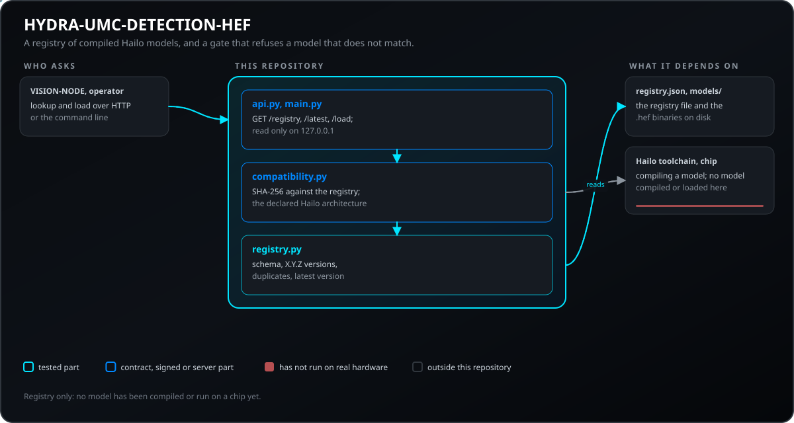
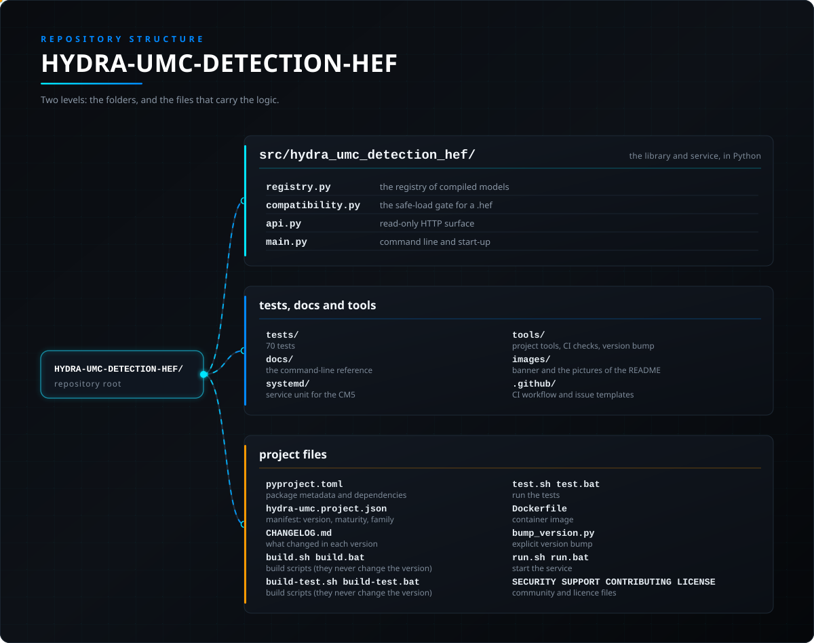

<!-- =============================================================================
HYDRA-UMC-DETECTION-HEF - Compiled-model registry
Copyright (C) JuanenRac (Electro Hobby 3D) <electrohobby3d@gmail.com>
GPL-3.0-or-later - see LICENSE
============================================================================= -->

<p align="center">
  
</p>

# 🎯 HYDRA-UMC-DETECTION-HEF

<p align="center"><a href="README.md">🇺🇸 English</a> | <a href="README_spa.md">🇪🇸 Español</a> | <a href="README_fra.md">🇫🇷 Français</a> | <a href="README_ita.md">🇮🇹 Italiano</a> | <a href="README_deu.md">🇩🇪 Deutsch</a> | 🇨🇳 <b>简体中文</b> | <a href="README_jpn.md">🇯🇵 日本語</a> | <a href="README_por.md">🇵🇹 Português</a></p>

### 📦 Hailo HEF 模型的已编译模型注册表与安全加载检查（尚未编译或运行任何模型）

<p align="center">
  
  
  
  
  
  
</p>

---

> **安全与安防现状:**本生态系统不是经认证的安全系统。目前尚无硬件 E-STOP 通路,没有由固件强制执行的限位或联锁,也没有经过验证的运动指令;固件映像使用 CRC-32 和 Ed25519 签名校验,发布构建会拒绝已公开的开发密钥(中继之后的工具头和扩展板仍运行 URTC 的引导程序,它们使用共享密钥的 HMAC-SHA256 而不是签名);TLS 与双向 TLS 均为可选项,默认关闭;自制电路板尚未组装或测试。在依赖此处任何说法来保障人身安全之前,请先阅读[安全基线](https://github.com/JuanenRac/HYDRA-UMC-DOCS/blob/main/docs/SECURITY_BASELINE.md)和[威胁模型](https://github.com/JuanenRac/HYDRA-UMC-DOCS/blob/main/docs/THREAT_MODEL.md)。

---

## 📋 速览

| | |
|---|---|
| 版本 | `0.1.6` |
| 成熟度 | 可用 |
| 测试 | 128 |
| 技术栈 | Python / Hailo SDK / HEF model registry (no model compiled yet) |
| 目标 | HYDRA-UMC 工作单元的 Raspberry Pi CM5 |
| 真实硬件 | 尚未：此版本没有在真实硬件上运行的记录 |

**跳转：** [概述](#-概述) · [架构](#-架构) · [功能](#-功能) · [安全与防护](#-安全与防护) · [接口](#-接口) · [配置](#-配置) · [快速开始](#-快速开始) · [测试](#-测试) · [故障排除](#-故障排除) · [仓库结构](#-仓库结构) · [相关项目](#-相关项目)

## 🚦 项目状态

每一行是本仓库的一个部分，灯号表示它今天做到了哪一步。内容依据仓库能够展示的证据（测试、构建、运行），而不是计划。

🟢 已完成并验证 · 🟡 可用，有已知限制 · 🟠 部分完成或尚未验证 · 🔴 未完成或不可用

| 领域 | 状态 | 在这里的含义 |
|---|---|---|
| 软件 | 🟡 | 主要用途可用；上面的诚实性检查列出了仍然缺少的内容 |
| 测试 | 🟢 | 128 项自动测试，每次变更都会运行 |
| 真实硬件 | 🔴 | 尚未：此版本没有在真实硬件上运行的记录 |
| 文档 | 🟢 | 八种语言的 README，每次变更都会与清单核对 |

## 🎯 概述

**HYDRA-UMC-DETECTION-HEF** 旨在成为一个精心策划的高性能神经网络模型库和
工具链，这些模型被编译为 **Hailo 可执行格式（HEF）**，并针对工业微工厂
环境（电子装配、SMD 贴片和刀头验证）进行调优。

这是集成父项目 **[HYDRA-UMC-VISION-NODE](https://github.com/JuanenRac/HYDRA-UMC-VISION-NODE)** 4 个子项目之一：本项目仅负责模型编译和版本管理——`.hef` 模型的实际服务、运行副本由持有 Hailo-8 设备句柄的父项目加载和执行，而非本项目自身。

## 🧩 在 HYDRA-UMC 中的角色

**HYDRA-UMC-DETECTION-HEF** 是整齐存放视觉节点已编译模型的架子：每个模型有名称、版本、任务、输入形状、类别和校验和，不匹配的东西不能被加载。尚未在 Hailo 芯片上编译或运行过任何模型。

## 🏛️ 架构

下图是本项目正朝其构建的目标*编译*工具链——由于每一步都需要真实的 Hailo 硬件，目前仍未实现。模型*注册表*（对这条流水线未来产出的 `.hef` 进行版本管理和完整性校验）在今天是真实的；参见上方"关键要点"和下方的设计决策。

<p align="center">
  
</p>

<details>
<summary>图表的文本版本（Mermaid）</summary>


</details>

**为什么这样构建**

### 为何这里没有 `hardware/`/`firmware/`，以及为何 `os/`/`models/` 仍位于父项目中

本项目交付模型文件及编译它们的工具，而非物理设备——因此，与 Vision AI
Node 系列的其他项目一样，它不携带 `hardware/`/`firmware/` 文件夹。它也
不携带 `os/` 或 `models/`，即使 `.hef` 文件确实是在这里*生成*的：运行时
加载到 Hailo-8 NPU 上的*实际提供服务、正在运行*的副本，仅存在于集成父
项目 [HYDRA-UMC-VISION-NODE](https://github.com/JuanenRac/HYDRA-UMC-VISION-NODE) 中，因为那是持有 Hailo-8 设备句柄的进程。本项目自身的 `build/` 是编译后的工具链输出在发布到那里之前应落地的地方。

### 编译流程是先于代码的设计决策

上图已经确定了预期的流水线形态：PyTorch/YOLO 训练在其他地方进行（超出
本仓库范围），模型导出为 ONNX，通过 Hailo Dataflow Compiler 进行
INT8/INT4 量化（生成 `.har`），最后打包为 [HYDRA-UMC-VISION-NODE](https://github.com/JuanenRac/HYDRA-UMC-VISION-NODE) 所消费的 `.hef` 二进制文件。在编写工具链代码之前，现在就决定并记录这一形态，可以避免最终实现日后不得不临时拼凑模型注册/版本管理方案。

### 已做出的设计决策

* **本地缺失的 `.hef` 文件不算校验和失败** —— 当注册表所描述的文件在 `--models-dir` 下不存在时，`verify_checksum()` 返回 `None`（而非 `False`），`registry validate` 将其报告为"skipped"，而非错误。注册表所描述的模型可能存放在一个独立的对象存储中，未必纳入本仓库——只有对一个确实存在的文件计算出真正不一致的校验和，才代表注册表已损坏。
* **为何 `safe_load()` 先检查架构再检查校验和，而不是反过来。** 架构兼容性是纯粹的元数据（无需 I/O）；校验和验证则需要读取真实文件。先检查这个廉价、根本性的关卡，意味着一个为错误 Hailo 芯片编译的模型会在文件系统被真正触碰之前就被拒绝，而拒绝理由指出的是真正失败的根本性检查，而不是对一个本来就永远不会在这个硬件上运行的模型给出一个误导性的"文件缺失"。
* **为何架构兼容性是精确匹配，而不是一张兼容性矩阵。** Hailo Dataflow Compiler 在编译时就把目标芯片烙进了 `.hef` 里——比如声称 Hailo-15H 可以运行一个 Hailo-8 的 `.hef`，需要在真实硬件上做真正的跨架构验证，而这个环境并不具备。精确匹配是仅凭注册表元数据就能诚实验证的唯一兼容性主张。

## ✨ 功能

* ✅ **真实 v0 —— 模型注册表：** `registry.py` 解析并按模式校验已编译模型的 JSON 注册表，检测重复的名称+版本条目，按名称/任务查找最新版本，并对本地 `.hef` 文件进行 sha256 校验和核对。通过下方的 `registry validate`/`registry latest`/`registry add` 暴露——运行或测试都不需要 Hailo SDK 或硬件。
* 🔒 **真实 v0 —— 安全加载关卡：** `compatibility.py` 的 `safe_load()` 会先校验真实的 Hailo 架构兼容性（`hailo8`/`hailo15h` 等——现在每条注册表条目都会声明自己的目标芯片），然后再校验校验和，只有两项真实检查都通过时才会报告某个模型已准备好部署。通过下方的 `registry load` 暴露。
* 🌐 **真实 v0 —— JSON/HTTP API：** `api.py` 的 `serve` 子命令将同样的注册表/安全加载检查作为一个长期运行的本地服务运行(默认 `127.0.0.1:8093`)，通过 `GET /registry`、`GET /registry/latest`、`GET /registry/load` 和 `GET /stats` 暴露——注册表和模型目录只在启动时配置一次，而非按每个请求配置。每个端点的真实抓取示例见 [`docs/CLI_REFERENCE.md`](docs/CLI_REFERENCE.md)。
* 🛠️ **工业检测（计划中）：** 针对 PCB 组件、焊点和机械缺陷的模型。
* 📐 **基准点对位（计划中）：** 用于抓取放置同步的高精度锚点。
* ⚡ **量化性能（计划中）：** 针对 Hailo-8/Hailo-10 NPU 的 INT8/INT4 变体，实现亚 10ms 推理。*（未来工作——需要本环境尚不具备的真实 Hailo-8/Hailo-10 NPU 和 Dataflow Compiler。）*
* 🤖 **姿态估计（计划中）：** 用于机械臂关节跟踪的关键点检测。*（未来工作，原因相同。）*
* 🧩 **为何作为独立项目存在：** 编译和管理模型版本是一项数据/机器学习工作流，与提供服务的运行时进程完全不同——将工具链保持在此处，意味着一次糟糕的编译永远不会危及正在运行的感知节点，模型可以在到达 [HYDRA-UMC-VISION-NODE](https://github.com/JuanenRac/HYDRA-UMC-VISION-NODE) 之前离线迭代和验证。
* 📐 **输入输出约定(可选):** 注册表条目可以带一个 `io_contract`，说明如何向模型输入数据(布局、颜色顺序、数据类型、归一化、缩放或 letterbox、填充值)以及如何读取其输出(NMS 格式、框的顺序、是否归一化、阈值)。注册表加载时会校验它，重写注册表时会保留它，它的校验和也是模型标识的一部分。没有它的条目仍按原来的方式加载。
* 🔐 **已验证的字节:** `safe_load(..., keep_bytes=True)` 只读取文件一次，检查其 SHA-256，并原样返回这些字节；因此用这些字节构建模型的使用方(视觉推流器和视觉伺服 API 就是这样做的)不会拿到校验之后又被改动的文件。`GET /stats` 只显示文件名而不是绝对路径，除非加上 `serve --stats-full-paths`。

**诚实说明——今天实际运行的内容：** 本项目工作中真实、独立于硬件的那一半——模型注册表（`registry.py`）和真实的安全加载关卡（`compatibility.py`）——通过 `registry validate`/`registry latest`/`registry load`，以及作为长期运行 JSON/HTTP API 的 `serve`（`api.py`）暴露，已经实现并经过测试（128 个测试）。而真正*生产*这些注册表所描述模型的 ONNX 导出、Hailo Dataflow Compiler 量化和 HAR/HEF 打包步骤仍是未来工作：它们都需要本环境不具备的真实 Hailo 硬件。具体已交付内容请参见 [`CHANGELOG.md`](CHANGELOG.md)，尚待完成的
内容请参见下方"当前状态与后续步骤"章节。

编译模型（ONNX，然后经 Hailo Dataflow Compiler，最后得到 `.hef`）在安装了 Dataflow Compiler 的 x86_64 Linux 主机上进行，并需要用于量化的校准数据集，不需要 Hailo-8 本身。只有运行编译后的模型才需要加速器。`registry load` 和 `GET /registry/load` 会拒绝有歧义的注册表（相同名称和版本对应不同文件），接受设备所报告的架构写法（`HAILO8`），并可用 `--version` / `?version=` 固定确切版本；`registry add` 已串行化，同时添加不会丢失条目。在开发板上，模型位于 `/opt/hydra-umc/detection-hef/models`。

## 🔒 安全与防护

| 威胁 | 防御 | 位置 |
|---|---|---|
| 加载损坏的或用于其他芯片的模型 | 加载关口（`compatibility.py`）将 `.hef` 的 SHA-256 与注册表比对，并将 Hailo 架构与 `KNOWN_HAILO_ARCHS`（`hailo8`、`hailo8r`、`hailo8l`、`hailo15h`、`hailo15m`、`hailo15l`、`hailo10h`）比对；加载需要 `--target-arch` | `compatibility.py`, `registry.py` |
| 重复或格式错误的版本 | 注册表会校验模式，要求 `X.Y.Z` 形式的版本并报告重复项 | `registry.py` |
| 对网络的暴露 | HTTP 接口只读，默认监听 `127.0.0.1:8093`。它没有令牌：是否需要仍未决定 | `api.py`, `main.py` |

**它绝不做的事：** 它不编译任何东西，也不运行模型：只保存并检查已编译文件的注册表。

`GET /stats` 显示文件名而不是绝对路径，因此调用方无从得知主机把注册表和模型放在哪里；`serve --stats-full-paths` 会重新显示完整路径。

## 🔌 接口

默认在 `127.0.0.1:8093` 提供 HTTP（只读）和命令行。完整参考见 `docs/CLI_REFERENCE.md`。

| 主题或路由 | 内容 |
|---|---|
| `GET /registry`, `GET /registry/latest`, `GET /registry/load` | 注册表、模型的最新版本以及加载关口的结果 |
| `GET /stats` | 健康状态 |
| `registry validate \| latest \| load \| add` | `--registry`, `--models-dir`, `--hef-path`, `--name`, `--version X.Y.Z`, `--task`, `--input-shape 640,640,3`, `--classes`, `--hailo-arch` |
| `serve` | `--registry FILE --models-dir DIR --addr 127.0.0.1 --port 8093` |

## ⚙️ 配置

没有环境变量：一切都是命令行选项（`--registry` 总是需要，`--models-dir` 取决于命令）。

## 🚀 快速开始

### 前提条件

* `PATH` 中存在 **Python 3.10 或更新版本**（脚本先尝试 `python3`，再回退到 `python`）。
* 目前不需要任何 ONNX/Hailo Dataflow Compiler 工具——此阶段**没有任何第三方运行时依赖**（`pyproject.toml` 中 `dependencies = []`）。
* 本地虚拟环境（`.venv/` 下）需要数十 MB 磁盘空间。

### 逐步说明

```bash
# Linux / macOS
./build.sh
```

1. **版本读取** —— 读取并显示项目版本；构建绝不会更改它（只有 `python tools/hydra_project_tool.py bump` 才会提升）。
2. **虚拟环境** —— 若 `.venv/` 不存在则创建；否则复用。
3. **可编辑安装** —— `pip install -e ".[dev]"`，使 `src/` 下的修改立即生效，安装 `pytest`，并注册 `hydra-umc-detection-hef` 控制台入口点。
4. **编译检查** —— `python -m compileall -q src` 对 `src/` 下每个文件进行字节码编译，在整个生态系统范围内捕获语法错误。
5. **真实测试套件** —— `python -m pytest tests/ -q`（128 个测试，覆盖注册表、安全加载关卡和 CLI）。

`set -euo pipefail` 会在第一个失败步骤处停止脚本；只有全部 5 个步骤均
成功时，构建才会报告成功。

```bash
./run.sh
```

在 `.venv` 内定位解释器（同时处理 POSIX 和 Windows 的 `.venv` 目录结构），
运行 `python -m hydra_umc_detection_hef.main` 并转发所有参数——裸调用会
打印名称 + 版本 + 角色。

真实示例——校验一个注册表并查找某个模型的最新版本：

```bash
./run.sh registry validate --registry registry.json --models-dir models/
# 2 entries in registry.json
#   pcb-defect 0.1.0: pcb-defect-0.1.0.hef not present locally, skipped
#   pcb-defect 0.2.0: checksum OK
# registry OK

./run.sh registry latest --registry registry.json --name pcb-defect
# pcb-defect 0.2.0  task=detection  input_shape=(640, 640, 3)
# classes: solder_bridge, missing_component
# hef_path: pcb-defect-0.2.0.hef
# sha256: 1c8a52bb4a34927d55efc913b23f06bd08ff5eeee0aca2ccd8d2c0fd34c81497
```

每条注册表条目还会声明自己的目标 `hailo_arch`（例如 `hailo8`）。真实的
`registry load` 子命令会把上面的校验和检查与一次真实的架构兼容性检查
结合在一起，只有两者都通过时才会报告模型已就绪：

```bash
./run.sh registry load --registry registry.json --models-dir models/ --name pcb-defect --target-arch hailo8
# READY: pcb-defect 0.2.0 (hailo8) verified and ready

./run.sh registry load --registry registry.json --models-dir models/ --name pcb-defect --target-arch hailo15h
# REJECTED_ARCH_MISMATCH: model compiled for 'hailo8', this deployment targets 'hailo15h'
```

添加新模型不再意味着手动编辑 JSON(包括 sha256——`verify_checksum()` 只会校验它,从不生成它)—— `registry add` 会对真实的本地 `.hef` 文件计算哈希,并追加一条已验证的条目:

```bash
./run.sh registry add --registry registry.json --models-dir models/ --hef-path pcb-defect-0.3.0.hef \
  --name pcb-defect --version 0.3.0 --task detection --input-shape 640,640,3 \
  --classes solder_bridge,missing_component --hailo-arch hailo8
# added pcb-defect 0.3.0 to registry.json (sha256=<真实计算出的摘要>)
```

注册表文件以原子方式重写（先写到它旁边、fsync，再重命名覆盖），因此添加模型时遇到断电或磁盘已满，保留下来的是之前的注册表，而不是一个被截断的文件。

同样的注册表/安全加载检查也可以通过 `./run.sh serve --registry registry.json --models-dir models/`（默认 `127.0.0.1:8093`）作为长期运行的 JSON/HTTP API 使用。完整的命令与端点参考（每个示例均来自真实运行）见 [`docs/CLI_REFERENCE.md`](docs/CLI_REFERENCE.md)。

```bat
:: Windows - 步骤相同，批处理语法
build.bat
run.bat
```

## 🧪 测试

运行 `python -m pytest tests/ -q` 会执行 128 个自动测试：注册表、安全加载关口、命令行和 HTTP 接口。不使用 Hailo 工具、硬件和外部网络。

CI 运行 `HYDRA_UMC_CI=1 python tools/ci_validate.py`，检查清单、文档、八个 README 和图片。

## 🏗️ 构建与发布

发布无需编译：`build.sh` / `build.bat` 创建虚拟环境、以可编辑模式安装包并运行测试，`build-test` 只做检查。构建从不改变版本；只有 `python tools/hydra_project_tool.py bump` 会提升版本，并同时推进更新日志。包、清单和更新日志的版本必须一致，否则 `ci_validate.py` 会失败。

## 🩺 故障排除

* **找不到 `python`/`python3`** —— 安装 Python 3.10+ 并确保其在 `PATH` 中。
* **`compileall` 失败** —— 意味着 `src/` 下确实引入了语法错误；构建会故意在不触及安装的情况下停止。
* **`run.sh`/`run.bat` 提示"未找到 `.venv`"** —— 先至少运行一次 `build.sh`/`build.bat`。
* **可编辑安装过期** —— 删除 `.venv/` 并重新构建；很少需要这样做。

## 📂 仓库结构

<p align="center">
  
</p>

<details>
<summary>目录树的文本版本</summary>

```text
HYDRA-UMC-DETECTION-HEF/
├── src/hydra_umc_detection_hef/
│   ├── registry.py                              已编译模型的注册表
│   ├── compatibility.py                         .hef 的安全加载关口
│   ├── api.py                                   只读 HTTP 接口
│   └── main.py                                  命令行与启动
├── tests/                                       93 项测试
├── docs/                                        命令行参考
├── systemd/                                     CM5 的服务单元
├── tools/                                       构建与测试运行器、版本提升、CI 校验、README 与图片的生成和检查
├── images/                                      横幅图与 README 的图片
├── .github/                                     CI 工作流和 Issue 模板
├── pyproject.toml                               包元数据与依赖
├── hydra-umc.project.json                       清单：版本、成熟度、系列
├── CHANGELOG.md                                 每个版本的变化
├── build.sh build.bat                           构建脚本（从不改变版本）
├── build-test.sh build-test.bat                 构建脚本（从不改变版本）
├── test.sh test.bat                             运行测试
├── Dockerfile                                   容器镜像
├── bump_version.py / bump_manifest_version.py   显式的版本提升
├── run.sh run.bat                               启动服务
└── SECURITY.md SUPPORT.md CONTRIBUTING.md CODE_OF_CONDUCT.md LICENSE LICENSE.md
```

</details>

## 🗺️ 路线图与已知限制

**当前已知限制**

**今天已实现的内容：** 模型注册表——模式校验（包括必须提供且经过校验的 Hailo 架构元数据）、重复版本检测、最新版本查找、以及 sha256 完整性校验（`registry.py`）——加上一个真实的、组合式的安全加载关卡，会一起检查架构兼容性和校验和完整性，只有两者都通过时才会报告模型就绪（`compatibility.py`），同样的检查也作为一个真实的、长期运行的 JSON/HTTP API（`api.py`，`serve` 子命令）与一次性 CLI 并行暴露，共 128 个测试，再加上一个真实的、可安装的 Python 包，带有已验证的入口点，以及一个显式的`bump` 命令，用于提升版本（构建绝不会更改版本）。具体已捕获的构建/运行输出见 [`CHANGELOG.md`](CHANGELOG.md)。

**仍待完成、顺序不分先后、无既定时间表、且受限于真实 Hailo 硬件的内容：**

* 从已训练的 PyTorch/YOLO 模型进行真实的 ONNX 导出步骤。
* 集成 Hailo Dataflow Compiler 以进行 INT8/INT4 量化。 手动步骤记录在 [`docs/COMPILING_A_HEF.md`](docs/COMPILING_A_HEF.md) 中；实现自动化的脚本需等待获得 Dataflow Compiler 许可证。
* HAR/HEF 打包——这将真正填充一个本项目 `registry.py` 已经能够读取和校验的注册表文件。
* 将编译好的 `.hef` 输出发布到 [HYDRA-UMC-VISION-NODE](https://github.com/JuanenRac/HYDRA-UMC-VISION-NODE) 的 `models/` 文件夹中。

## 🌍 语言

本 README 和仓库文档提供八种语言：英语、西班牙语、德语、法语、意大利语、日语、中文和葡萄牙语（葡萄牙）。它们同时编写，并由 CI 检查八个文件拥有相同的章节和相同的链接。 本仓库没有自己的界面或消息目录，因此没有需要翻译的界面文字。

## 🔗 相关项目

本项目是同一作者(JuanenRac / Electro Hobby 3D)打造的 HYDRA-UMC 机器人生态系统的一部分。值得了解,因为某个请求实际上可能是关于这些项目之一,而非本仓库本身。

**父项目**
- **[HYDRA-UMC-VISION-NODE](https://github.com/JuanenRac/HYDRA-UMC-VISION-NODE)** — 面向 Hailo-8 视觉流水线的集成中枢,具备逐阶段的真实硬件就绪检测;本仓库是其自身感知流水线中一个具体阶段或消费者所属的父项目。

**兄弟项目** —— HYDRA-UMC-VISION-NODE 自身 Hailo-8 感知流水线中的其他阶段/消费者
- **[HYDRA-UMC-VISION-STREAMER](https://github.com/JuanenRac/HYDRA-UMC-VISION-STREAMER)** — 具备真实 HailoRT 集成边界的真实 GStreamer 流水线 + MediaMTX 配置生成器。
- **[HYDRA-UMC-SAFETY-ZONES](https://github.com/JuanenRac/HYDRA-UMC-SAFETY-ZONES)** — 从文件读取物体位置的 v0 区域入侵、校准新鲜度与 E-STOP 请求逻辑;没有检测器为其供数,也尚未连接任何物理 E-STOP。
- **[HYDRA-UMC-VISUAL-SERVOING-API](https://github.com/JuanenRac/HYDRA-UMC-VISUAL-SERVOING-API)** — 以区域状态为授权条件的 Position-Based Visual Servoing 修正律;尚无摄像头位姿估计。

**直接相关**
- **[URTC](https://github.com/JuanenRac/URTC)** — 面向实体 Universal Robot Tool Controller 板卡的固件,通过 CAN 总线支持 25 种以上工具配置;URTC 自身工具头的视觉识别依赖于此处编译的模型。

**生态系统中的其他项目**

*核心硬件与平台*
- **[HYDRA-UMC](https://github.com/JuanenRac/HYDRA-UMC)** — 机器人手臂主板设计——CM5 主机 + 双核 STM32H745,目标是通过 CAN-OTA/SPI-OTA 协调最多 8 条工具臂(固件处于早期阶段,尚无已组装的电路板)。
- **[HYDRA-UMC-OS](https://github.com/JuanenRac/HYDRA-UMC-OS)** — 面向 CM5 的可复现 Raspberry Pi OS 产品层——只读代理、经过验证的配置/配置文件、WiFi 首次配网。
- **[HYDRA-UMC-SDK](https://github.com/JuanenRac/HYDRA-UMC-SDK)** — 每个桥接都据此校验自身指令的共享 JSON-Schema 契约与软件作业门限边界(并非经认证的安全功能)。
- **[HYDRA-UMC-CONNECTOR-HUB](https://github.com/JuanenRac/HYDRA-UMC-CONNECTOR-HUB)** — 面向外部机器连接器的声明式适配器清单注册与校验工具；把 SDK 自身的契约理念扩展到外部机器，而不取代工业网关类项目。

*核心后端与客户端*
- **[HYDRA-UMC-SERVER](https://github.com/JuanenRac/HYDRA-UMC-SERVER)** — 每个控制客户端真正通信的真实无头后端(REST/WebSocket)。
- **[HYDRA-UMC-STUDIO](https://github.com/JuanenRac/HYDRA-UMC-STUDIO)** — 具有实时多机器人 3D 可视化的网页控制面板。
- **[HYDRA-UMC-SUITE](https://github.com/JuanenRac/HYDRA-UMC-SUITE)** — 面向多台服务器的桌面(PySide6)集群指挥中心，打包为独立可执行文件。
- **[HYDRA-UMC-ANDROID-CONTROL](https://github.com/JuanenRac/HYDRA-UMC-ANDROID-CONTROL)** — 具有生物识别登录和配对 Wear OS 伴侣应用的原生 Android 控制应用。
- **[HYDRA-UMC-IOS-CONTROL](https://github.com/JuanenRac/HYDRA-UMC-IOS-CONTROL)** — 具有实时 WebSocket 同步的 iOS/iPadOS 控制应用(Flutter)。
- **[HYDRA-UMC-DSI](https://github.com/JuanenRac/HYDRA-UMC-DSI)** — 面向机载 7 英寸 DSI 触摸屏的原生触控界面，直接嵌入 CM5 本体。
- **[HYDRA-UMC-EDITOR-URDF](https://github.com/JuanenRac/HYDRA-UMC-EDITOR-URDF)** — 将完成的模型推送到 STUDIO 自身目录的桌面版图形化 URDF 创建/编辑工具。
- **[HYDRA-UMC-EDITOR-STL](https://github.com/JuanenRac/HYDRA-UMC-EDITOR-STL)** — 桌面 STL 模型编辑器，在 HYDRA-UMC-EDITOR-URDF 编辑的同一模型目录中变换/替换/移除/添加真实部件。
- **[HYDRA-UMC-BRIDGE-AMR](https://github.com/JuanenRac/HYDRA-UMC-BRIDGE-AMR)** — 通过 VDA 5050 MQTT 发布者为 AGV/AMR 车队提供的协调边界(仅针对仿真车队测试)。
- **[HYDRA-UMC-BRIDGE-CNC](https://github.com/JuanenRac/HYDRA-UMC-BRIDGE-CNC)** — 具备 GRBL 状态/控制字节访问能力的高层 CNC 单元协调器(仅针对模拟器测试)。
- **[HYDRA-UMC-BRIDGE-DROIDS](https://github.com/JuanenRac/HYDRA-UMC-BRIDGE-DROIDS)** — 面向足式/人形机器人的协调边界,带有 Boston Dynamics Spot 指令发送器(仅针对模拟器测试)。
- **[HYDRA-UMC-BRIDGE-LASER](https://github.com/JuanenRac/HYDRA-UMC-BRIDGE-LASER)** — 读取 3 路钥匙/外壳/联锁 GPIO 信号的激光单元协调器(仅针对模拟芯片测试;无法使激光器上膛或发射)。
- **[HYDRA-UMC-BRIDGE-OPENPNP](https://github.com/JuanenRac/HYDRA-UMC-BRIDGE-OPENPNP)** — 面向 OpenPnP 贴片机板级流程的安全高层协调器。
- **[HYDRA-UMC-BRIDGE-PRINTER3D](https://github.com/JuanenRac/HYDRA-UMC-BRIDGE-PRINTER3D)** — 面向 Moonraker/Klipper 3D 打印机的安全协调边界，具备真实的受控作业指令。
- **[HYDRA-UMC-BRIDGE-ROS2](https://github.com/JuanenRac/HYDRA-UMC-BRIDGE-ROS2)** — 带有惰性导入 rclpy ROS 2 传输层的协调器(尚未在 ROS 2 环境中运行)。
- **[HYDRA-UMC-BRIDGE-UAV](https://github.com/JuanenRac/HYDRA-UMC-BRIDGE-UAV)** — 面向搭载摄像头的无人机的协调边界,带有 MAVLink 指令发送器(仅针对模拟器测试)。

*URTC 工具平台*
- **[URTC-FLASHER](https://github.com/JuanenRac/URTC-FLASHER)** — 面向 URTC 板卡的桌面图形烧录工具，支持 CAN-OTA 以及全芯片 SWD/JTAG。
- **[URTC-TESTER](https://github.com/JuanenRac/URTC-TESTER)** — 面向 URTC 板卡的桌面实时 CAN 总线诊断工具，每种工具配置对应一个面板。
- **[URTC-WEB-STUDIO](https://github.com/JuanenRac/URTC-WEB-STUDIO)** — 通过 Web Serial API 实现的浏览器版 URTC-TESTER 替代方案，无需本地安装。
- **[URTC-GATEWAY](https://github.com/JuanenRac/URTC-GATEWAY)** — URTC CAN 总线前的网关：允许的标识符列表、速率限制和会话密钥；软件已在计算机上测试，尚未在真实总线上测试。

*认知 AI 节点(Hailo-10)*
- **[HYDRA-UMC-COGNITIVE-NODE](https://github.com/JuanenRac/HYDRA-UMC-COGNITIVE-NODE)** — 面向 Hailo-10 认知流水线(LLM/VLA/语音编排)的集成中枢。
- **[HYDRA-UMC-VLA-ENGINE](https://github.com/JuanenRac/HYDRA-UMC-VLA-ENGINE)** — 面向 Vision-Language-Action 模型的真实动作 token 编解码与轨迹生成。
- **[HYDRA-UMC-VOICE-UI](https://github.com/JuanenRac/HYDRA-UMC-VOICE-UI)** — 具备受限、需确认的 Watch 中继的真实语音前端(VAD + 意图解析)。
- **[HYDRA-UMC-SEMANTIC-PLANNER](https://github.com/JuanenRac/HYDRA-UMC-SEMANTIC-PLANNER)** — 基于真实规则的任务分解，以及针对 MCU 错误码的语义化错误恢复。
- **[HYDRA-UMC-DOCS-QA](https://github.com/JuanenRac/HYDRA-UMC-DOCS-QA)** — 面向本生态系统自身 Markdown 文档的真实纯标准库 TF-IDF 文档检索。
- **[HYDRA-UMC-LOCAL-TECHNICIAN](https://github.com/JuanenRac/HYDRA-UMC-LOCAL-TECHNICIAN)** — 面向生态系统自身的本地、按策略门控的 AI 维护技师——观察、诊断并提出修复建议;两个最高风险等级目前特意尚未实现。

*编排与集群*
- **[HYDRA-UMC-ORCHESTRATOR](https://github.com/JuanenRac/HYDRA-UMC-ORCHESTRATOR)** — 具备真实 gRPC/Protobuf 健康报告契约与任务状态机的集成中枢。
- **[HYDRA-UMC-JOB-DISPATCHER](https://github.com/JuanenRac/HYDRA-UMC-JOB-DISPATCHER)** — 基于真实 HTTP API 的真实优先级任务队列，支持去重。
- **[HYDRA-UMC-NODE-HEALING](https://github.com/JuanenRac/HYDRA-UMC-NODE-HEALING)** — 具备重试/退避与身份不匹配检测的真实基于 gRPC 的车队健康看门狗。
- **[HYDRA-UMC-PATH-PLANNER-3D](https://github.com/JuanenRac/HYDRA-UMC-PATH-PLANNER-3D)** — 具备真实障碍物/工作空间碰撞校验的真实基于 RRT 的三维路径规划器。
- **[HYDRA-UMC-SWARM-SYNC](https://github.com/JuanenRac/HYDRA-UMC-SWARM-SYNC)** — 经过多单元收敛属性测试的真实 CRDT LWW-Element-Map 状态同步。

*数字孪生与仿真*
- **[HYDRA-UMC-TWIN](https://github.com/JuanenRac/HYDRA-UMC-TWIN)** — 面向数字孪生引擎的集成中枢，具备真实的版本兼容性同步契约。
- **[HYDRA-UMC-HIL-BRIDGE](https://github.com/JuanenRac/HYDRA-UMC-HIL-BRIDGE)** — 在仿真与真实硬件之间带有软件碰撞联锁的硬件在环路由器(未在真实硬件上测试)。
- **[HYDRA-UMC-PHYSICS-REPLICA](https://github.com/JuanenRac/HYDRA-UMC-PHYSICS-REPLICA)** — 面向真实 URDF 子集的真实正向运动学与关节限位校验。
- **[HYDRA-UMC-SYNTHETIC-DATA-GEN](https://github.com/JuanenRac/HYDRA-UMC-SYNTHETIC-DATA-GEN)** — 具备 YOLO/COCO 标注导出功能的真实程序化 2D 场景生成器。

*数据与分析*
- **[HYDRA-UMC-DATALAKE](https://github.com/JuanenRac/HYDRA-UMC-DATALAKE)** — 具备真实数据摄入/查询 HTTP API 的真实 sqlite3 时序数据存储。
- **[HYDRA-UMC-ANOMALY-DETECTOR](https://github.com/JuanenRac/HYDRA-UMC-ANOMALY-DETECTOR)** — 具备漂移监测能力的真实 FFT + 统计基线异常检测器。
- **[HYDRA-UMC-PRODUCTION-REPORTS](https://github.com/JuanenRac/HYDRA-UMC-PRODUCTION-REPORTS)** — 基于 DATALAKE 历史数据的真实 OEE/可用率计算，支持可复现的 CSV 导出。
- **[HYDRA-UMC-TELEMETRY-COLLECTOR](https://github.com/JuanenRac/HYDRA-UMC-TELEMETRY-COLLECTOR)** — 面向 DATALAKE 的真实 CAN/WebSocket 数据摄入管道，支持序列去重。

*工业网关*
- **[HYDRA-UMC-GATEWAY-INDUSTRIAL](https://github.com/JuanenRac/HYDRA-UMC-GATEWAY-INDUSTRIAL)** — 中继至工业协议的集成中枢，具备真实的指令白名单/背压控制层。
- **[HYDRA-UMC-OPCUA-SERVER](https://github.com/JuanenRac/HYDRA-UMC-OPCUA-SERVER)** — 经真实二进制协议客户端会话验证的真实 OPC-UA 地址空间。
- **[HYDRA-UMC-MQTT-BROKER](https://github.com/JuanenRac/HYDRA-UMC-MQTT-BROKER)** — 具备可选按客户端认证与主题 ACL 的真实 MQTT 代理。
- **[HYDRA-UMC-MTCONNECT-ADAPTER](https://github.com/JuanenRac/HYDRA-UMC-MTCONNECT-ADAPTER)** — 具备降级模式输出的真实 MTConnect `/probe` 与 `/current` XML 端点。

*辅助工具与生态系统运维*
- **[HYDRA-UMC-DASHBOARD-AI](https://github.com/JuanenRac/HYDRA-UMC-DASHBOARD-AI)** — 基于 DATALAKE/ANOMALY-DETECTOR 的智能摘要与异常高亮面板，具备诚实的统计回退机制。
- **[HYDRA-UMC-TOOL-CLI](https://github.com/JuanenRac/HYDRA-UMC-TOOL-CLI)** — 具备真实、稳定退出码契约的车队 CLI，是 HYDRA-UMC-SERVER 自身 API 的真实在线客户端。
- **[HYDRA-UMC-WATCH](https://github.com/JuanenRac/HYDRA-UMC-WATCH)** — 带有触觉提醒模式与配对手机语音中继的 WearOS 伴侣应用(尚未在实体手表上运行)。
- **[URTC-SMART-RACK](https://github.com/JuanenRac/URTC-SMART-RACK)** — 面向板卡安装机架的固件，具备真实的工具 ID 解码与 Smart Idle 预热逻辑。
- **[URTC-VISION-TOOL](https://github.com/JuanenRac/URTC-VISION-TOOL)** — 面向热成像/RGB 检测工具头的固件及真实 Python 视觉伴侣程序。
- **[HYDRA-UMC-UPDATER](https://github.com/JuanenRac/HYDRA-UMC-UPDATER)** — 发现、克隆并更新本生态系统中每个仓库的管理类桌面工具。
- **[HYDRA-UMC-OS-REBUILDER](https://github.com/JuanenRac/HYDRA-UMC-OS-REBUILDER)** —— 构建即刻可烧录、预装生态系统最新版本的 CM5 镜像的 Windows/Linux 桌面工具,具备类似 Raspberry Pi Imager 风格的首次启动 Wi-Fi/用户/SSH 配置。
- **[HYDRA-UMC-OPS-AGENT](https://github.com/JuanenRac/HYDRA-UMC-OPS-AGENT)** — 维护事件协调器：一个低权限的边缘角色采集经过脱敏的库存/健康快照，一个控制面角色以只读方式渲染它，并请求某个 AI 提供方给出诊断建议——从不应用补丁，也从不部署任何内容。
- **[HYDRA-UMC-DEV-SERVER](https://github.com/JuanenRac/HYDRA-UMC-DEV-SERVER)** — 可复现的开发主机（Raspberry Pi 5 / CM5），保存整个生态系统的源代码，并在持久队列下运行有界的构建/测试任务；这是专用的开发角色，明确区别于运行中的 CM5。

## 📚 文档

更多阅读：

* [docs/CLI_REFERENCE.md](docs/CLI_REFERENCE.md) - 每个命令和选项、HTTP 路由以及退出码
* [生态系统的安全基线](https://github.com/JuanenRac/HYDRA-UMC-DOCS/blob/main/docs/SECURITY_BASELINE.md)
* [生态系统的威胁模型](https://github.com/JuanenRac/HYDRA-UMC-DOCS/blob/main/docs/THREAT_MODEL.md)
* [本仓库的更新日志](CHANGELOG.md)
* [本仓库的许可证](LICENSE.md)

## 🤝 参与贡献与社区

* 提交 pull request 之前，请运行 `HYDRA_UMC_CI=1 py -3 tools/ci_validate.py`（或 `HYDRA_UMC_CI=1 python3 tools/ci_validate.py`）：它必须输出 `CI_VALIDATION=PASS`。此检查不要运行 `build.sh` 或 `build.bat`；构建不是检查。
* 八个 README 由 HYDRA-UMC-DOCS 中的同一个源生成；请勿手工编辑。修改源文件，再用 `tools/make_readmes.py` 重新生成。
* 不要在 README 中声称尚未运行过的内容：属实时请写“仅模拟”或“尚未在硬件上试过”。
* 请参阅 [CONTRIBUTING.md](CONTRIBUTING.md)、[行为准则](CODE_OF_CONDUCT.md)、[SECURITY.md](SECURITY.md) 和 [SUPPORT.md](SUPPORT.md)。

## 👤 作者

**JuanenRac (Electro Hobby 3D)** · electrohobby3d@gmail.com

## 📜 许可证

GPL-3.0-or-later - [LICENSE](LICENSE).
